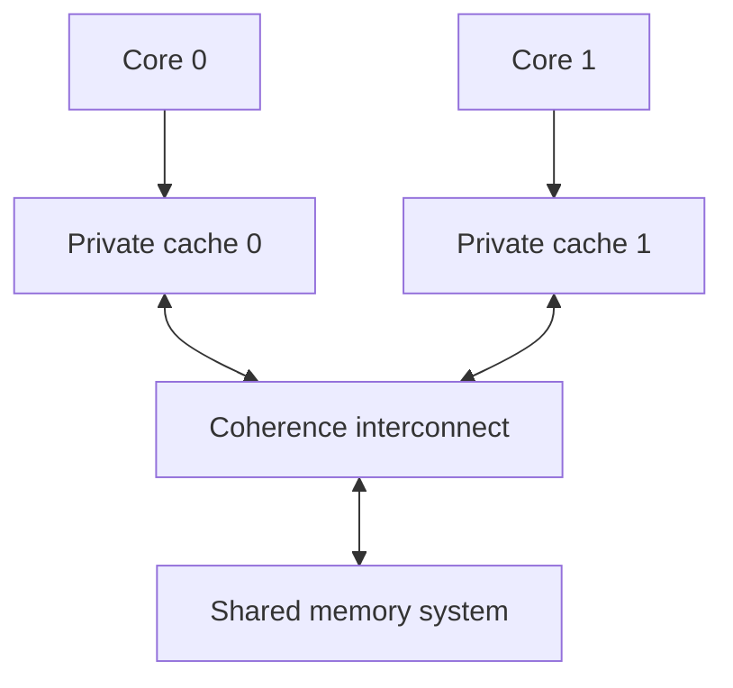

# Computer Architecture｜計算機架構

> **定位：理解 CPU、記憶體與平行系統的設計取捨。** 建議先讀 [Computer Organization and Design](Computer_Organization_and_Design.md)，再用本篇學習如何評估效能。
>
> 資料查核日期：**2026-09-27**。本篇採繁體中文與英文術語。數值皆為明示假設的教學例題，除特別標示的公開教材原例外，不是商用 CPU 的測試結果或某本付費教科書的官方解答。

[回到 README](README.md)

## 目錄

1. [架構研究什麼](#arch-01)
2. [效能衡量與 CPU time](#arch-02)
3. [Amdahl 定律與平行化](#arch-03)
4. [管線、分支預測與亂序執行](#arch-04)
5. [快取效能與記憶體階層](#arch-05)
6. [虛擬記憶體與 TLB](#arch-06)
7. [多核心、coherence 與 consistency](#arch-07)
8. [SIMD、GPU 與 Roofline](#arch-08)
9. [Raspberry Pi 與嵌入式應用](#arch-09)
10. [動手實驗與綜合練習](#arch-10)
11. [教材閱讀路線與查核來源](#arch-11)

<a id="arch-01"></a>
## 1. 架構研究什麼？

Architecture 經常同時包含「軟體可見的機器規則」與「如何設計更有效率的系統」。本篇將層次分清楚：[A1]

| 層次 | 核心問題 | 例子 |
| --- | --- | --- |
| ISA | 程式可要求硬體做什麼？ | 指令、暫存器、例外與記憶體模型 |
| Microarchitecture | 如何實作 ISA？ | Pipeline、execution units、branch predictor |
| Memory system | 如何供應指令與資料？ | Cache、DRAM、TLB |
| System architecture | 多個運算與 I/O 元件如何合作？ | Multicore、GPU、DMA、interconnect |

**重要區分：** 同樣支援某個 ISA，不表示每條指令執行時間相同。RISC 也不等於每條指令必定一個 cycle；CISC 也不必然較慢。要比較具體工作負載、實作與工具鏈。

### 學習順序

| 層級 | 本篇章節 | 應能回答 |
| --- | --- | --- |
| 入門 | §1–3 | GHz、CPI、speedup 各代表什麼？ |
| 核心 | §4–6 | 管線與 cache 如何改善速度？何時無效？ |
| 進階概覽 | §7–8 | 多核心為何不線性加速？GPU 何時合適？ |
| 應用 | §9–10 | 如何為自己的專案設計可驗證的量測？ |

<a id="arch-02"></a>
## 2. 效能衡量與 CPU time

### 2.1 先定義你要改善的指標

| 指標 | 意義 | 生活／工程例子 |
| --- | --- | --- |
| Latency | 一件工作從開始到完成的時間 | 按快門後多久得到處理好的照片 |
| Throughput | 每單位時間完成的工作量 | 每秒處理幾張照片 |
| CPU time | CPU 為該工作執行所花的時間 | 運算本身的成本 |
| Wall-clock time | 實際經過的時間 | 使用者等待，含 I/O 與排程 |

這些指標不能互換。批次處理可增加每秒完成量，卻可能讓第一件工作的等待變久。多執行緒程式各執行緒 CPU time 的總和也可能超過 wall-clock time。

### 2.2 CPU performance equation

假設用固定或適當等效的 clock rate 描述該段執行：

$$T_{CPU}=IC\times CPI\times T_{cycle}=\frac{IC\times CPI}{f}$$

- IC（instruction count）是**動態執行**的指令數，不是原始碼行數或執行檔指令總數。
- CPI 是每條指令平均 cycles，需對該工作負載計算。
- f 的單位是 cycles/second。1 GHz = $10^9$ cycles/s。
- Superscalar CPU 的平均 CPI 可以小於 1。[A2]

**教科書型例題 A1：比較兩台 CPU。** 同一工作在兩者均執行 $10^9$ 條指令：

| 系統 | Clock | CPI | CPU time |
| --- | --- | --- | --- |
| A | 2 GHz | 1.2 | $10^9\times1.2/(2\times10^9)=0.60$ s |
| B | 3 GHz | 2.0 | $10^9\times2/(3\times10^9)=0.667$ s |

A 的時脈較低卻較快。A 相對 B 的 speedup = $T_B/T_A\approx1.11$。若 compiler／ISA 改變 IC，就必須重新計算，不能沿用相同 IC。

### 2.3 Weighted CPI

若指令類別 i 的動態比例是 $p_i$、CPI 是 $c_i$：

$$CPI_{avg}=\sum_i p_i c_i,\qquad \sum_i p_i=1$$

**教科書型例題 A2：** 算術 50%×1、load/store 30%×2、branch 20%×3，得到 CPI=**1.7**。若只把 load/store 降至 1.5，新的 CPI=**1.55**；同 IC、同 clock 下 speedup=1.7/1.55≈**1.097×**。

注意這裡是各類別的**平均成本**。真實管線中 stall 可能重疊，不能把所有 penalty 都不加判斷地相加。[A2]

### 2.4 一份可信的 benchmark 記錄

至少記錄輸入規模、正確性、CPU／OS、compiler 與 flags、執行次數、時間指標。若比較平行程式，要同時保留直接的 serial baseline 與平行版單執行緒結果，才能看出平行框架自身的 overhead。[A3]

本倉庫沒有宣稱任何特定硬體的 benchmark 分數。後面的數字是題目參數。

<a id="arch-03"></a>
## 3. Amdahl 定律與平行化

### 3.1 從時間分解推導

原始總時間正規化為 1；其中比例 p 可加速 s 倍，其餘不變：

$$T_{new}/T_{old}=(1-p)+p/s$$
$$Speedup=\frac{1}{(1-p)+p/s}$$

p 是**原始執行時間比例**，不是程式碼行數比例。公式假設工作量固定，沒有額外平行 overhead，也沒有因 cache 改變而改變工作成本。[A3]

### 3.2 教科書型例題 A3：四核心不等於四倍

假設某工作原本 10 秒，80% 可理想平行分到四核心：

- Serial：10×0.2 = 2 秒。
- Parallel：10×0.8/4 = 2 秒。
- 新時間：4 秒；speedup = **2.5×**。
- Efficiency = 2.5/4 = **62.5%**。
- 即使可平行部分無限快，speedup 上限仍是 1/0.2 = **5×**。

**應用：** 如果影片分析程式主要在等相機與網路，再增加 CPU cores 不一定有顯著改善。先量測各階段時間，再決定優化位置。

### 3.3 公開教科書原例

《Dive Into Systems》§14.4.1 用以下數值區分 speedup 與 efficiency：[A4]

| 原始時間 | 平行時間 | 核心數 | Speedup | Efficiency |
| --- | --- | --- | --- | --- |
| 60 s | 30 s | 2 | 2 | 1（100%） |
| 60 s | 30 s | 4 | 2 | 0.5（50%） |

兩者加速比一樣，但使用的資源不同。這是對原書例子的簡短重算，完整解說請看來源。實測偶爾可能出現 superlinear speedup，例如額外 cache 改善了記憶體行為；這超出上面固定成本模型的假設，不能當成一般保證。

<a id="arch-04"></a>
## 4. 管線、分支預測與亂序執行

### 4.1 管線先解決吞吐量，再面對相依性

經典五級管線在理想情況可每 cycle 開始一條指令，但單條仍需穿過多級。公式 $N+k-1$ cycles 只適用於單發射、無 stall 等假設；詳細時序見 [組織與設計 §7](Computer_Organization_and_Design.md#org-07)。

不要把 **latency**（一個操作多久完成）與 **initiation interval**（多久能開始下一個操作）混在一起：一個管線乘法器可以有多 cycle latency，卻每 cycle 接受新工作。[A5]

### 4.2 Branch prediction

CPU 在分支真正解出前預測下一個 PC，以減少取指等待。預測錯誤時，要丟棄較年輕的錯誤路徑指令並恢復正確路徑。預測方向與預測目標位址是相關但不同的問題。[A6]

**教科書型例題 A4：分支成本。** 假設 base CPI=1、20% 指令為 branch、misprediction rate=5%、每次錯誤額外 4 cycles，忽略 penalty 重疊與其他 stall：

$$CPI=1+0.20\times0.05\times4=\mathbf{1.04}$$

若錯誤率變成 20%，CPI=1.16。在相同 IC、clock 下，較準預測的 speedup=1.16/1.04≈**1.115×**。

**二位元飽和計數器的小例子：** 設 00/01 預測 not-taken，10/11 預測 taken。真實結果為 taken 就加一，否則減一，飽和在 00 與 11。從 10 開始，觀察 T、T、N、T，狀態依序為 11、11、10、11；只預測錯一次。這是簡化 predictor，不代表現代 CPU 的完整設計。

### 4.3 Superscalar、out-of-order 與 register renaming

| 名稱 | 解決什麼問題 | 不保證什麼 |
| --- | --- | --- |
| Superscalar | 一個 cycle 可處理多條指令 | 不保證每次都填滿所有執行單元 |
| Out-of-order（OoO） | 等待時先做獨立的後續工作 | 不能違反真實資料相依 |
| Register renaming | 用內部名稱分開不同版本的同名暫存器 | 不會消除 RAW 依賴 |
| In-order retirement | 按程式順序確認架構結果 | 不等於內部執行必須順序 |

RAW（read after write）是真正 producer-consumer 依賴；WAR、WAW 可能只是重用相同 register name 造成的名稱相依。Renaming 能解除後兩者。[A7]

**教科書型例題 A5：找出可先做的工作。**

```asm
lw  x5, 0(x10)
add x6, x5, x7
add x8, x11, x12
```

第二條必須等第一條的 x5。第三條的來源與前兩條獨立，OoO 設計在資源允許時可先執行它。其正確性仍需考量例外、記憶體順序及提交機制，不是「CPU 可以任意打亂程式」。

**應用：** 用多個獨立累加器有機會增加 instruction-level parallelism；但浮點加法重新分組可能改變捨入結果。是否值得做，需測效能也需檢查數值正確性。

<a id="arch-05"></a>
## 5. 快取效能與記憶體階層

### 5.1 不同 miss 的原因

| Miss 類型 | 原因 | 可能改善方向 |
| --- | --- | --- |
| Compulsory | 第一次需要某個 block | 預取或資料重用；第一次取資料的成本不會憑空消失 |
| Capacity | Working set 超過 cache 可容納量 | 分塊、縮小 working set、增加容量 |
| Conflict | 多個 block 競爭受限的同一 set | 增加 associativity、調整布局 |

3C 是基本分類；多核心 coherence 等還可能產生其他 miss。不能看到 tag mismatch 就一律稱為 conflict miss：第一次讀到一個新 block 仍屬 compulsory。[A8]

### 5.2 教科書型例題 A6：同容量，不同映射

假設 cache 資料容量 16 bytes、block=4 bytes、只讀、初始為空，依序讀取位址 `0, 16, 0, 16`。

| 地址 | Block number | Direct-mapped index（4 lines） | Direct-mapped | 2-way（2 sets） |
| --- | --- | --- | --- | --- |
| 0 | 0 | 0 | Miss | Miss |
| 16 | 4 | 0 | Miss | Miss |
| 0 | 0 | 0 | Miss | Hit |
| 16 | 4 | 0 | Miss | Hit |

Direct-mapped 的兩個 block 不斷替換同一 line；2-way 的 set 0 可以同時容納它們。兩者資料容量相同。前兩次是 compulsory misses；direct-mapped 後兩次展示 conflict misses。

### 5.3 寫入有兩個不同維度

| 決策 | 選項 | 行為 |
| --- | --- | --- |
| Write hit 時如何更新下層 | Write-through / write-back | 每次向下傳遞，或先標 dirty、稍後寫回 |
| Write miss 是否載入 block | Write-allocate / no-write-allocate | 先取得 block 再寫，或不因該次 store 配入 cache |

Write-back 常配合 write-allocate，但兩個維度不能當成同義詞。Dirty 表示修改後需要適當寫回／傳播，不表示資料損壞。[A8][A9]

### 5.4 AMAT：平均存取時間

$$AMAT=T_{hit}+r_{miss}\times P_{miss}$$

本式的 miss penalty 是 **hit lookup 之後額外增加的時間**。若題目給的 miss time 已包含 lookup，就不能再重複加。[A9]

**教科書型例題 A7：** hit time=1 ns、miss rate=5%、額外 penalty=60 ns：AMAT=1+0.05×60=**4 ns**。

**教科書型例題 A8：兩層 AMAT。** L1 hit=1 ns、L1 miss rate=10%；L2 lookup=5 ns、L2 local miss rate=20%；L2 miss 後額外 memory penalty=50 ns：

$$AMAT=1+0.10\times(5+0.20\times50)=\mathbf{2.5\ ns}$$

- L2 local miss rate：在**到達 L2** 的請求中，有多少 miss。
- Global miss rate：相對全部原始請求；本例為 0.10×0.20=**2%**。

AMAT 不是整個程式的 CPI。亂序執行與 memory-level parallelism 可重疊等待；不能把每次存取的 AMAT 直接全部加到 CPU time。

### 5.5 生活與程式中的 locality

C 二維陣列按 row-major 排列。若元素 4 bytes、每列 1024 個元素，沿同一列前進一步相差 4 bytes，沿同一欄跳到下一列則相差 4096 bytes。

**教科書型例題 A9：** 假設一條 64-byte cache line 且每個元素 4 bytes，一條 line 可容納 **16 個元素**。逐列掃描可重用同一 line 的鄰近值；逐欄掃描可能在每次讀取間跨越很大距離。[A10]

這不保證任何程式逐列一定快 16 倍；預取、cache 容量、編譯器轉換與資料布局都會影響實測。矩陣乘法的 tiling 就是把多次使用的區塊留在較快儲存體，減少重複搬資料。

<a id="arch-06"></a>
## 6. 虛擬記憶體與 TLB

### 6.1 位址轉換不是「RAM 不夠就用硬碟」而已

Virtual memory 提供位址映射及存取保護；OS 管理 page tables，硬體協助翻譯。Demand paging／swap 是相關機制，但不是虛擬記憶體的全部定義。[A11]

| 名詞 | 意義 |
| --- | --- |
| Virtual address（VA） | 程式使用的位址 |
| Physical address（PA） | 實際記憶體系統使用的位址 |
| VPN / PPN | Virtual / physical page number |
| Page offset | 頁面內的 byte 位置 |
| TLB | 快取位址轉換與相關權限資訊 |

### 6.2 教科書型例題 A10：頁面轉換

假設 page size=4 KiB=$2^{12}$ bytes，VA=`0x12345ABC`，VPN=`0x12345` 的 page table entry 指向 PPN=`0xABCDE`，且權限允許：

1. 低 12 bits offset=`0xABC`。
2. VPN=`0x12345`，經轉換取得 PPN=`0xABCDE`。
3. PA=`(0xABCDE << 12) | 0xABC` = **`0xABCDEABC`**。

Offset 保持不變。4 KiB 是本題設定，不是所有系統只能用的 page size；實作的 virtual/physical address bits 也不必等於 CPU register width。

### 6.3 三種容易混淆的事件

| 事件 | 缺少／不符合什麼 | 後續可能動作 |
| --- | --- | --- |
| Cache miss | 要的指令／資料不在該 cache | 往下層取資料 |
| TLB miss | 位址轉換不在 TLB | Page table walk，或依架構以軟體處理 |
| Page fault | 頁面映射／存取權限不符合要求 | OS 分配、載入、處理 copy-on-write，或拒絕存取 |

**TLB miss 不等於 page fault；page fault 也不一定需要磁碟 I/O。** Kernel 也常使用 virtual addresses，不宜把教學簡化敘述誤讀成「kernel 完全不做位址轉換」。[A11][A12]

**應用：** 第一次走訪大型陣列可能觸發頁面配置；暖機前後的耗時差別，未必全是 CPU cache 效果。

<a id="arch-07"></a>
## 7. 多核心、coherence 與 consistency

### 7.1 有共享記憶體，為什麼還需要同步？

不同 cores 可能持有同一資料的 cache copies。**Coherence** 關注同一位置的讀寫如何一致；**consistency** 定義多個位置的操作可以呈現什麼順序。兩者不是同一問題。[A13][A14]



這是概念關係圖，不代表所有 CPU 都有相同 cache 層級或共享拓樸。

### 7.2 MESI 入門

| 狀態 | 教學意義 |
| --- | --- |
| Modified | 這份 copy 已修改，與下層不一致，具寫入所有權 |
| Exclusive | 只有此 cache 持有，且資料乾淨 |
| Shared | 可能有多個乾淨 copies |
| Invalid | 本 copy 不可使用 |

MESI 是常見的概念模型；實際協定可能增加狀態、目錄與過渡狀態。不要由名稱推定某顆 CPU 完整採用這四個狀態。[A13]

### 7.3 教科書型例題 A11：false sharing

假設 coherence block=64 bytes，兩個執行緒分別頻繁更新不同的 8-byte counter，但兩個 counter 在同一條 line。它們沒有共用同一變數，仍可能反覆爭取同一 line 的寫入所有權。[A13]

可能做法：各執行緒使用本地累計，再批次合併；或依實際平台適當分離資料。Padding 會增加容量成本，不能只憑增加空白就宣稱加速。

### 7.4 Coherent 不表示操作已經 atomic

`counter++` 通常涉及 read、add、write。兩個執行緒可能都讀到 10，然後各寫 11；即使 cache coherence 正常，仍會丟失一次更新。需要語言層級的 mutex／atomic 操作。[A15]

「先寫資料，再設 ready flag」也需要正確的同步關係。不要用普通變數或 `volatile` 取代 C/C++ 的 thread synchronization；硬體 fence 與語言 memory model 的對應需依工具鏈處理。[A14][A15][A19]

**應用：** 多感測器系統中，讀取執行緒與警報執行緒共享狀態時，可先使用受保護的 queue／mutex，再量測是否需要更細緻的設計。

<a id="arch-08"></a>
## 8. SIMD、GPU 與 Roofline

### 8.1 三種不同平行性

| 方法 | 並行的單位 | 常見工作 |
| --- | --- | --- |
| Instruction-level parallelism | 同一指令流中的獨立指令 | CPU 內部多執行單元 |
| SIMD / vector | 同一操作處理多個資料元素 | 音訊、影像像素、向量運算 |
| Thread-level parallelism | 多個執行緒／工作 | 伺服器請求、分塊計算 |

GPU 適合大量可並行的工作，但資料傳輸、啟動成本、不規則存取與分歧控制流可能降低效益。「用了 GPU」不是速度保證。[A16]

### 8.2 Roofline：算得快，還是餵不飽？

Operational intensity（I）是在指定記憶體階層邊界，每搬一 byte 能做多少運算。採 FLOP/byte 及 FLOP/s：

$$P_{attainable}\le\min(P_{peak},BW\times I)$$

BW 必須與 I 使用**同一個記憶體邊界**。若 I 以 DRAM traffic 計算，就不能隨便代入 L1 bandwidth。[A17]

**教科書型例題 A12：** 假設運算峰值 100 GFLOP/s、記憶體頻寬 20 GB/s、I=2 FLOP/byte，memory roof=40 GFLOP/s，因此模型上限是 **40 GFLOP/s**。若透過重用資料把 I 提升為 8，memory roof=160，則上限改由計算端限制為 **100 GFLOP/s**。

這是上界，不是達成保證；本例使用十進位 GB 與 GFLOP。也不是建議看到低效能就只更換 CPU：可能應先減少資料搬移。

**應用：** 影像處理若對每個像素只做少量運算卻搬很多資料，可能受頻寬限制；矩陣運算若能重用資料，較可能提高 operational intensity。

<a id="arch-09"></a>
## 9. Raspberry Pi 與嵌入式應用

### 9.1 對照實際硬體

Raspberry Pi 官方產品頁列出 Pi 3 Model B 的四核心 1.2 GHz、64-bit CPU 與 1 GB RAM；處理器文件說明使用 Cortex-A53（Armv8）核心。官方文件也記載部分後期 Pi 3 Model B 使用 BCM2837B0，因此實際晶片修訂應核對板子，而非一律假定相同。[A18]

| 課堂概念 | 在 Pi 3 上的意義 |
| --- | --- |
| ISA 與工具鏈 | RISC-V 練習需模擬／交叉工具；Pi 原生執行的是適當的 Arm binary |
| Multicore | 可並行處理工作，但受序列比例及共享資源限制 |
| Cache / DRAM | 資料布局可能影響處理速度 |
| Virtual memory | Linux process 的 pointer 不直接代表 device/DMA address |
| CPU time vs wall time | 感測／檔案／網路等待可能主導端到端延遲 |

64-bit CPU 不代表現在的 OS 與每個程式一定是 64-bit；需要檢查實際執行環境。這份筆記未假設 Pi 的 cache 容量、pipeline 深度或支援某個特定模擬器。

### 9.2 火災偵測專案的架構練習（規劃案例）

以下是學習上的設計情境，**不是宣稱 Smart-Fire-Detection-System 已實作這些功能**。

| 階段 | 可觀察指標 | 與本篇的關係 |
| --- | --- | --- |
| Sensor sampling | 取樣間隔、讀取失敗率 | I/O、polling／interrupt |
| Filtering / decision | CPU time、每批資料量 | 指令與 cache、SIMD 的可能性 |
| Alarm output | 事件到輸出的時間 | End-to-end latency |
| Logging / notification | Queue depth、寫檔／網路耗時 | 吞吐量、backpressure |

**教科書型例題 A13：** 假設每 100 ms 取樣一次，判斷與輸出固定再花 5 ms，事件剛好錯過取樣，且忽略感測器自身反應及 OS 抖動，理想最壞等待可接近 **105 ms**。把計算時間從 5 ms 降至 1 ms，並不能消除 100 ms 的取樣等待。

一般 Linux 上的平均量測不等於最壞反應時間保證。若將來有嚴格 deadline，還要分析排程、阻塞、I/O 與故障情境，不能只用平均 FPS 或 CPU 利用率評估。

<a id="arch-10"></a>
## 10. 動手實驗與綜合練習

### 10.1 可執行的 direct-mapped cache 教學模型

將程式存為 `cache_demo.py`，使用 Python 3 執行 `python3 cache_demo.py`。本程式模擬 byte addresses 的 read accesses；不模擬實機 timing、write-back、prefetch、virtual memory 或 multicore。

```python
def direct_mapped_trace(addresses, capacity_bytes, block_bytes):
    if capacity_bytes <= 0 or block_bytes <= 0:
        raise ValueError("Sizes must be positive")
    if capacity_bytes % block_bytes != 0:
        raise ValueError("Capacity must be divisible by block size")
    lines = capacity_bytes // block_bytes
    tags = [None] * lines  # None means invalid
    result = []
    for address in addresses:
        if address < 0:
            raise ValueError("Addresses must be nonnegative")
        block = address // block_bytes
        index = block % lines
        tag = block // lines
        hit = tags[index] == tag
        result.append((address, index, tag, "hit" if hit else "miss"))
        tags[index] = tag
    return result


if __name__ == "__main__":
    rows = direct_mapped_trace([0, 16, 0, 16], 16, 4)
    for row in rows:
        print(row)
    assert [row[3] for row in rows] == ["miss"] * 4
```

預期輸出：

```text
(0, 0, 0, 'miss')
(16, 0, 1, 'miss')
(0, 0, 0, 'miss')
(16, 0, 1, 'miss')
```

延伸：把序列改為 `[0, 4, 0, 4]`，結果為 miss、miss、hit、hit。先預測，再執行，最後說明 index 為何不同。

### 10.2 實機量測練習：不要預先填答案

在自己的電腦以 C 建立二維陣列，分別逐列與逐欄求和；將總和輸出以避免整段計算被當成無用工作刪除。固定 compiler flags，記錄資料大小，重複執行並交換測試順序；檢查 optimizer 是否重排／向量化迴圈。

| 記錄欄位 | 你的結果 |
| --- | --- |
| CPU / OS / compiler / flags | 待量測 |
| 元素型別、矩陣尺寸、總 bytes | 待量測 |
| 兩種順序的 checksum 是否相同 | 待量測 |
| 重複次數、median、最小／最大時間 | 待量測 |
| 是否做 warm-up；是否包含配置與初始化 | 待記錄 |

不要把 Python 純迴圈的時間直接解讀為「硬體 cache 效果」；interpreter 成本可能主導。若結果與直覺不同，先查程式、資料規模與 compiler，再下結論。[A3][A10]

### 10.3 綜合練習

1. 某程式 IC=$2\times10^8$、CPI=1.5、clock=2 GHz，CPU time 是多少？
2. 90% 原始時間可理想平行化，8 核心的 speedup 與無限核心上限？
3. Cache hit=2 ns、miss rate=4%、額外 penalty=80 ns，AMAT？
4. 16 KiB、4-way、64-byte blocks、32-bit byte address：set／offset／index／tag？
5. 4 KiB page，VA=`0x3456`，VPN=3 映射到 PPN=9，PA？
6. 200 GFLOP/s、40 GB/s、I=2 FLOP/byte，Roofline 上限？
7. CPU utilization 低，但警報慢，是否表示「CPU 太弱」？

<details>
<summary>答案與推導</summary>

1. $2\times10^8\times1.5/(2\times10^9)=0.15$ s。
2. $1/(0.1+0.9/8)=4.706\times$；上限 10×。均忽略額外 overhead。
3. $2+0.04\times80=5.2$ ns。
4. Sets=16384/(4×64)=64；offset=6、index=6、tag=20 bits。
5. Offset=`0x456`；PA=`0x9456`。
6. min(200,40×2)=80 GFLOP/s。
7. 不能直接判斷。可能在等待 sensor、network、lock 或排程；先拆解端到端時間。

</details>

### 10.4 學習檢核

- [ ] 能用 units 檢查 CPU time、AMAT 與 bandwidth 計算。
- [ ] 能說明 speedup 使用哪個 baseline。
- [ ] 能區別 pipeline latency 與 throughput。
- [ ] 能追蹤 cache 的 index、tag、valid。
- [ ] 能區別 cache miss、TLB miss、page fault。
- [ ] 能區別 coherence、consistency、atomicity。
- [ ] 能提出可重現的實驗，而不預設測試結果。

<a id="arch-11"></a>
## 11. 教材閱讀路線與查核來源

### 11.1 公開教材怎麼搭配

| 目標 | 資料 | 使用方式 |
| --- | --- | --- |
| 從基礎建立 CPU 概念 | [MIT OCW 6.004](https://ocw.mit.edu/courses/6-004-computation-structures-spring-2017/) | 先電路、再處理器、管線與記憶體 |
| 跟著文字筆記自學 | [Cornell CS 3410 Spring 2026](https://www.cs.cornell.edu/courses/cs3410/2026sp/) | 依課表進入 Numbers、Architecture、Caches、VM 等章節 |
| 看完整公開教科書例子 | [Dive Into Systems](https://diveintosystems.org/book/index.html) | Chapter 5、11、14；使用作者提供的公開版本 |
| 做有解答的題目 | [MIT 6.004 Tutorial Problems](https://ocw.mit.edu/courses/6-004-computation-structures-spring-2009/pages/tutorial-problems/) | Pipelining／Caches 題目與 solutions 分開閱讀 |
| 進階架構 | [MIT 6.5900 Fall 2023](https://csg.csail.mit.edu/6.5900F23/lecnotes.html) | 基礎熟練後讀 L05、L07、L08、L12、L14、L18–19 |

若使用 Patterson & Hennessy 的 *Computer Organization and Design RISC-V Edition*, 2nd edition，本篇效能對應 Ch.1、管線對應 Ch.4、cache 對應 Ch.5、平行處理對應 Ch.6；章名與版次依[出版商公開目錄](https://shop.elsevier.com/books/computer-organization-and-design-risc-v-edition/patterson/978-0-12-820331-6)核對。**沒有把自編題號冒充原書題號，也未宣稱看過付費章節全文。**

### 11.2 查核來源

| ID | 一手來源與查核範圍 |
| --- | --- |
| A1 | [Dive Into Systems, Chapter 5](https://diveintosystems.org/book/C5-Arch/index.html)：ISA 與 microarchitecture；本篇不沿用過度概括的 RISC/CISC 效能斷言 |
| A2 | [Cornell CS 3410, Performance lecture](https://www.cs.cornell.edu/courses/cs3410/2019sp/schedule/slides/08-performance-notes.pdf)：CPU time、CPI 與效能比較 |
| A3 | [Cornell CS 3410, Parallel Performance](https://www.cs.cornell.edu/courses/cs3410/2026sp/notes/parallel-perf.html)：baseline、量測與 Amdahl |
| A4 | [Dive Into Systems §14.4.1](https://diveintosystems.org/book/C14-SharedMemory/performance_basics.html)：60/30 秒原例、speedup／efficiency |
| A5 | [MIT 6.5900 Fall 2023, L05](https://csg.csail.mit.edu/6.5900F23/Lectures/L05.pdf)：管線與 hazard |
| A6 | [MIT 6.5900 Fall 2023, L08](https://csg.csail.mit.edu/6.5900F23/Lectures/L08.pdf)：分支預測 |
| A7 | [MIT 6.5900 Fall 2023, L07](https://csg.csail.mit.edu/6.5900F23/Lectures/L07.pdf)：OoO、renaming、exceptions |
| A8 | [Dive Into Systems §11.4](https://diveintosystems.org/book/C11-MemHierarchy/caching.html)：cache mapping、3C 與 write policies |
| A9 | [Cornell CS 3410, Caches](https://www.cs.cornell.edu/courses/cs3410/2026sp/notes/caches.html)：AMAT 與階層 |
| A10 | [Dive Into Systems, Locality](https://diveintosystems.org/book/C11-MemHierarchy/locality.html)：locality 與資料重用 |
| A11 | [Cornell CS 3410, Virtual Memory](https://www.cs.cornell.edu/courses/cs3410/2026sp/notes/vm.html)：page、VPN／PPN、TLB；本篇補明 kernel 亦可使用 VA |
| A12 | [Linux Kernel, DMA mapping Guide](https://docs.kernel.org/core-api/dma-api-howto.html)：kernel VA、CPU PA 與 DMA address 的區別 |
| A13 | [MIT 6.5900 Fall 2023, L12](https://csg.csail.mit.edu/6.5900F23/Lectures/L12.pdf)：cache coherence、protocols 與 sharing |
| A14 | [MIT 6.5900 Fall 2023, L14](https://csg.csail.mit.edu/6.5900F23/Lectures/L14.pdf)：memory consistency |
| A15 | [Cornell CS 3410, Atomics](https://www.cs.cornell.edu/courses/cs3410/2026sp/notes/atomics.html)：atomic operations 與同步 |
| A16 | MIT 6.5900 Fall 2023 [L18 Vector Computers](https://csg.csail.mit.edu/6.5900F23/Lectures/L18.pdf)／[L19 GPUs](https://csg.csail.mit.edu/6.5900F23/Lectures/L19.pdf)：資料平行運算 |
| A17 | [Williams, Waterman & Patterson, Roofline technical report](https://www2.eecs.berkeley.edu/Pubs/TechRpts/2008/EECS-2008-134.html)：operational intensity 與上界模型 |
| A18 | [Raspberry Pi 3 Model B 官方規格](https://www.raspberrypi.com/products/raspberry-pi-3-model-b/) 與 [Processors documentation](https://www.raspberrypi.com/documentation/computers/processors.html)：Arm 核心與板卡規格 |
| A19 | [GCC: Volatiles](https://gcc.gnu.org/onlinedocs/gcc/Volatiles.html)：volatile 並非一般記憶體排序屏障；[WG14 N1570](https://www.open-std.org/jtc1/sc22/wg14/www/docs/n1570.pdf) §5.1.2.4：C 執行緒與 data races |

**可信度與界線：** 一手來源仍可能簡化概念或有筆誤。本篇採明確假設並交叉比對；具體 CPU 的時序、cache geometry、memory ordering 或 SIMD 支援，應再查該型號官方手冊。未做實機量測的內容不標示成 benchmark 結論。
