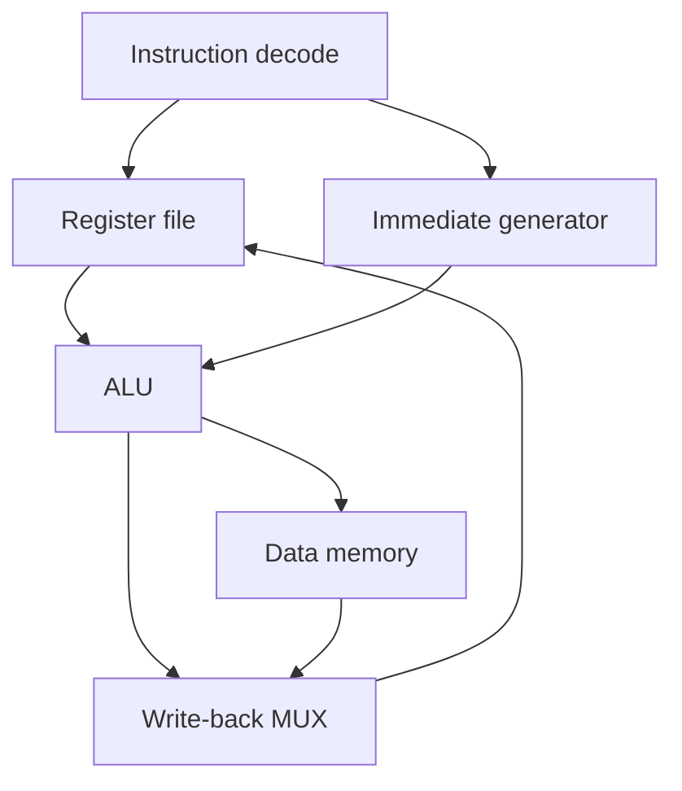

# Computer Organization and Design｜計算機組織與設計

> **定位：從位元到能執行指令的 CPU。** 本筆記以繁體中文解說、英文術語輔助，使用 **RV32I** 作為組合語言教學模型。它不是 Raspberry Pi 3 的 Arm 指令集。
>
> 資料查核日期：**2026-09-27**。公式與數值例題採明確假設；未標成教材原例的題目，都是本筆記自行編寫的「教科書型例題」，不是 Patterson & Hennessy 原書題目的轉錄或官方解答。

[回到 README](README.md) · [進階：Computer Architecture](Computer_Architecture.md)

## 目錄

1. [如何使用與課程分工](#org-01)
2. [資料表示：整數、位址與浮點數](#org-02)
3. [邏輯電路、暫存器與時脈](#org-03)
4. [ISA 與 RV32I 指令](#org-04)
5. [陣列、迴圈與函式呼叫](#org-05)
6. [資料路徑與控制](#org-06)
7. [單週期、多週期與管線](#org-07)
8. [記憶體與快取的組織](#org-08)
9. [I/O、中斷與 DMA](#org-09)
10. [動手練習與自我檢查](#org-10)
11. [教材例題、閱讀對照與來源](#org-11)

<a id="org-01"></a>
## 1. 如何使用與課程分工

學完本篇，你應能回答：`a[i] += 3` 如何變成指令？CPU 如何選到正確的運算元？為什麼兩條有相依性的指令不能任意重疊？

| 階段 | 先讀內容 | 應完成的成果 |
| --- | --- | --- |
| 基礎 | §2–3；搭配 [Logic Design](Logic_Design.md) | 手算二補數、說明加法器與暫存器差別 |
| 軟硬體介面 | §4–5 | 追蹤一段 RV32I 的暫存器與記憶體變化 |
| CPU 實作 | §6–7 | 畫出 load 路徑、找出 hazard |
| 系統整合 | §8–10 | 算快取欄位、比較 polling 與 interrupt |

「Architecture」與「Organization」在不同學校的課名裡會重疊。本倉庫把本篇用於**結構與執行過程**，另一篇用於**效能分析與設計取捨**。先理解機制，再比較速度。

先備知識：二進位、AND/OR/XOR、簡單 C 陣列與指標。不要求先有開發板。MIT 6.004 使用的 Beta 也是教學 ISA；讀其範例時，不要把 Beta 指令名稱直接當成 RISC-V。[S1][S2]

<a id="org-02"></a>
## 2. 資料表示：整數、位址與浮點數

### 2.1 位元本身沒有型別

`11111111` 是一組位元：解讀成 8-bit unsigned 是 255，解讀成 8-bit two's complement 是 −1。**型別／指令決定如何解釋資料。** [S3]

| 表示方式 | n 位元的範圍 | 8 位元範例 |
| --- | --- | --- |
| Unsigned integer | $0$ 到 $2^n-1$ | 0 到 255 |
| Two's complement | $-2^{n-1}$ 到 $2^{n-1}-1$ | −128 到 127 |

二補數的最高位權重為負：

$$x=-b_{n-1}2^{n-1}+\sum_{i=0}^{n-2}b_i2^i$$

**教科書型例題 O1：8 位元的 −18。**

1. +18 = `00010010`。
2. 逐位反相得到 `11101101`。
3. 加一得到 `11101110`。
4. 用權重驗算：−128 + 64 + 32 + 8 + 4 + 2 = −18。

擴大成 16 位元且保留有號數值時，要做 **sign extension**：`11111111 11101110`。若直接補零，得到的會是 +238。

### 2.2 Carry 與 signed overflow 不同

在固定寬度加法器中，結果保留低 n 位。

| 8-bit 運算 | 低 8 位結果 | 判讀 |
| --- | --- | --- |
| unsigned 255 + 1 | `00000000`，有 carry-out | 超出 unsigned 範圍 |
| signed 100 + 60 | `10100000`，解讀為 −96 | 真值 160 超出 signed 範圍；即使沒有 carry-out 仍會 overflow |
| signed −1 + 1 | `00000000`，有 carry-out | 真值 0 可表示，沒有 signed overflow |

同號相加卻得到異號，是二補數加法發生 signed overflow 的判準。硬體低位結果與程式語言規則要分開：**不可依賴 C 的 signed overflow 自動環回**。後面的 C 練習使用 unsigned 型別。[S3][S4][S20]

**應用：** 感測資料若以 16-bit signed 表示，錯用 unsigned 讀取負溫度，會得到非常大的正數。

### 2.3 Byte addressing、alignment 與 endianness

本篇採 **byte-addressable memory**：一個位址指出一個 byte。假設每個陣列元素 4 bytes，`a[i]` 的位址是 `base + 4*i`。

將 `0x12345678` 存在 `0x1000` 開始的四個 byte：

| 位址 | Little-endian | Big-endian |
| --- | --- | --- |
| `0x1000` | `78` | `12` |
| `0x1001` | `56` | `34` |
| `0x1002` | `34` | `56` |
| `0x1003` | `12` | `78` |

Endianness 改變多 byte 資料的存放順序，**不是把每個 byte 的 bit 順序倒過來**。本篇的記憶體範例假設 little-endian；RV32I 的執行環境可定義端序。[S4]

4-byte 資料的 naturally aligned address 是 4 的倍數。未對齊存取是否成功、是否較慢，取決於 ISA 與執行環境，不能一概當成合法或非法。

**應用：** 讀取感測器封包或圖片檔時，必須依格式指定的端序組合 byte，而不是假設與主機相同。

### 2.4 Fixed-point 與 IEEE 754 binary32

Fixed-point 把整數乘上一個約定的比例。例如以整數 2534 表示 25.34°C；比例需由程式或協定另外約定。它易控制精度，但要自行處理範圍與縮放。

binary32 的欄位為 1-bit sign、8-bit exponent、23-bit fraction。正常數的值是：

$$(-1)^s\times(1+F/2^{23})\times2^{E-127},\quad 1\le E\le254$$

| E | F | 意義 |
| --- | --- | --- |
| 0 | 0 | 正零或負零 |
| 0 | 非零 | Subnormal：$(-1)^s(F/2^{23})2^{-126}$ |
| 1–254 | 任意 | Normal |
| 255 | 0 | 正／負無窮大 |
| 255 | 非零 | NaN |

**教科書型例題 O2：13.25 的 binary32。**

1. $13.25=1101.01_2=1.10101_2\times2^3$。
2. sign = 0；exponent = 3 + 127 = 130 = `10000010`。
3. fraction = `10101000000000000000000`。
4. 合併為 `0 10000010 10101000000000000000000`，hex 為 `0x41540000`。

0.1 在二進位中是循環小數，因此有限精度通常只能存近似值。比較測量值時，應根據測量精度與數值尺度選容許誤差；不要把所有浮點運算的結果都拿來做精確相等比較。以上討論限定 binary32，不把所有語言的 `float` 都當成同一格式。[S5]

<a id="org-03"></a>
## 3. 邏輯電路、暫存器與時脈

### 3.1 Combinational 與 sequential logic

| 元件 | 類別 | 工作 |
| --- | --- | --- |
| Adder | Combinational | 對目前輸入做加法 |
| Multiplexer（MUX） | Combinational | 依 select 選一個輸入 |
| Decoder | Combinational | 將編碼轉成選擇訊號 |
| Register | Sequential | 在指定時脈事件儲存資料 |
| FSM | Sequential system | 依目前狀態與輸入決定下一狀態 |

一個 full adder 接收 A、B、carry-in：

$$Sum=A\oplus B\oplus C_{in}$$
$$C_{out}=AB+C_{in}(A\oplus B)$$

式中的加號代表 Boolean OR，乘號代表 AND。以 A=1、B=0、carry-in=1 驗算，sum=0、carry-out=1，正好是十進位 2。[S6]

串接 full adders 可建立 ripple-carry adder；高位需等待低位進位。更複雜的加法器可減少等待，但增加電路成本。

### 3.2 時脈不是讓運算「瞬間完成」

暫存器輸出經過邏輯，再由下一個暫存器接收。忽略 skew 等額外裕量的簡化 setup 條件：

$$T_{clk}\ge t_{clk\to Q}+t_{logic,max}+t_{setup}$$

**教科書型例題 O3：** clk-to-Q=30 ps、最長邏輯延遲=180 ps、setup=40 ps。最短週期為 250 ps；理想最高頻率 $1/(250\times10^{-12})=4$ GHz。這只是題目模型，實際設計還要檢查 hold time、skew 與製程／電壓／溫度變化。[S7][S8]

**應用：** FPGA 設計出現 timing violation 時，可能要拆短組合邏輯路徑、增加管線暫存器；不能只提高時脈設定期待更快。

<a id="org-04"></a>
## 4. ISA 與 RV32I 指令

ISA 是軟體看得到的機器介面；microarchitecture 是實現此介面的內部結構。同一套 ISA 可以有不同的管線、快取與執行單元。[S9]

### 4.1 RV32I 的基本狀態

- 整數暫存器為 `x0`–`x31`，每個 32 bits；`x0` 讀取永遠是 0，寫入結果會被丟棄。
- PC 保存指令位址。以下只用 32-bit 指令，順序執行時 PC 加 4。
- `add` 等整數運算作用於暫存器；`lw`、`sw` 在暫存器與記憶體間搬資料。
- RV32I 本身不包含 `mul`／`div`；它們屬於 M extension。勿把某個模擬器支援的所有指令都算入 RV32I。[S4]

| 指令 | 意義 | 注意 |
| --- | --- | --- |
| `add x5, x6, x7` | x5 ← x6 + x7 的低 32 位 | 不修改記憶體 |
| `addi x5, x6, -3` | x5 ← x6 − 3 | 一般 immediate 為 12-bit signed |
| `lw x5, 8(x6)` | 從 x6+8 的位址載入 32 bits | 8 是 byte offset |
| `sw x5, 8(x6)` | 將 x5 的 32 bits 寫到 x6+8 | 沒有目的暫存器 rd |
| `beq x5, x6, label` | 相等時跳到 label | 比較後改變 PC |
| `jal x1, label` | x1 ← PC+4，並跳躍 | 可用於函式呼叫 |

**教科書型例題 O4：編碼 `addi x5, x0, 13`。**

I-type 欄位如下：[S4]

| Bits | 欄位 | 本例 |
| --- | --- | --- |
| 31:20 | imm[11:0] | `000000001101` |
| 19:15 | rs1 | `00000` |
| 14:12 | funct3 | `000` |
| 11:7 | rd | `00101` |
| 6:0 | opcode | `0010011` |

依位移合併：`(13 << 20) | (5 << 7) | 0x13 = 0x00D00293`。這是機器指令值；若以 little-endian 放入記憶體，四個 byte 是 `93 02 D0 00`。

### 4.2 不要混用 ISA 與 ABI

ISA 定義指令；ABI 約定函式如何傳參數、哪些暫存器需要保留，以及 stack 如何對齊。RISC-V 標準整數 calling convention 使用 `a0`–`a7` 傳參數，`a0`／`a1` 也可傳回結果；`ra` 是 x1、`sp` 是 x2。這些慣例不能直接套用到 Arm。[S10]

<a id="org-05"></a>
## 5. 陣列、迴圈與函式呼叫

### 5.1 `a[i] += 3` 的執行過程

假設陣列每個元素 4 bytes，base=0x1000、i=2、a[2]=7，索引有效且記憶體可讀寫：

1. 算位址：0x1000 + 2×4 = 0x1008。
2. load：從 0x1008 取出 7。
3. add：7 + 3 = 10。
4. store：將 10 寫回 0x1008。

這也解釋為什麼 `a[i] += 3` 不應自行假設是跨執行緒的 atomic operation。

### 5.2 完整的 RV32I leaf function 範例

**教科書型例題 O5：加總 unsigned 32-bit 陣列。** 輸入 a0=陣列起始位址，a1=元素數；輸出 a0=總和 modulo $2^{32}$。假設位址 4-byte aligned、範圍有效且位址計算不環回。這是可組譯的函式片段，不是含作業系統入口的完整執行檔。

```asm
.text
.globl sum_u32
sum_u32:
    addi t0, x0, 0
loop:
    beq  a1, x0, done
    lw   t1, 0(a0)
    add  t0, t0, t1
    addi a0, a0, 4
    addi a1, a1, -1
    jal  x0, loop
done:
    addi a0, t0, 0
    jalr x0, 0(ra)
```

對輸入 `[4, 7, 9]` 手算：

| 已處理元素數 | t0（累計） | a1（剩餘） | a0（目前指標） |
| --- | --- | --- | --- |
| 0 | 0 | 3 | base |
| 1 | 4 | 2 | base+4 |
| 2 | 11 | 1 | base+8 |
| 3 | 20 | 0 | base+12 |

到 `done` 才把 a0 改成回傳值 20。本函式不呼叫其他函式，只使用 caller-saved 暫存器，因此不需建立 stack frame。[S4][S10]

### 5.3 為什麼非 leaf function 可能需要 stack？

`jal ra, other_function` 會改寫 ra。如果目前函式還需要回到自己的 caller，就必須保留舊 ra。若使用 `s0` 等 callee-saved 暫存器，也要在返回前恢復它們。

**應用：** 遞迴每深入一層，都可能需要保存返回位置與區域狀態。遞迴過深可能耗盡 stack；「電腦有很多 RAM」不表示單一執行緒的 stack 沒有限制。[S10][S11]

<a id="org-06"></a>
## 6. 資料路徑與控制

### 6.1 一條指令需要哪些部件？

| 部件 | 功能 | `lw x5, 8(x6)` 中的工作 |
| --- | --- | --- |
| PC / instruction memory | 指出並取得指令 | 取出 lw 的機器碼 |
| Decoder / control | 決定各部件如何工作 | 選 load 控制訊號 |
| Register file | 讀來源、寫結果 | 讀 x6；最後寫 x5 |
| Immediate generator | 產生立即值 | sign-extend offset 8 |
| ALU | 算術與位址計算 | x6 + 8 |
| Data memory | 讀寫資料 | 讀指定位置的 32 bits |
| Write-back MUX | 選擇寫回來源 | 選記憶體輸出，而非 ALU 位址 |

概念資料路徑如下；沒有畫出所有控制線、PC 更新或實體埠。[S12]



### 6.2 簡化的控制表

以下是**本篇教學資料路徑自訂訊號名稱**，不是 RISC-V 規格規定的硬體介面。[S12]

| 指令 | RegWrite | ALU 第二輸入 | MemRead | MemWrite | 寫回來源 | PC 選擇 |
| --- | --- | --- | --- | --- | --- | --- |
| add | 1 | rs2 | 0 | 0 | ALU | PC+4 |
| addi | 1 | immediate | 0 | 0 | ALU | PC+4 |
| lw | 1 | immediate | 1 | 0 | Memory | PC+4 |
| sw | 0 | immediate | 0 | 1 | 不使用 | PC+4 |
| beq | 0 | rs2，用來比較 | 0 | 0 | 不使用 | 相等則選 branch target |

本表假設另有 branch-target 加法器，以指令自身 PC 加上 branch offset。若硬體共用一個 ALU，必須重新安排時間與控制。

**思考題：** sw 若錯把 RegWrite 打開會如何？可能錯誤修改一個暫存器；所以控制錯誤不一定表現為 ALU 算錯。

<a id="org-07"></a>
## 7. 單週期、多週期與管線

### 7.1 三種組織方式

| 方式 | 指令如何前進 | 主要取捨 |
| --- | --- | --- |
| Single-cycle | 每條指令一個長週期 | 週期需容納最慢指令路徑 |
| Multi-cycle | 一條指令分多個短週期 | 可共用硬體；不同指令可能需不同週期數 |
| Pipeline | 不同指令在不同 stage 同時工作 | 增加吞吐量，但需處理相依性 |

經典五級為 IF（fetch）、ID（decode/register read）、EX（ALU）、MEM（data memory）、WB（write back）。這是教學模型，不是所有 CPU 的固定設計。[S12]

### 7.2 教科書型例題 O6：速度與延遲分開算

假設五段組合邏輯延遲為 180、120、150、200、100 ps，每段暫存器總 overhead=20 ps，無 stall、無記憶體額外等待。

- 非管線：週期 = 180+120+150+200+100+20 = **770 ps**。
- 五級管線：週期 = max(180,120,150,200,100)+20 = **220 ps**。
- 20 條指令非管線需 20×770 = **15,400 ps**。
- 管線需 N+k−1 = 20+5−1 = 24 cycles，即 **5,280 ps**。
- Speedup = 15,400/5,280 ≈ **2.92×**。
- 單條指令走完五級需 5×220 = **1,100 ps**，比 770 ps 更久。

**結論：管線改善吞吐量，不保證降低單條指令延遲。** 長程速度比還受到不平衡 stage 與暫存器 overhead 限制，不會自動等於級數。[S8][S12]

### 7.3 Hazard：重疊後遇到的問題

| 類型 | 原因 | 常見處理 |
| --- | --- | --- |
| Structural | 同時需要同一個不足的資源 | 增加埠、分離資源或 stall |
| Data（例如 RAW） | 後一條需要前一條尚未可用的結果 | Forwarding、stall 或排程 |
| Control | 尚未確定下一個 PC | Stall、預測與錯誤恢復 |

**教科書型例題 O7：load-use hazard。**

```asm
lw  x5, 0(x6)
add x7, x5, x8
```

假設 load 資料在 MEM **結束**才可用，add 在 EX **開始**就需要資料，具有一般 forwarding、沒有 cache miss。仍需一個 stall：[S13]

| 指令 | C1 | C2 | C3 | C4 | C5 | C6 | C7 |
| --- | --- | --- | --- | --- | --- | --- | --- |
| lw | IF | ID | EX | MEM | WB | — | — |
| add | — | IF | ID | ID 等待 | EX | MEM | WB |

C4 時 add 所在 ID 被凍結，EX 放入 bubble；C5 才能把 load 結果送給 add。沒有 forwarding 或記憶體更慢時，答案可能不同，因此不能只背「load 一定停一個 cycle」。

<a id="org-08"></a>
## 8. 記憶體與快取的組織

### 8.1 為什麼需要階層？

Register、cache、DRAM、儲存裝置在容量、成本與延遲上有不同取捨。程式使用的資料不可能全部長期放在昂貴的小型高速儲存體。[S14]

- **Temporal locality：** 不久前使用的資料可能再次使用。
- **Spatial locality：** 相鄰位址可能接著使用。
- 一條 cache line 存放一段連續 bytes；load 一個元素可能順便帶進鄰近資料。[S15]

### 8.2 教科書型例題 O8：拆解快取位址

假設 32-bit byte address、32 KiB **資料容量**、64-byte block、4-way set associative：

$$Sets=\frac{32768}{64\times4}=128$$

| 欄位 | 計算 | 位元數 |
| --- | --- | --- |
| Offset | $\log_2 64$ | 6 |
| Index | $\log_2 128$ | 7 |
| Tag | 32−6−7 | 19 |

對位址 `0x12345678`：offset=`0x38`=56，index=`0x59`=89，tag=`0x91A2`。驗算：`(tag << 13) + (index << 6) + offset` 應還原原位址。

Index 找到 set；比較 set 內所有有效 ways 的 tag；符合才是 hit。32 KiB 通常不包含 tag、valid、dirty 等 metadata，本題也不計這些。[S15]

### 8.3 真正的公開教科書例題

《Dive Into Systems》§11.4.1 的 **Direct-Mapped Read Examples** 使用 16-bit 位址、128 lines、32-byte blocks、初始 empty cache。下表是對原例數值的簡短重算；完整圖解請讀原書連結。[S16]

| 依序讀取（hex） | Tag（4 bits） | Index（7 bits） | Offset（5 bits） | 結果 |
| --- | --- | --- | --- | --- |
| `0xA064` | A | 3 | 4 | Miss，line 3 原先 invalid |
| `0xA067` | A | 3 | 7 | Hit，同一 block |
| `0x9020` | 9 | 1 | 0 | Miss，line 1 原先 invalid |
| `0xF065` | F | 3 | 5 | Miss，line 3 的 tag 不符 |

這個例子展示：**相同 index 不代表 hit，還要檢查 valid 與 tag。** 本段只摘述四次讀取，沒有複製原書插圖或整節內容。

寫入策略、AMAT、miss 分類及 cache trace 延伸到 [Computer Architecture §5](Computer_Architecture.md#arch-05)。

<a id="org-09"></a>
## 9. I/O、中斷與 DMA

### 9.1 CPU 如何與外界交換資料？

MMIO（memory-mapped I/O）將裝置控制／狀態暫存器映射到位址空間；對這些位址的操作可能有硬體副作用，不能當成一般 RAM。作業系統中的程式通常透過驅動與 API 使用硬體。[S17]

| 方法 | 機制 | 適用情境與成本 |
| --- | --- | --- |
| Polling | 主動檢查裝置狀態 | 簡單；太頻繁會耗 CPU，太稀疏會增加延遲 |
| Interrupt | 裝置事件要求 CPU 處理 | 適合非連續事件；有進入 handler 與排程成本 |
| DMA | 裝置／控制器搬移資料到記憶體或反向搬移 | CPU 負責設定與完成處理；適合較大量傳輸 |

Interrupt 通常指相對目前指令非同步的外部事件；exception 通常由當前指令同步觸發。各 ISA 對 trap 的命名略有差異，不能把軟體 signal、硬體 interrupt、普通 function call 畫上等號。[S18]

### 9.2 教科書型例題 O9：polling 的等待時間

假設每 10 ms 檢查一次，事件在週期間均勻隨機發生，忽略檢查及排程耗時。偵測等待在 0 到接近 10 ms 之間，平均 **5 ms**。若系統有其他負載，實際最壞延遲可能更高。

**應用：** 感測器警報不只看「CPU GHz」。採樣週期、裝置介面、OS 排程、事件處理及通知都可能影響反應速度。

### 9.3 DMA 不等於完全不需要 CPU

CPU／driver 仍需安排 buffer、提交傳輸並處理完成事件。DMA address 也不一定等於 CPU virtual address；IOMMU、cache coherency 與同步規則需依平台處理。Linux 有專用 DMA API，因此不要直接把任意指標交給裝置。[S17]

<a id="org-10"></a>
## 10. 動手練習與自我檢查

### 10.1 C 練習：觀察 byte 順序與 bit mask

把下列完整程式存為 `inspect_bits.c`。需要支援 C11 的編譯器；以下假設主機提供 `uint32_t` 與 8-bit byte。

```c
#include <inttypes.h>
#include <limits.h>
#include <stdint.h>
#include <stdio.h>

int main(void) {
    _Static_assert(CHAR_BIT == 8, "This example requires 8-bit bytes");
    uint32_t value = UINT32_C(0x12345678);
    const unsigned char *bytes = (const unsigned char *)&value;
    for (size_t i = 0; i < sizeof(value); ++i) {
        printf("%02x%s", (unsigned int)bytes[i],
               i + 1 == sizeof(value) ? "\n" : " ");
    }
    uint32_t flags = 0;
    flags |= UINT32_C(1) << 3;
    printf("set bit 3: %" PRIu32 "\n", flags);
    flags &= ~(UINT32_C(1) << 3);
    printf("clear bit 3: %" PRIu32 "\n", flags);
    return 0;
}
```

```sh
cc -std=c11 -Wall -Wextra inspect_bits.c -o inspect_bits
./inspect_bits
```

Little-endian 主機第一行為 `78 56 34 12`；big-endian 為 `12 34 56 78`。後兩行的數值分別是 8、0。以 unsigned char 讀取物件表示可避免不相容指標轉型造成的 aliasing 問題。[S20]

### 10.2 紙筆練習

先自己作答，再展開答案。

1. 8-bit 二補數 `11110110` 是多少？
2. 4-byte 元素陣列 base=`0x2000`，第 5 號索引的位址？
3. 8 KiB direct-mapped cache、32-byte blocks、32-bit 位址，各欄位幾 bits？
4. 五級理想管線執行 8 條指令需幾 cycles？
5. 為什麼不能直接在 Raspberry Pi 的 shell 輸入本篇的 RISC-V 組合語言？

<details>
<summary>答案與理由</summary>

1. −10；取反加一得 `00001010`。
2. `0x2014`，因為 5×4=20=`0x14`。
3. 256 lines；offset 5、index 8、tag 19。容量只算 data。
4. 8+5−1=12；必須無 stall、每 cycle 發出一條且沒有額外延遲。
5. Shell 不是 assembler，而且 Pi 3 使用 Arm CPU。需要適當的 RISC-V 工具鏈與模擬環境才能執行 RISC-V 程式。

</details>

### 10.3 下一個實作里程碑

- [ ] 手算 O1–O9 並保留過程。
- [ ] 執行 C 範例，記下 OS、CPU、編譯器與輸出。
- [ ] 用紙筆追蹤 `sum_u32` 的空陣列、單元素與三元素情況。
- [ ] 在選定的 RISC-V 模擬器重做追蹤，明確記錄 ISA/ABI 與載入方式。
- [ ] 以 Python 自行寫 direct-mapped cache simulator，再對照本篇 trace。

這些是學習任務，**不表示倉庫已提供模擬器、RTL 或硬體測試結果**。

<a id="org-11"></a>
## 11. 教材例題、閱讀對照與來源

### 11.1 教科書閱讀對照

Patterson & Hennessy, *Computer Organization and Design RISC-V Edition*, **2nd edition**：出版商公開目錄可核對下列章名。[S19] 此處未宣稱讀取或重製全書付費內容。

| 本篇 | 對照章節 |
| --- | --- |
| §4–5 指令與函式 | Chapter 2, Instructions: Language of the Computer |
| §2 數值表示與運算 | Chapter 3, Arithmetic for Computers |
| §6–7 CPU 與管線 | Chapter 4, The RISC-V Processor |
| §8 快取 | Chapter 5, Large and Fast: Exploiting Memory Hierarchy |
| §3 邏輯電路 | Appendix A, The Basics of Logic Design |

**公開練習：** MIT 6.004 的 [Tutorial Problems](https://ocw.mit.edu/courses/6-004-computation-structures-spring-2009/pages/tutorial-problems/) 提供題目及解答；可先做 Pipelining，再做 Caches。題目採用的 processor、時序及 units 必須依題目本身，不套用本篇假設。[S2]

### 11.2 查核來源

來源代號放在相關章節，方便回查。規格用於核對指令語義；大學課程與公開教科書用於教學；自行設計的數值例題只是演示，沒有被包裝成硬體量測。

| ID | 來源與用途 |
| --- | --- |
| S1 | [MIT OCW 6.004, Spring 2017](https://ocw.mit.edu/courses/6-004-computation-structures-spring-2017/)：從電路到系統的學習架構 |
| S2 | [MIT OCW 6.004 Tutorial Problems, Spring 2009](https://ocw.mit.edu/courses/6-004-computation-structures-spring-2009/pages/tutorial-problems/) 與 [Beta documentation](https://ocw.mit.edu/courses/6-004-computation-structures-spring-2009/resources/mit6_004s09_lab_beta_doc/)：公開習題與教學 ISA |
| S3 | [Cornell CS 3410: Numbers](https://www.cs.cornell.edu/courses/cs3410/2026sp/notes/numbers.html)：二補數 |
| S4 | [RISC-V RV32I v2.1, 20240411 specification](https://docs.riscv.org/reference/isa/v20240411/unpriv/rv32.html)：指令、編碼、位址與溢位語義 |
| S5 | [Cornell CS 3410: Floating Point](https://www.cs.cornell.edu/courses/cs3410/2026sp/notes/float.html)：binary32 與固定小數點 |
| S6 | [Cornell CS 3410: Gates & Logic](https://www.cs.cornell.edu/courses/cs3410/2026sp/notes/logic.html)：組合邏輯 |
| S7 | [Cornell CS 3410: Stateful Logic](https://www.cs.cornell.edu/courses/cs3410/2026sp/notes/state.html)：狀態與暫存器 |
| S8 | [MIT 6.004: Pipelining annotated slides](https://ocw.mit.edu/courses/6-004-computation-structures-spring-2017/pages/c7/c7s1/)：管線時序限制 |
| S9 | [Dive Into Systems, Chapter 5](https://diveintosystems.org/book/C5-Arch/index.html)：ISA／microarchitecture 的區別；不採用 RISC 必定每條一 cycle 等過度概括 |
| S10 | [RISC-V ELF psABI](https://riscv-non-isa.github.io/riscv-elf-psabi-doc/)：Register Convention／Integer Calling Convention |
| S11 | [Cornell CS 3410: Calling Conventions](https://www.cs.cornell.edu/courses/cs3410/2026sp/notes/asm-call.html)：呼叫與 stack |
| S12 | [Cornell CS 3410: CPU Architecture](https://www.cs.cornell.edu/courses/cs3410/2026sp/notes/arch.html)：CPU stages；本篇另明示多週期可有不同 CPI |
| S13 | [MIT 6.5900 Fall 2023, L05](https://csg.csail.mit.edu/6.5900F23/Lectures/L05.pdf)：hazard、stall 與資料路徑 |
| S14 | [Dive Into Systems §11.1](https://diveintosystems.org/book/C11-MemHierarchy/mem_hierarchy.html)：記憶體階層 |
| S15 | [Cornell CS 3410: Caches](https://www.cs.cornell.edu/courses/cs3410/2026sp/notes/caches.html)：locality、映射與欄位 |
| S16 | [Dive Into Systems §11.4.1](https://diveintosystems.org/book/C11-MemHierarchy/caching.html)：Direct-Mapped Read Examples 原例 |
| S17 | [Linux Kernel: Dynamic DMA mapping Guide](https://docs.kernel.org/core-api/dma-api-howto.html)：MMIO、CPU／DMA 位址與同步 |
| S18 | [Cornell CS 3410: Interrupts](https://www.cs.cornell.edu/courses/cs3410/2026sp/notes/interrupt.html)：中斷與系統服務 |
| S19 | [Elsevier: COD RISC-V, 2nd edition](https://shop.elsevier.com/books/computer-organization-and-design-risc-v-edition/patterson/978-0-12-820331-6)：書目與公開目錄 |
| S20 | [WG14 C11 committee draft N1570](https://www.open-std.org/jtc1/sc22/wg14/www/docs/n1570.pdf)：§6.5 p5、p7，算術結果不可表示與 character-type 存取物件表示 |

**查核界線：** 公開課程也會使用簡化模型。遇到差異時，先核對 ISA、版本、位寬與題目假設；涉及特定硬體行為，再以該處理器的官方手冊為準。
