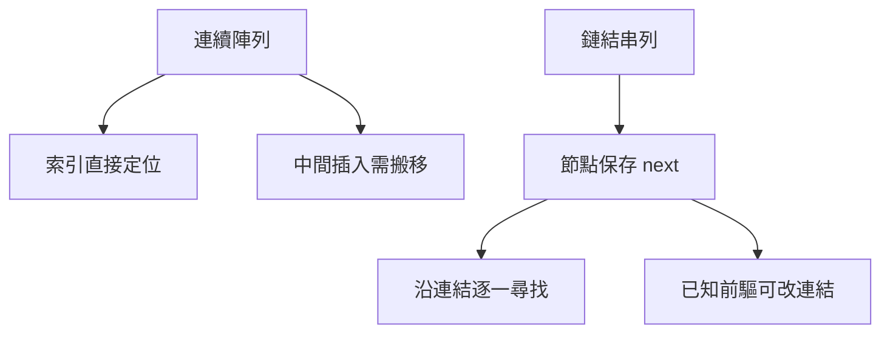
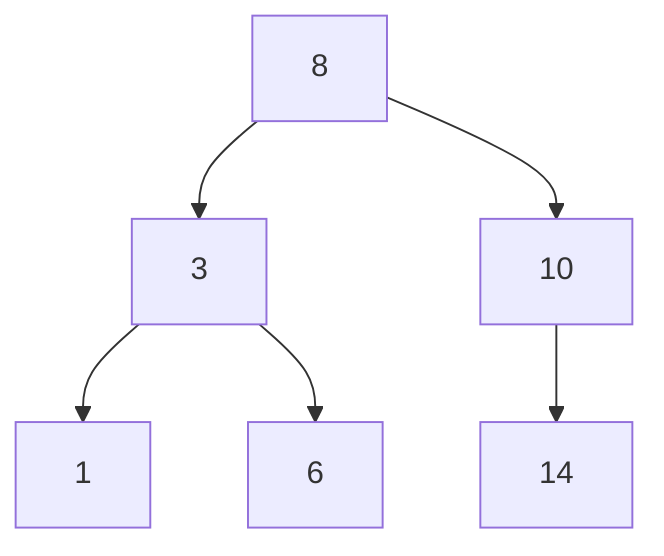
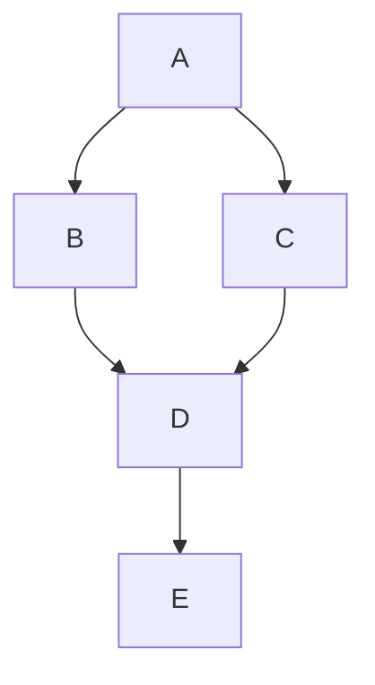

# Data Structures｜資料結構：從資料排列到演算法成本

> [!NOTE]
> 本篇先建立概念，再看小型 Python 範例，最後進入樹、圖與進階路線。無需先熟悉 C++ 指標語法。所有數值與程式範例均為自編；指定的公開教材例題另列於文末。

[共通基礎](Foundations.md) · [學習總覽](README.md)

## 1. 資料結構、演算法與 ADT

**資料 data** 是程式操作的內容；**資料結構 data structure** 是組織資料與其關係的方法；**演算法 algorithm** 是完成操作的步驟。相同資料可以用不同結構保存，操作成本因此不同。

**抽象資料型別 ADT** 描述「可以做什麼」，實作描述「怎麼做到」。例如 stack 要支援 push、pop、看頂端；底層可以用陣列或鏈結串列。選結構前先列出常做的操作：依編號讀取、搜尋名字、插入、刪除、取最小值，還是走訪關係？

| 名詞 | 意義 | 例子 |
| --- | --- | --- |
| Element 元素 | 結構中的一筆項目 | 一位聯絡人 |
| Index 索引 | 元素所在的位置編號 | 第 0、1、2 個 |
| Key 鍵 | 用來識別或比較項目的值 | 學號 |
| Value 值 | 與 key 關聯的內容 | 姓名與電話 |
| Node 節點 | 保存資料與連接資訊的單位 | 鏈結串列節點 |
| Pointer / reference | 用來參照另一個物件的值 | next 指向下一個節點 |
| Invariant 不變量 | 每次合法操作前後都應成立的規則 | queue 的長度不得為負 |

> [!IMPORTANT]
> 「操作快」要指定哪個操作、資料量與前提。陣列很適合依索引讀取，卻不代表在未排序陣列裡搜尋名字也只要一步。

## 2. 複雜度：資料變多時，成本如何成長？

令 n 為元素數量。時間複雜度研究操作次數隨 n 的成長，空間複雜度研究額外空間的成長。**Big O** 給漸近上界；**Θ** 表示同時有相應上下界的成長階。它們不直接給出實測秒數。

| 成長階 | n=8 的尺度 | n=1024 的尺度 | 典型用途與前提 |
| --- | --- | --- | --- |
| O(1) | 常數 | 常數 | 陣列依有效索引讀值 |
| O(log n) | log₂8=3 | log₂1024=10 | 已排序隨機存取陣列的二分搜尋 |
| O(n) | 8 | 1024 | 掃描所有元素 |
| O(n log n) | 24 | 10240 | 常見有效比較排序 |
| O(n²) | 64 | 1048576 | 兩層各走 n 次的迴圈 |

表中數字是成長尺度，不是精確比較次數。**Worst case 最壞情況**關心最昂貴輸入；**average case 平均情況**需要輸入分布假設；**amortized 攤銷**把一串操作的總成本平均到每次，不需要隨機輸入假設。

> [!WARNING]
> O(1) 仍可能花很多常數步驟。Quick sort 平均常為 O(n log n)，最壞可為 O(n²)；它不是二分搜尋的 O(log n)。

**例 D1：** 一個迴圈做 n 次，內層每次做固定 3 次，總共 3n，為 Θ(n)。如果內層也做 n 次，總共 n²，為 Θ(n²)。若先做 n 次再做 n 次，是 2n 而不是 n²。

## 3. 陣列與鏈結串列

**Array 陣列**把元素依規則排列，可由起始位置與索引算出位置。**Dynamic array 動態陣列**需要時配置更大區域並搬移資料，不是每次插入都恰好擴一格。**Linked list 鏈結串列**用節點間的連接保存順序。

| 操作 | 動態陣列 | 單向鏈結串列 |
| --- | --- | --- |
| 依索引讀第 i 筆 | O(1) | O(n) 最壞，須循連結 |
| 未排序搜尋 key | O(n) | O(n) |
| 中間插入且保持順序 | O(n)，搬移後面元素 | 已知前驅節點時 O(1)；找位置另計 |
| 尾端追加 | 攤銷 O(1)，個別擴容 O(n) | 有 tail 指標時 O(1) |
| 空間特性 | 可能保留未使用容量 | 每節點另有連結與配置成本 |



**例 D2：** `[10,20,30,40]` 在索引 1 插入 15，須把 20、30、40 往後移。若鏈結串列已持有 10 的節點，新節點先連向 20，再讓 10 連向新節點。若只知道「在 30 前」，仍須先找到前驅。

```python
values = [10, 20, 30]
values.append(40)        # 尾端追加
values.insert(1, 15)     # 保持順序的中間插入
assert values == [10, 15, 20, 30, 40]
assert values[2] == 20
```

> [!TIP]
> 日常播放清單可以用來理解順序，但選實作時還要看「跳到第幾首」和「編輯順序」哪個更頻繁。不要只因畫起來像鏈，就認定鏈結串列一定較好。

## 4. Stack、queue 與 deque

**Stack 堆疊**後進先出 LIFO：像把盤子疊起來再從上面取。**Queue 佇列**先進先出 FIFO：像排隊。**Deque 雙端佇列**可在兩端加入與移除。這些是操作規則，不指定唯一底層實作。

| 結構 | 主要操作 | 生活與電腦應用 |
| --- | --- | --- |
| Stack | push 加入、pop 取頂端 | 復原操作、函式呼叫、DFS |
| Queue | enqueue 加入、dequeue 取前端 | 工作排隊、BFS、資料緩衝 |
| Deque | 兩端加入和移除 | 滑動視窗、雙向工作佇列 |

```python
from collections import deque
stack = []
stack.append("A"); stack.append("B")
assert stack.pop() == "B"
queue = deque(["A", "B"])
assert queue.popleft() == "A"
```

Python list 的 `pop(0)` 要移動後面元素，為 O(n)；不能因為叫做「出隊」就自動當 O(1)。`deque` 適合兩端操作。固定容量 ring buffer（環狀緩衝）則讓索引繞回開頭，必須定義滿與空的判斷，常見於通訊接收。

**例 D3：** push 1、push 2、pop、push 3、pop 的兩次輸出是 2、3；相同加入順序改用 queue 的取出結果是 1、2。

## 5. Hash table：用 key 尋找資料

**Hash function 雜湊函數**把 key 映射到整數，再對應某個 bucket（桶）。不同 key 可能到同一桶，稱 collision（碰撞）。Hash 不保證每個 key 都有不同結果，也不是加密的同義詞。

| 方法 | 如何處理碰撞 | 要注意 |
| --- | --- | --- |
| Chaining 鏈結法 | 同一桶保存多個項目 | 桶太長會拖慢搜尋 |
| Open addressing 開放定址 | 按規則找其他槽位 | 刪除、探查與負載因子需配合 |

**Load factor 負載因子** α=n/m，其中 n 是項目數，m 是桶／槽位數。期望 O(1) 查找需要適當雜湊、負載與實作假設；最壞仍可 O(n)。擴容通常要重新安排項目。

**例 D4：** 示範函數 h(k)=k mod 5。12、7、22 都到桶 2，明確展示碰撞。要找 22，不能只找到桶就宣稱成功，還要比較 key。

```python
phone = {"Amy": "123", "Bo": "456"}
phone["Amy"] = "789"
assert phone.get("Amy") == "789"
assert phone.get("Unknown") is None
```

> [!NOTE]
> 聯絡人查詢、快取索引和編譯器的符號表都可以使用 map。若要按 key 排序或做範圍查詢，平衡搜尋樹可能更適合。

## 6. Tree：階層、搜尋與優先順序

Tree（樹）由節點和邊組成；本篇採有根樹。Root 是根，parent 是父節點，child 是子節點，leaf 是沒有子節點的葉。Depth 是離根的邊數，height 是到最深葉的邊數（有些教材採節點數，必須先統一定義）。

**Binary tree 二元樹**每節點至多兩個子節點。**BST 二元搜尋樹**再加排序規則：此處假設 key 不重複，左子樹都小於節點、右子樹都大於節點。



**例 D5：** 找 6：比較 8，往左；比較 3，往右；找到 6。若依 1、2、3、4 插入普通 BST，可能變成長鏈，搜尋退化 O(n)。平衡樹如 AVL、red-black tree 維持高度 O(log n)，以額外調整換取最壞操作保證。

### 6.1 遞迴與走訪

**Recursion 遞迴**是函式以更小的問題呼叫自己，必須有停止條件。例如計算樹大小：空樹大小 0；非空樹大小為 1 + 左子樹大小 + 右子樹大小。呼叫太深會耗盡呼叫堆疊。

| 走訪 | 規則 | 上圖輸出 |
| --- | --- | --- |
| Preorder 前序 | 根、左、右 | 8,3,1,6,10,14 |
| Inorder 中序 | 左、根、右 | 1,3,6,8,10,14 |
| Postorder 後序 | 左、右、根 | 1,6,3,14,10,8 |
| Level order 層序 | 逐層，常用 queue | 8,3,10,1,6,14 |

BST 的中序結果依 key 排序；普通二元樹不保證。

### 6.2 Heap 不是 BST

**Binary heap 二元堆**是一種完全二元樹形狀的優先佇列實作。Min-heap 保證父節點不大於子節點，因此根是最小值；兄弟與不同子樹不必全排序。通常以陣列保存：0-based 索引 i 的子節點為 2i+1、2i+2。

| 操作 | Binary min-heap |
| --- | --- |
| 看最小值 | O(1) |
| 插入、移除最小值 | O(log n) |
| 任意 key 搜尋 | 一般 O(n) |
| 由 n 個元素 bottom-up 建堆 | O(n) |

應用包括優先工作排程和 Dijkstra 的待處理項目。不要和動態記憶體配置的 heap 混淆。

## 7. Searching 與 sorting

Linear search 線性搜尋逐項比較，無需排序。Binary search 二分搜尋利用已排序資料，每次排除不可能的半邊。以下以半開區間 `[lo,hi)` 表示仍可能包含答案的索引；hi 本身不包含。

```python
def binary_search(a, target):
    lo, hi = 0, len(a)
    while lo < hi:
        mid = (lo + hi) // 2
        if a[mid] < target:
            lo = mid + 1
        else:
            hi = mid
    return lo if lo < len(a) and a[lo] == target else -1

assert binary_search([2, 5, 9, 12, 17], 12) == 3
assert binary_search([], 12) == -1
assert binary_search([2, 5, 9], 7) == -1
```

**例 D6：** 找 12。初始 `[0,5)`，mid=2，值9太小，所以 lo=3；`[3,5)` mid=4，值17夠大，hi=4；`[3,4)` mid=3，值12，hi=3。區間縮到 lo=hi=3，再確認值相等。

排序會讓後續搜尋容易，但它本身有成本；只查一次的小資料未必值得先排序。**Stable 穩定排序**保留相同 key 項目的原相對順序；不是指速度穩定。

| 演算法 | 核心想法 | 時間 | 常見性質 |
| --- | --- | --- | --- |
| Insertion sort | 把新項目插入已排序前綴 | 最壞 O(n²)，已排序 O(n) | 可穩定、適合小型或近排序資料 |
| Merge sort | 分半排序再合併 | O(n log n) | 陣列版本通常需 O(n) 額外空間，可穩定 |
| Quick sort | 依 pivot 分區再遞迴 | 期望 O(n log n)，最壞 O(n²) | 隨機化可改善期望；常見版本不穩定 |
| Heap sort | 建堆後反覆取極值 | O(n log n) | 常見原地版本不穩定 |

**例 D7：** merge `[2,7]` 與 `[3,5]`，比較開頭：先2，再3，再5，最後7。每次只要比較兩邊目前最小的未取元素，因此一次合併為線性成本。完整排序每層合計 O(n)，層數 O(log n)。

## 8. Graph：不只有階層，還有一般關係

Graph（圖）包含 vertex（頂點）與 edge（邊）。有向邊有方向；無向邊可雙向。Weighted graph 的邊帶權重，例如距離或時間。樹是一種特殊結構；一般圖可能有環 cycle，走訪必須避免重複。

| 表示法 | 儲存方式 | 典型空間與特點 |
| --- | --- | --- |
| Adjacency list 鄰接串列 | 每頂點列出鄰居 | O(V+E)，適合稀疏圖 |
| Adjacency matrix 鄰接矩陣 | V×V 格子表示是否有邊 | O(V²)，查兩點間有無邊直接 |

BFS（廣度優先）以 queue 逐層展開；DFS（深度優先）先深入一條路，再返回探索其他分支。用鄰接串列時，完整走訪為 O(V+E)。BFS 可求無權圖的最少邊數路徑；一般不同權重最短路徑不能直接套 BFS。[DS3]



**例 D8：** 從 A 出發，按圖中 B 再 C 的順序，BFS 層次為 `{A}`、`{B,C}`、`{D}`、`{E}`。A 到 E 最少 3 條邊。D 被 B 發現後，C 再遇到 D 不應重複入隊。

```python
from collections import deque

def bfs_distance(graph, start):
    distance = {start: 0}
    pending = deque([start])
    while pending:
        node = pending.popleft()
        for neighbor in graph.get(node, []):
            if neighbor not in distance:
                distance[neighbor] = distance[node] + 1
                pending.append(neighbor)
    return distance

g = {"A": ["B", "C"], "B": ["D"], "C": ["D"], "D": ["E"]}
assert bfs_distance(g, "A") == {"A": 0, "B": 1, "C": 1, "D": 2, "E": 3}
```

生活應用：社群關係、交通網路、課程先修依賴。先修依賴通常用有向無環圖 DAG；topological sort（拓樸排序）列出符合依賴的順序，若存在循環就沒有這種完整順序。

## 9. 如何選結構，以及下一步學什麼

| 需求 | 先考慮 | 進階延伸 |
| --- | --- | --- |
| 依索引快速讀取 | 動態陣列 | 記憶體局部性 |
| 依 key 精確查詢 | Hash map | 碰撞、負載與對抗輸入 |
| 排序與範圍查詢 | 平衡 BST | AVL、red-black tree |
| 反覆取最小值 | Heap | Dijkstra；非負邊權前提 |
| 前綴查詢 | Trie 字首樹 | 字典、自動完成 |
| 磁碟上大量有序資料 | B-tree / B+ tree | 區塊 I/O 與資料庫索引 |
| 動態合併集合 | Disjoint-set union | 路徑壓縮、Kruskal |

以上進階主題提供定位，完整證明與實作需接續原教材。資料結構和演算法相互配合；動態規劃、貪婪法與分治法屬更廣的演算法設計方法。

> [!TIP]
> 每學一種結構，畫出 4–6 個元素，手做插入、刪除與搜尋，再問：空結構怎麼辦？只有一筆呢？重複 key 呢？哪些假設讓複雜度成立？

## 10. 練習與詳解

1. 1000 筆未排序陣列找一個不存在的 key，最壞看幾筆？**1000 筆，O(n)**；依索引讀值才是 O(1)。
2. 每次動態陣列滿了把容量加倍，是否每次 append 都 O(1)？**不是**；擴容那次 O(n)，一串 append 的總搬移次數形成幾何級數，攤銷才是 O(1)。
3. BST 插入 5、4、3、2、1，未平衡時高度（邊數）多少？**4**；不能假定高度 log n。
4. Min-heap 的左子樹所有值必定小於右子樹嗎？**不必**；只有父子之間的 heap order。
5. 在有環圖中 BFS 若沒有 seen/distance 判斷會怎樣？**可能重複加入，甚至不終止**；發現時就標記可避免重複入隊。
6. 地圖每條路距離不同，BFS 找到的最少道路條數必定總距離最短嗎？**不一定**；應依權重條件選最短路徑演算法。

## 11. 公開教材例題與查核來源

- **[DS1]** [Pat Morin, Open Data Structures](https://opendatastructures.org/)：第 2–6、10 章，陣列、鏈結串列、hash、樹與 heap。
- **[DS2]** [§11.1 Comparison-Based Sorting](https://opendatastructures.org/ods-python/11_1_Comparison_Based_Sorti.html)：merge、quick、heap sort 的分析；對照本篇 D7 的自編小例。
- **[DS3] 公開教材實例導讀：** [§12.3 Graph Traversal, Figure 12.4](https://opendatastructures.org/ods-python/12_3_Graph_Traversal.html) 展示從頂點 0 開始的 BFS。先依原書鄰接順序追蹤 queue，再對照圖中的發現順序；換鄰接順序可能改變同層順序。原圖未複製，本篇 D8 為另行自編的小圖。
- **[DS4] 公開教材遞迴導讀：** [§6.1 BinaryTree](https://www.opendatastructures.org/ods-python/6_1_BinaryTree_Basic_Binary.html) 的 size 遞迴，以空樹 0、非空樹 1+左右大小理解 base case（基底情況）。

查核日期：2026-09-28 UTC。讀完本篇應能比較主要結構、手算小例與說明複雜度條件；不以背完所有程式碼為目標。
