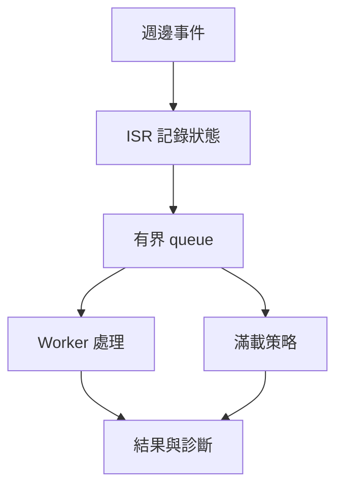

# Embedded System Design｜嵌入式系統設計

> 對應 ECEN 5613；從需求、微控制器到可測試的系統整合。繁體中文＋英文術語。查核：2026-09-29（台北）。這是公開資源整理的自學筆記，不是官方講義或完整考試範圍。

[學習總覽](README.md) · [專案規劃](Projects.md) · [邏輯先修](../Logic_Design.md)

## 目錄

1. [需求與架構](#s1)
2. [CPU、記憶體與開機](#s2)
3. [GPIO、匯流排與時間](#s3)
4. [中斷、DMA 與事件](#s4)
5. [FSM 與故障設計](#s5)
6. [整合、練習與來源](#s6)

<a id="s1"></a>
## 1. 先寫出可驗收的需求

嵌入式系統把計算嵌入實體環境；成功條件通常同時包含正確輸出、期限、耗能、成本與可恢復性。溫度資料最後算對，但風扇晚開十秒，仍可能不合規格。[D1]

| 需求層次 | 模糊說法 | 可測試的自訂規格 |
| --- | --- | --- |
| 功能 | 能讀溫度 | 每 100 ms 接受一筆帶序號樣本 |
| 時間 | 警報很快 | 已接受的高溫樣本在 20 ms 內更新狀態 |
| 故障 | 不會當掉 | 缺資料超過 500 ms 進入 SENSOR_FAULT |
| 資源 | 記憶體很少 | 固定大小 32 筆 queue，滿時記錄 dropped counter |
| 證據 | 測試成功 | 保存輸入、預期狀態、實際狀態與測試版本 |

注意「物理變化到警報」還包含感測器反應與取樣等待，不能和「樣本接受後的期限」混用。以下數值皆為自編教科書型例題，不是產品建議值。

**例 E1：延遲預算。** 每 100 ms 取樣，感測器轉換 8 ms，queue 最壞等待 3 ms，運算 2 ms，輸出 1 ms。若變化剛好發生在上次取樣之後，最壞延遲上界約 114 ms。需求若為 50 ms，不能只把 2 ms 的演算法加快：取樣週期本身已經太長。把週期改為 20 ms，其他條件不變，上界為 34 ms。此加總假設各延遲串接、且界限已成立；共享資源阻塞須另計。

### 1.1 MCU、SBC 與 FPGA

| 平台 | 擅長 | 需要注意 |
| --- | --- | --- |
| MCU | 控制、低功耗、週邊與中斷 | RAM 小、需研究 datasheet |
| Linux SBC | 網路、檔案、複雜應用 | OS 排程與儲存會增加時間變動 |
| FPGA | 平行資料路徑、精確 clock 行為 | HDL、時序約束與硬體工具 |

你的 Raspberry Pi 3 Model B 可作 gateway／Linux 練習平台；它不是 Cortex-M MCU，不能直接執行 Cortex-M 的寄存器範例。Mac 是 host，目標板是 target；cross compiler 的輸出 ISA、ABI、作業系統都必須和 target 相符。

<a id="s2"></a>
## 2. CPU、記憶體映射與開機

CPU 執行指令；bus 連到 RAM、flash 與 peripherals。Memory-mapped I/O 把週邊控制映射成位址，但讀寫可能有副作用，例如 read-to-clear 或 write-one-to-clear。先讀 reference manual，不能對所有 status register 使用 read-modify-write。[D2]

**例 E2：位元欄位。** 普通可讀寫 32-bit config register 的 bits 6:4 要設為 5，其他位保留：

```c
/* Concept only: reg is an ordinary local value, not a real address. */
#include <stdint.h>
uint32_t configure(uint32_t reg) {
    const uint32_t mask = UINT32_C(7) << 4;
    return (reg & ~mask) | (UINT32_C(5) << 4);
}
```

輸入 `0xFFFF` 得 `0xFFDF`。若真實寄存器包含 W1C flags，以上方式可能誤清除事件；需使用硬體指定的 set/clear registers 或專用寫入序列。`volatile` 可表達特定存取不可被一般最佳化略去，但不提供互斥、atomicity 或跨核心記憶體排序。

一般 bare-metal 開機可包含：設定 stack、初始化 `.data`／`.bss`、clock／pin mux、進入 main。Linux 系統還有 bootloader、kernel 與 root filesystem。實際 reset sequence 依晶片而定，不能將一塊板的 startup 檔原封不動搬到另一塊。

**例 E3：RAM 預算。** 32 KiB RAM，global/static 8 KiB、三個 task stacks 各 2 KiB、buffers 6 KiB、預留 4 KiB，剩下 8 KiB。這是配置估計；stack watermark、最深呼叫路徑與 interrupt nesting 還需測試。Heap 可用空間不等於任何時候都能成功配置相同大小的連續區塊。

<a id="s3"></a>
## 3. GPIO、UART、SPI、I²C 與 timer

GPIO input 必須有明確電位；floating input 不能當作可靠 0。Output 的電壓和電流能力取決於器件，motor 或 relay 不能直接接 GPIO 當功率驅動。

| 介面 | 核心概念 | 常見錯誤 |
| --- | --- | --- |
| UART | 非同步串列、兩端約定 baud／frame | 忘了 start/stop bits 與 TX/RX 交叉 |
| SPI | clock、chip select、移位資料 | CPOL/CPHA 不符；選取時間不合規 |
| I²C | SDA/SCL、address、ACK、open-drain | 沒 pull-up；把 7-bit address 與含 R/W 的 byte 混淆 |
| Timer | counter、prescaler、compare/capture | 忽略 ARR+1 或 timer clock 倍頻規則 |

I²C 參考 NXP UM10204；不同速度模式的電氣條件不同。SPI 沒有一份涵蓋所有器件細節的通用 register protocol，command 格式仍看裝置 datasheet。[D3]

**例 E4：UART 與 buffer。** 115200 baud、8N1，每 byte 需 10 bits，因此理想最多 11520 bytes/s。一次 40-byte packet 佔線約 3.472 ms。如果 CPU 最長 20 ms 不消費資料，連續串流可能累積約 231 bytes，256-byte buffer 只有少量餘裕；還需考慮 packet burst 與實際 queue 可用容量。[D4]

**例 E5：timer。** 假設 timer input=48 MHz，prescaler register=47，則 tick=1 MHz；up-counter 從 0 到 ARR=999，一週期 1000 ticks，更新率=1 kHz。公式為 `f_update=f_timer/((PSC+1)(ARR+1))`，僅適用此題指定模式，不直接套用到 center-aligned PWM。

<a id="s4"></a>
## 4. Polling、中斷與 DMA

Polling 不斷查狀態，容易理解但可能空耗 CPU。Interrupt 在事件發生時轉到 ISR；DMA 讓硬體搬運資料，但仍需處理 ownership、completion、cache coherency 與錯誤。DMA 不等於完全沒有 CPU 成本。[D2]

建議 ISR 只做必要的狀態保存、依手冊清 flag、通知 worker；避免無界迴圈、阻塞 I/O、一般 mutex 或大量格式化列印。使用 RTOS 時，只能呼叫文件允許的 ISR API，並遵守 interrupt priority 限制。



**例 E6：burst 不是平均流量。** 每 1 ms 收一筆，consumer 停 30 ms，至少需容納 30 筆，端點同時事件可能多一筆；若 consumer 回來後也只有 1000 筆/s，它不能清除 backlog。要讓 backlog 下降，恢復時的服務率須高於到達率，或允許丟棄／降低流量。

<a id="s5"></a>
## 5. 由 FSM 建立可理解的故障行為

把系統狀態與感測值分開。例如 NORMAL、ALARM、SENSOR_FAULT。先決定 fault 優先順序、警報是否 latch、何時允許 reset，才能寫轉移表。熱控制可用 hysteresis：到 30°C 開風扇、低於 28°C 才關，避免雜訊造成頻繁切換；這些是教學數值。

**公開教材原例導讀。** Valvano/Yerraballi Chapter 10、Table 10.2 是兩道路的四狀態 traffic-light controller。觀察 state 如何同時決定輸出、等待時間與依輸入選擇的下一狀態。本文不複製其程式；自學延伸是把 blocking delay 改成 timer event，並測試「兩個方向不可同時綠燈」的不變量。[D5]

Watchdog 只在有意義的健康條件滿足時餵食。若獨立 thread 不管主工作是否卡死都餵狗，watchdog 失去作用。Reset 後保存 reset cause，並確認 actuator 初始狀態；watchdog 也不能替代功能與時序正確性。

<a id="s6"></a>
## 6. Bring-up、Mac 練習與檢核

先做 host model，再做板級 bring-up。第一次接板依序看供電、reset、clock、最小輸出、單一週邊、整合；保留可重現的已知良好版本。Simulator 能證明模型中的轉移，不能量測真實電壓、EMI 或 IRQ latency。

推薦搭配 [P1 虛擬感測器與韌體核心](Projects.md#p1)。將 sensor read 抽成介面，以 CSV 注入值、時間戳、timeout、超量程。程式不要使用真實 GPIO 地址，Mac 才能安全執行。

### 練習

1. 9600 baud、8N1，50 bytes 最少佔線多久？
2. 16 MHz timer，PSC=15，要 2 kHz 更新，ARR 為何？
3. 為何 `volatile int count; count++;` 仍可能有 race？
4. 每次取樣後相對 sleep 100 ms，而計算花 7 ms，長期取樣週期多少？如何改？

<details><summary>解答</summary>

1. `50×10/9600=52.083 ms`，不含間隔。
2. Tick=1 MHz；需 500 ticks，ARR=499。
3. 遞增含讀、加、寫；另一執行者可能在中間插入。需適合環境的 atomic／critical section／mutex。
4. 約 107 ms；以 absolute next-release time 排程，並明訂超時策略。一般 OS 仍有 jitter。

</details>

### 來源

| ID | 來源 | 用途／閱讀位置 |
| --- | --- | --- |
| D1 | [Lee & Seshia 公開教材](https://ptolemy.berkeley.edu/books/leeseshia/) | Cyber-physical modeling；進一步閱讀，不聲稱抄錄完整教材 |
| D2 | [UT Austin Embedded Systems 電子書](https://users.ece.utexas.edu/~valvano/Volume1/E-Book/) | Chapters 6、7、12；平台特定範例須對照手冊 |
| D3 | [NXP UM10204](https://www.nxp.com/docs/en/user-guide/UM10204.pdf) | I²C 電氣與傳輸規範 |
| D4 | [UT Chapter 11](https://users.ece.utexas.edu/~valvano/Volume1/E-Book/C11_SerialInterface.htm) | UART frame 與串列介面 |
| D5 | [UT Chapter 10](https://users.ece.utexas.edu/~valvano/Volume1/E-Book/C10_FiniteStateMachines.htm) | Table 10.2 公開教材原例 |

數值例題為自編；計算已由 `examples/check_models.py` 交叉驗證。完整硬體專案仍為 planned。
