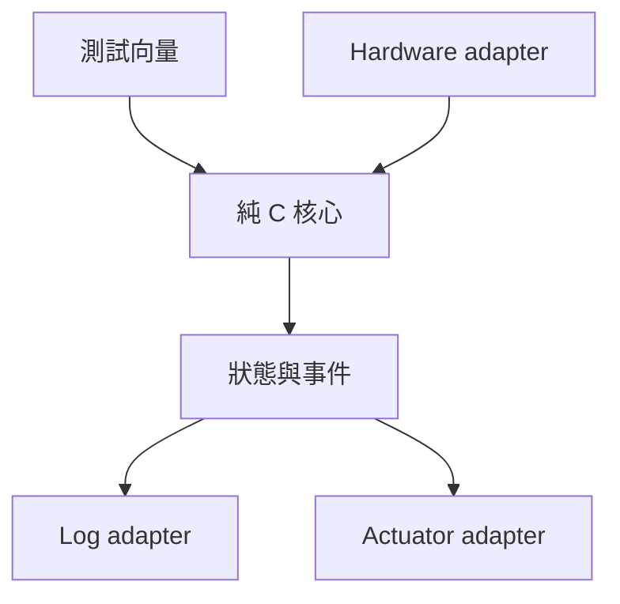

# Embedded Software + Advanced Embedded Linux｜嵌入式軟體整合筆記

> 合併 ECEN 5813 Principles of Embedded Software 與 ECEN 5713 Advanced Embedded Software Development。先學可測試 C，再進 Linux 系統程式與建置。查核：2026-09-29。

[總覽](README.md) · [P1](Projects.md#p1) · [P3](Projects.md#p3) · [P8](Projects.md#p8)

## 目錄

1. [C 的資料與生命週期](#s1)　2. [模組與測試](#s2)　3. [Build 與除錯](#s3)　4. [Linux 系統程式](#s4)　5. [Embedded Linux](#s5)　6. [更新、安全與練習](#s6)

<a id="s1"></a>
## 1. 寫 C 前先描述資料契約

函式契約包含可接受輸入、長度、所有權、生命週期、回傳值與錯誤。`uint8_t *data` 只表明指標型別，不表明有多少可讀 bytes；需另傳長度。函式回傳 local array 的位址，在函式結束後已失去有效生命週期。

| 情境 | 風險 | 設計方式 |
| --- | --- | --- |
| 有號運算溢位 | C 中通常是 undefined behavior | 運算前檢查或使用足夠寬型別 |
| 無號減法 | 模數回繞，可能意外變很大 | 先檢查範圍，必要時明示模數假設 |
| Network packet cast 成 struct | Alignment、padding、endianness | 逐 byte decode，檢查長度 |
| Heap 配置 | 失敗、碎片、生命週期複雜 | 有界buffer、清楚ownership |
| `volatile` 共享資料 | 仍可能data race | C atomics或適合平台的鎖 |

**例 S1：little-endian decode。** Bytes `{0x34,0x12}` 表示0x1234=4660。使用 `(uint16_t)p[0] | ((uint16_t)p[1] << 8)`，先確認至少2 bytes；不假設host的byte order。

### 1.1 Ring buffer 的不變量

Head是下次寫位置、tail是下次讀位置。選擇「保留一格」方案：head==tail表示empty，`(head+1)%N==tail`表示full，有效容量N−1。另一方案以count區分full/empty；不要混合兩個定義。

**例 S2：容量。** N=8、head=6、tail=2，count=(6−2+8)%8=4；再push三筆後full，第四筆須依策略拒絕。多執行緒下head/tail更新還需memory ordering，本文單執行緒練習不能直接當lock-free實作。

<a id="s2"></a>
## 2. 把平台相依部分放到邊界



核心接收已定義的sample與timestamp，輸出事件；sensor adapter處理I²C，log adapter寫檔。這種拆分讓Mac先測核心，再換真實週邊。不是每個函式都需抽象一層；只有真正要替換或隔離的界面才增加介面。

**例 S3：錯誤處理。** Decode介面應區分SHORT_PACKET、BAD_VERSION、OUT_OF_RANGE。回傳0同時代表「0°C」與「讀取失敗」會使caller無法正確判斷。傳遞result與status，並保留錯誤count。

測試由小到大：unit tests確認轉換與邊界；integration tests確認模組協定；system tests確認完整情境。Coverage指出哪些程式經過，不表示預期結果正確。Sanitizer可發現某些記憶體錯誤，但不能替代需求測試。[S1]

<a id="s3"></a>
## 3. 編譯、連結與除錯

Preprocess→compile→assemble→link。Header提供宣告；source提供定義；linker解決symbols並安排sections。Cross build還需符合target的compiler、sysroot與libraries。`sizeof(int)`、pointer寬度等不能以Mac結果代替MCU。

**例 S4：精度與溢位。** 1000筆12-bit unsigned ADC相加，最大4,095,000，小於2³²，`uint32_t`可容納；`uint16_t`不行。先累加再除1000可避免每筆先整數除法造成的過度截斷。

本目錄附完整可編譯的 `examples/firmware_core.c`：測little-endian decode、overflow guard與ring buffer。

```sh
cc -std=c11 -Wall -Wextra -Werror -O0 -g ESE_Core/examples/firmware_core.c -o /tmp/firmware_core
/tmp/firmware_core
```

若編譯器支援，可另用 `-fsanitize=address,undefined -fno-omit-frame-pointer`。本次在工作環境編譯與執行，未在你的M2實機執行。Mac可用Apple command-line development tools提供的compiler；安裝屬後續project setup。

除錯順序：重現最小輸入→確認contract→加assertion／breakpoint→找首次出錯位置→回歸測試。不要只在最終crash位置加null check掩蓋上游錯誤。

<a id="s4"></a>
## 4. Linux processes、threads 與 I/O

Process有自己的虛擬位址空間；同process的threads共享大部分記憶體，各自有執行狀態與stack。共享讓資料交換方便，也需要同步。[S2]

| 機制 | 適合 | 邊界 |
| --- | --- | --- |
| Pipe | 單機byte stream | 沒有應用訊息邊界 |
| Socket | 網路／單機IPC | TCP一次send不等於一次recv |
| Shared memory | 大量共享資料 | 同步、ownership由應用處理 |
| Mutex + condition variable | 協作與等待條件 | 等待要在predicate迴圈中檢查 |

**例 S5：TCP framing。** 發送兩個10-byte records，receiver可能讀到4、9、7 bytes。先累積，解析固定header與length，再等完整payload。不能假設`recv(20)`必回20，也不能把半包當錯誤封包。

`read`／`write`可能短讀短寫；read回0對一般stream代表EOF；負值需要檢查errno，`EINTR`可按操作語義重試。Socket nonblocking還要處理`EAGAIN`／`EWOULDBLOCK`。錯誤重試必須有timeout與終止條件。

**公開教材原例導讀。** OSTEP的Concurrency introduction用共享counter說明非原子read-modify-write。不要只記得「加鎖」：先列出可能的交錯，再指出需要保護的不變量。本文的S6是另設的數字。[S2]

**例 S6：lost update。** Counter=10；A與B都讀到10，各算11，各寫11，兩次increment後實際11而非12。若每次完整更新持同一mutex，結果才依序變11、12。

### 4.1 Linux-specific與macOS POSIX的差別

Mac可學多數C、檔案與socket概念，但`epoll`、Linux kernel modules、`/proc`等不是macOS功能。這些練習用Linux VM；不要在Mac host照貼kernel命令。Thread排程優先權提高不等於hard real-time保證。

<a id="s5"></a>
## 5. Embedded Linux：從host到root filesystem

| 名詞 | 功能 |
| --- | --- |
| Bootloader | 初期硬體設定與載入kernel；流程依板而異 |
| Kernel | 排程、記憶體與drivers |
| Device tree | 描述非自動探測硬體；不是driver本身 |
| Root filesystem | 程式、libraries、設定與init |
| Buildroot／Yocto | 可重建系統映像的框架；不是同一工具的別名 |

Buildroot生成toolchain／kernel／rootfs等組件，使用Linux build host。保存defconfig、board overlay、package recipe、source hashes與版本，才能重建。只備份一張SD card image不等於可維護的build流程。[S3]

**例 S7：部署的ABI。** Mac編譯的Mach-O arm64 executable不能因為Raspberry Pi也有Arm CPU就直接當Linux ELF執行。ISA僅是條件之一；OS ABI、dynamic loader、library版本也要符合。

QEMU模擬的是選定machine model；不能隨便拿任意Raspberry Pi image期待完整週邊都支援。先使用文件明確支援的target與對應image配置，再進真實板。[S4]

### 5.1 Driver與user space的責任

Driver以kernel提供的接口管理裝置；user process不能直接當kernel pointer使用。Kernel context限制（是否可sleep、持何種lock、copy_to/from_user）會影響正確性。先在disposable Linux VM做user-space服務與虛擬device，再研究driver。Kernel API會變，舊書範例需對照當前文件。[S5]

<a id="s6"></a>
## 6. 更新、診斷與練習

可靠更新要考慮完整性、來源真實性、版本相容、斷電、rollback與storage。Checksum能偵測部分損壞，但不是數位簽章。A/B partition的inactive image經驗證後才切換，首次開機未通過health check則rollback；實際bootloader支援與atomic metadata更新仍需設計。

**例 S8：更新空间。** 兩份64 MiB系統image需128 MiB，外加bootloader、metadata與persistent data。128 MiB flash不代表剛好能用，因為不能漏掉其他區域。這是空間模型，不是已實作OTA。

### Mac路線

P1先在原生Mac做C core；P3在Linux VM做network service；P8再做Buildroot/QEMU。ECEN5713公開Spring2026頁面仍指定x86-64 host，本筆記的M2自學方案不聲稱等同課堂支持配置，入學前須確認當期要求。[S6]

### 練習

1. N=16、保留一格的ring能放幾筆？
2. TCP傳100 bytes，read只回30是否必然丟包？
3. 為何在ISR／持spinlock時不能任意呼叫可能sleep的函式？
4. Unit tests全過是否代表driver與實機都正確？

<details><summary>解答</summary>

1. 15筆；full/empty表示法需要那一格。
2. 不一定，stream可分段交付；繼續讀並依framing組包。
3. Context不允許阻塞或持鎖者無法排出，可能違反kernel規則／造成死鎖；查具體API與context。
4. 不能，尚有ABI、integration、timing與硬體差異。

</details>

| ID | 原始來源 | 對應內容 |
| --- | --- | --- |
| S1 | [Clang AddressSanitizer](https://clang.llvm.org/docs/AddressSanitizer.html) | 記憶體錯誤檢查及限制 |
| S2 | [OSTEP，作者公開書](https://pages.cs.wisc.edu/~remzi/OSTEP/) | Processes、Concurrency introduction、Locks、Condition Variables |
| S3 | [Buildroot manual](https://buildroot.org/downloads/manual/manual.html) | Host requirements、configuration、project customization |
| S4 | [QEMU Arm system docs](https://www.qemu.org/docs/master/system/target-arm.html) | Machine models與emulation邊界 |
| S5 | [Linux Driver Basics](https://docs.kernel.org/driver-api/basics.html) | Kernel API與context限制 |
| S6 | [ECEN5713公開課程頁](https://sites.google.com/colorado.edu/ecen5713/home) | 進階課範圍與歷史host要求 |

這裡的例題與C core為自編；大型project、driver、OTA部署為planned。
