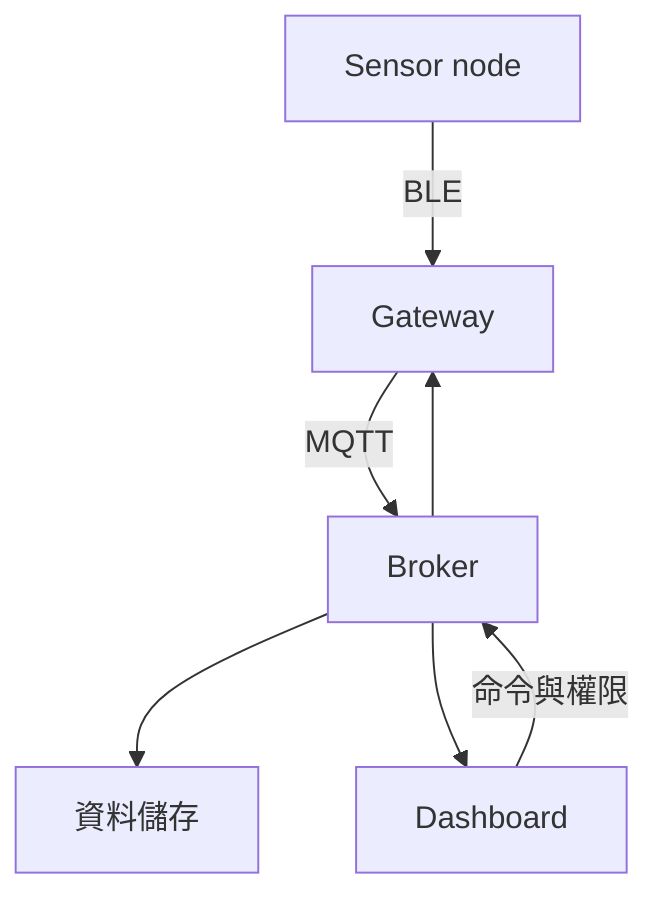

# IoT Firmware + Industrial IoT｜物聯網韌體與工業延伸

> 主課 ECEN 5823，整合 ECEN 5773 的工業應用延伸。兩者不是校方正式命名的上下學期課；本文件為自學合併。查核：2026-09-29。

[總覽](README.md) · [專案 P4](Projects.md#p4)

## 目錄

1. [系統與事件模型](#s1)　2. [BLE](#s2)　3. [MQTT／gateway](#s3)　4. [安全與可靠性](#s4)　5. [Industrial IoT](#s5)　6. [練習與來源](#s6)

## 1. Node、gateway、broker 與 application

Sensor node負責取樣與有限處理；gateway可轉換BLE與IP應用協定；broker分發訊息；application儲存、顯示與決策。不是每個node都需要直接連Internet。ECEN5823官方說明著重低能耗、event-driven firmware與BLE／Thread類wireless protocols；MQTT是本文的應用層延伸，不能替代BLE韌體內容。[I1]

Event-driven firmware把事件送給狀態機：BOOT→IDLE→SAMPLING→REPORTING，再回IDLE。每個事件handler應有界，長工作切段或移至worker，否則會阻塞其他事件。應處理timeout、busy、retry與disconnect，而非只寫成功路徑。

**例 I1：狀態逾時。** ADC開始後預期10 ms完成；設定15 ms timeout。若逾時，應取消／標記舊請求並進入錯誤處理；遲到的completion需用request_id辨認，避免當作下一次取樣。15 ms只是題目設定，真實值由datasheet與排程分析決定。

## 2. Bluetooth Low Energy：不要混淆角色

| 層次 | 問題 | 術語 |
| --- | --- | --- |
| GAP／link | 誰advertise、scan、建立連線？ | Peripheral、central等角色 |
| ATT／GATT | 資料如何被組織與存取？ | Attribute、service、characteristic、descriptor |
| Application | 此值代表什麼？ | 單位、比例、版本、有效旗標 |

GATT server保存attributes，client發起操作；central不必永遠等於client。Notification沒有ATT層confirmation；indication有confirmation，但都不等於「資料已永久寫入資料庫」。不可把notification直接說成完全無線鏈路重傳。[I2]

**例 I2：payload長度。** 對一般ATT Handle Value Notification，ATT_MTU=23時value最大20 bytes（扣opcode1+handle2）；MTU=247時可為244 bytes。這不保證單一link-layer packet或指定throughput；還受data length、PHY、connection interval、event長度與peer限制。

**例 I3：二進位感測值。** 自訂temperature characteristic使用signed16 little-endian，單位0.01°C。25.34°C→2534→0x09E6→bytes E6 09；−5.00°C→−500→16-bit二補數0xFE0C→0C FE。Schema必須同時寫明signedness、byte order、scale與無效值，不只給UUID。

### 2.1 Connection與功耗

廣播間隔越短，通常越容易被發現但radio活動更多；連線參數影響延遲與耗能。不要只看平均資料bytes/s，還需計算connection events、receive windows與重傳。實際可接受參數由雙方stack與規範決定，不能任意設定後假設peer接受。

BLE pairing、bonding、encryption、application authorization是不同層次。連線加密不自動代表所有client都能下控制命令。Mac可先mock GATT資料與狀態機；真實radio測試需合適peer與硬體，列為planned。

## 3. MQTT：傳送保證不等於業務保證

MQTT透過broker按topic分發。Payload是application定義的bytes；topic、schema與timestamp都屬系統契約。[I3]

| QoS | 傳輸語義 | 應用注意 |
| --- | --- | --- |
| 0 | At most once | 可能遺失 |
| 1 | At least once | 可能重複，consumer需idempotency |
| 2 | Exactly once 的協定交付流程 | 不保證跨DB／actuator的業務交易恰一次 |

Retained message保存某topic的最近retained值，不是歷史資料庫；新subscriber可能取得舊狀態。Last Will可表示非正常斷線，但偵測與發布不會瞬間發生，需考慮keep-alive與Will Delay等設定。

**例 I4：去重。** 封包使用 `(device_id, boot_id, seq)` 當key。QoS1重送同key時，DB以unique constraint避免多插入；重新開機seq歸0但boot_id不同，仍是新資料。這不是單靠MQTT設定能做到的效果。

建議schema：`schema_version, device_id, boot_id, seq, sample_time, value, unit, quality`。若node無UTC，記錄monotonic ticks與gateway receive time；不要假裝兩者是同一時間。

**例 I5：離線容量。** 每秒1筆，每筆序列化120 bytes，離線24h需10,368,000 bytes≈9.89 MiB（未含index、filesystem、重送metadata）。設定有界outbox、滿載策略與重連限速；無界retry可能耗盡disk。

## 4. Reliability、安全與OTA設計

| 故障 | 需要的機制 | 測試方式 |
| --- | --- | --- |
| Broker停機 | Backoff、bounded queue | 關閉本機broker後復原 |
| 訊息重複 | Idempotent consume | 重播相同seq |
| 舊值 | TTL／timestamp／quality | 注入過期樣本 |
| 憑證錯誤 | 拒絕連線並記錄原因 | 測試憑證、錯hostname |
| 更新斷電 | 驗證、rollback、狀態原子化 | 先用檔案模型注入各階段中斷 |

TLS驗證server身分與傳輸保護，topic ACL限制權限。裝置credential不能直接commit到GitHub。關閉certificate verification不是修好TLS。專案先綁定localhost，設計明確後再擴展網路部署。

**例 I6：backoff。** 自訂base=1s，cap=32s，full jitter範圍`[0,min(32,2^k)]`。k=0..5上界1、2、4、8、16、32s；成功後重設。這是設計選擇，不是MQTT強制規範。固定random seed可做可重現測試。

## 5. 工業延伸：資料價值與控制責任

IIoT不只是多裝幾個sensor。需考慮設備壽命、斷網運作、維護窗口、校正、資產識別與安全域。分析用途常可接受秒級延遲；快速閉迴路控制通常應放在本地控制器，不能把一般Internet連線當成有界deadline通道。[I4]

**例 I7：maintenance指標。** 假設motor振動RMS由0.2升到0.6（自訂normalized units），可觸發「需檢查」事件，但不能沒有fault label與驗證就宣稱預測軸承壽命。分開raw data、feature、alert與maintenance outcome，才能追查誤警報。

數位分身（digital twin）是與實體資產有資料關聯的模型；尚未接實體時，本專案稱simulator／virtual node較準確。模型的prediction error要量化，不能只以漂亮dashboard當成模型驗證。

### 公開資料閱讀與例題類型

BLE primer是標準組織教學文件；MQTT是規格，並非有統一課後題號的教科書。I1–I7皆為依規格自編的教科書型例題，無冒稱商業教科書原題。[I2][I3]

## 6. 練習

1. ATT_MTU=100，notification value理論最大？
2. QoS1能否讓「馬達多轉一次」的side effect自然去重？
3. 10 devices各2samples/s，每筆100bytes，1小時payload量？
4. Retained溫度是否保證現在還有效？

解答

1. 97 bytes，仍受實際stack與其他限制。
2. 不行；需應用command_id、持久化狀態與執行協定。
3. 10×2×100×3600=7,200,000bytes，約6.87MiB，不含protocol overhead。
4. 不保證；需時間與quality判斷。

| ID | 來源 | 範圍 |
| --- | --- | --- |
| I1 | [CU ECEE course catalog](https://catalog.colorado.edu/graduate/colleges-schools/engineering-applied-science/programs-study/electrical-computer-and-energy-engineering/) | ECEN5823公開描述 |
| I2 | [Bluetooth SIG LE Primer](https://www.bluetooth.com/bluetooth-le-primer/) | GAP、ATT、GATT與資料操作 |
| I3 | [OASIS MQTT 5.0](https://docs.oasis-open.org/mqtt/mqtt/v5.0/os/mqtt-v5.0-os.html) | §4.3 QoS、retain、session、Will |
| I4 | [CU Industrial IoT公開概述](https://www.colorado.edu/ali/developing-industrial-internet-things-specialization) | 工業應用學習方向；非校內5773逐堂課程替代 |
| I5 | [Eclipse Mosquitto官方下載](https://mosquitto.org/download/) | 本機broker，macOS安裝入口 |

P4為planned，未宣稱完成BLE硬體、TLS deployment或OTA。
