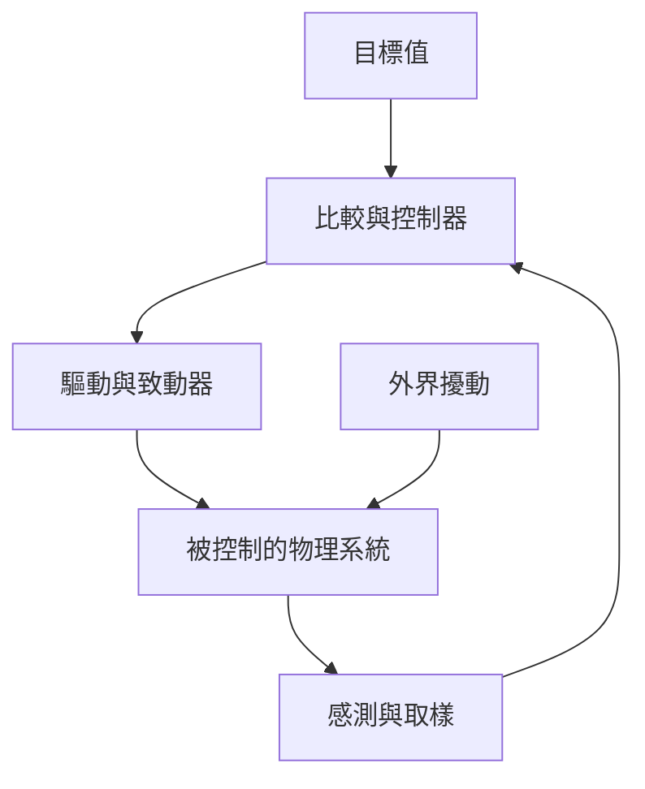

# Embedding Sensors and Motors｜感測、取樣與馬達控制

## 入門導讀｜量測、判斷與控制是三件不同的事

感測器把物理量轉成可讀訊號；估測與濾波從訊號提取資訊；控制器依目標與量測決定輸出；致動器把輸出轉成力量、速度或其他物理效果。知道溫度不等於能控制溫度。

| 名詞 | 白話定義 |
| --- | --- |
| Calibration 校正 | 建立讀值與參考物理量的對應 |
| Accuracy 準確度 | 與真實或參考值接近的程度 |
| Precision 精密度 | 重複量測彼此接近的程度 |
| Resolution 解析度 | 能分辨的最小變化尺度；不保證準確 |
| Offset / gain error | 整體偏移／比例斜率錯誤 |
| ADC | 類比數位轉換器：把輸入電壓轉成數位碼 |
| Sampling 取樣 | 在離散時間點觀察訊號 |
| Quantization 量化 | 把連續幅度對應到有限個數位碼 |
| Aliasing 混疊 | 不同連續訊號在取樣後難以區分 |
| Filter 濾波器 | 依頻率或其他規則調整訊號成分 |
| Feedback 回授 | 使用輸出量測修正控制動作 |
| Setpoint 目標值 | 希望被控制量達到的值 |
| Error 誤差 | 控制中常定義為目標減量測 |
| Saturation 飽和 | 致動器到達輸出上限或下限 |

### 逐步例子：12-bit ADC 的數字怎麼變成電壓？

12 bits 有 4096 個碼，通常標成 0 到 4095。假設理想量化步階為 3.3/4096 V，約 0.806 mV。碼值 2048 的對應電壓約 1.65 V；實際端點定義、參考電壓誤差和轉換特性仍看器件。若感測器標定關係為 V=0.5+0.01T，則 T=(1.65−0.5)/0.01=115°C。這只是自編校正模型，不代表所有溫度感測器。

> [!WARNING]
> 12-bit 解析度不表示讀值有 12-bit 的有效準確度。雜訊、偏移、參考源、非線性與校正都會影響最終結果。

### 不用微積分先懂 P 與 I

P（比例）讓目前誤差越大，修正越大；I（積分）累積過去誤差，讓持續的小偏差也逐步得到修正。積分就像把每一小段時間的「誤差×時間」加起來。微分 D 則對誤差變化趨勢敏感，也容易受到雜訊影響。

**自編例子：** 目標 100 rpm，量測 90 rpm，誤差 10 rpm。若 Kp=0.02/rpm，比例項為 0.2（把輸出定義成 0–1 比例）。這只是控制訊號，不代表轉速立刻變成 100；馬達、負載與供電需要時間反應。I 項過度累積且輸出已飽和會造成 windup，後文再談 anti-windup。

> [!TIP]
> 畫曲線時標清楚橫軸時間、縱軸物理量與單位。先問「這是感測電壓、估計溫度、目標值，還是控制輸出？」再解讀曲線。
> [!NOTE]
> 本篇按領域概念組織，從基礎走向進階；課程代碼不代表先備要求。原有來源與例題保留供第二輪深入閱讀。

[學習總覽](README.md) · [共通基礎](../Foundations.md)

## 目錄

1. [量測與校正](#s1)　2. [ADC與濾波](#s2)　3. [感測器選型](#s3)　4. [馬達模型與驅動](#s4)　5. [控制與驗證](#s5)　6. [練習與來源](#s6)

## 1. 感測值不是物理量本身

完整鏈：物理量→transducer→signal conditioning→ADC→calibration→filter→decision。每一段都可帶入offset、gain error、noise、delay或saturation。Accuracy、precision、resolution是不同概念；12-bit ADC不表示整套系統有12-bit accuracy。[M1]

**例 M1：兩點校正。** 已知0°C時讀100counts、100°C時讀3100counts，採線性模型T=a·code+b：a=100/3000=1/30°C/count，b=−100/30°C。讀1600得到50°C。超出校正區間是extrapolation，不保證仍線性；應保存校正日期、reference與residual。

**例 M2：error budget。** 獨立、零均值random errors的標準差分別0.2與0.3°C，RSS≈0.3606°C；若兩者是有方向的最壞界限，不能直接用RSS，保守加總為0.5°C。偏差不會因多取樣平均自然消失。

## 2. ADC、aliasing與filter

> [!NOTE]
> **讀這一節前：** Sampling rate 是每秒取幾點；signal bandwidth 描述需要保留的頻率範圍。Nyquist 條件針對有界頻寬理想訊號，實際通常還需類比 anti-alias filter（抗混疊濾波器）和轉換帶餘裕。取樣後再濾波無法一般性恢復已混疊的資訊。

理想N-bit單極性ADC的code bin寬常以`q=Vref/2^N`描述；端點校正formula有時用`2^N−1`映射最大code到滿刻度，兩種定義不能混用。題目必須說明採哪個模型。[M2]

**例 M3：量化。** 12bit、Vref=3.3V，q=0.805664mV；理想midpoint重建誤差在未飽和區約±q/2=±0.402832mV。這沒有包含noise、INL、reference error與輸入settling。

對band-limited signal，sampling rate須高於兩倍最高頻率才有理想重建的基礎；實際filter需transition band，所以不能總是剛好選2倍。Analog anti-alias filter在ADC前，digital filter不能把已折疊的不同頻率分開。[M1]

**例 M4：alias。** 900Hz sine以1000samples/s取樣，會對應100Hz的alias（相位／符號可能不同）。看到100Hz峰值不代表原始環境一定有100Hz來源。

**例 M5：moving average。** 長度5、fs=100Hz，線性相位group delay=(5−1)/(2×100)=20ms。對independent white noise，標準差約除√5；對相關noise或drift不保證此改善。Filter把訊號變平滑，也可能延遲alarm。

一階IIR：`y[k]=αx[k]+(1−α)y[k−1]`，0<α≤1；α小反應慢。初值與啟動暫態也應列入測試，不只比steady-state。

## 3. 感測器與encoder

| 類型 | 適合學習的現象 | 誤差／介面問題 |
| --- | --- | --- |
| Thermistor／RTD／thermocouple | 溫度與轉換／補償 | 自熱、非線性、lead resistance、冷接點 |
| Shunt／Hall sensor | 電流 | 壓降與隔離、offset、頻寬 |
| Optical／magnetic encoder | 位置與速度 | Counts定義、噪聲、低速量化 |
| IMU | 加速度與旋轉率 | Bias、座標系、積分drift |
| 光照／壓力感測 | 環境monitoring | 光譜／溫度敏感度與calibration |

ECEN5853公開頁面也以EV、wind與solar場景連結sensor和motor；這裡聚焦能跨平台運用的measurement與control基礎，不聲稱涵蓋全部能源系統。[M3]

**例 M6：encoder速度。** 明定decoder輸出為1024counts/revolution（已包含所用x4解碼，不再乘4）。50ms量到256counts，速度=(256/1024)/0.05=5rev/s=300rpm。若只看到「256PPR」而未定義edge counting，答案可能差四倍。

低速可改量兩脈衝間隔提升解析度，但更新慢；高速用固定window計數較方便。混合估測必須定義切換與timeout，不可在停轉時除以零。

## 4. DC motor：電氣與機械耦合

> [!NOTE]
> **讀這一節前：** DC motor 是直流馬達。Torque 是轉矩，angular speed 是角速度，inertia 是轉動慣量。Back EMF 是馬達轉動產生、抵抗輸入的電動勢。d/dt 表示某個量每單位時間的變化率；可先把方程讀成「輸入如何被各種效應分配」。

簡化brushed DC motor模型：

$$V=L\frac{di}{dt}+Ri+K_e\omega,$$
$$J\frac{d\omega}{dt}=K_ti-b\omega-\tau_L.$$

i為A，ω為rad/s，J為kg·m²，τ為N·m。SI且相符定義下Ke與Kt數值可相同，單位不同。此模型省略摩擦非線性、磁飽和、gear backlash與driver細節。[M4]

**例 M7：stall current。** V=6V、R=2Ω、轉子卡住時ω=0，忽略driver且看電氣steady-state，i=3A。不是馬達一開機瞬間就必為3A，電感限制di/dt；但driver與供電必須考慮startup／stall負荷，不能只按正常空載電流選型。

PWM duty控制施加電壓的時間比例；在理想模型與合適切換條件下可用average voltage近似，但duty不等於speed百分比。Load、back EMF與driver損失會改變速度。H-bridge提供雙向電流路径，需考慮續流、dead time與shoot-through。

**公開教學案例導讀。** University of Michigan CTMS的DC Motor Speed使用J=0.01、b=0.1、K=0.01、R=1、L=0.5建立線性模型。本文以這些公開模型參數另行驗算，並不複製其圖。[M4]

**例 M8：公開模型的steady-state驗算。** τL=0時i=bω/Kt；代入V=Ri+Keω，得ω=V·Kt/(Rb+KeKt)。上述數值、V=1時ω≈0.0999001rad/s，與教材約0.1rad/s的敘述相符。這是教學模型，不是一顆已指定型號馬達的實測。

## 5. Feedback、PI與飽和

Setpoint r與measurement y的error e=r−y；controller產生u，經driver與plant改變y。P加快反應但可能有steady-state error；I累積誤差可消除某些偏差，但saturation時可能wind up；D對變化敏感也容易放大noise。

離散PI的簡化實作：`integral += e*dt; u_raw=Kp*e+Ki*integral; u=clamp(u_raw,umin,umax)`。僅clamp輸出不能防止integral持續累積；可採conditional integration或back-calculation，並寫明方法。

**例 M9：飽和。** 目標10、量測0，Kp=0.2、Ki=0.5、dt=0.1s、integral起始0，第一次integral=1，u_raw=2.5。若範圍0..1，u=1；下一次不能因為仍只輸出1就忽略integral已增加。P6要求比較有／無anti-windup的恢復時間。

模擬先用獨立plant model與controller，不要controller直接寫入desired measurement。Euler法有步長誤差；以dt減半檢查收斂，必要時用較高階求解器。模型稳定不等於真實馬達稳定，delay與saturation必須納入。

**實際應用：** 風扇轉速控制、輸送帶、solar tracker與位置平台。先做低電壓模擬專案；之後若上motor，需要driver、獨立合適電源、保護與mechanical constraints，GPIO僅輸出控制訊號。

## 6. 練習

1. 10bit、2.5V ADC的ideal bin寬？
2. 2048counts/rev，0.1s讀1024counts，rpm？
3. 長度9、fs200Hz moving average的group delay？
4. 為何調大Ki未必讓系統「更好」？

解答

1. 2.5/1024≈2.4414mV。
2. 0.5rev/0.1s=5rev/s=300rpm。
3. 8/(2×200)=0.02s=20ms。
4. 積分增加可能引發overshoot、oscillation、windup；需看plant、delay與穩定裕度。

| ID | 來源 | 內容／限制 |
| --- | --- | --- |
| M1 | [UT Chapter14](https://users.ece.utexas.edu/~valvano/Volume1/E-Book/C14_ADCdataAcquisition.htm) | Data acquisition、sampling與control |
| M2 | [Analog Devices MT-001](https://www.analog.com/media/en/training-seminars/tutorials/MT-001.pdf) | Ideal quantization；公式有輸入與noise假設 |
| M3 | [ECEN5853公開頁](https://sites.google.com/colorado.edu/ecen5853/home) | Sensors／motors的EV、wind、solar脈絡 |
| M4 | [Michigan CTMS Motor Speed](https://ctms.engin.umich.edu/CTMS/?example=MotorSpeed&section=SystemModeling)及[System Analysis](https://ctms.engin.umich.edu/CTMS/?example=MotorSpeed&section=SystemAnalysis) | 公開模型與steady-state數值；本次全文抓取受403限制，參數／方程由官方索引可見內容交叉核對與代數重算 |

模型與例題已有數值驗算；motor hardware、閉迴路實測與P6工具為planned。
