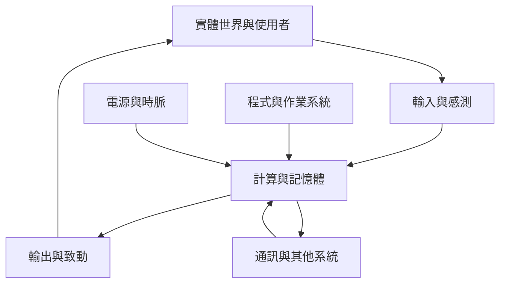

# Foundations｜從零建立電腦與嵌入式系統概念

> [!NOTE]
> 這套筆記是入學前的領域基礎教材。先理解「在解決什麼問題」，再記名詞與公式。它涵蓋主要概念與進階入口，並非宣稱涵蓋所有研究方向。例題以自編為主；公開教材原例會另外標出出處。

## 1. 先看到全貌

電腦把輸入轉成資料，依照程式處理，保存結果，再交給人或其他裝置。嵌入式系統把這個過程放進汽車、家電、醫療儀器等實體設備，還須考慮時間、能源與環境。相同基本觀念也適用於一般電腦，不需要先有某塊開發板。

| 領域 | 它回答的問題 | 日常例子 | 先備 |
| --- | --- | --- | --- |
| 邏輯設計 | 如何用 0、1 表示判斷與記憶？ | 電梯控制狀態 | 基本代數 |
| 資料結構 | 資料怎麼擺，才方便操作？ | 聯絡人搜尋、播放清單 | 變數與迴圈 |
| 計算機組織 | 一條程式指令如何被執行？ | 讀出照片像素並加亮 | 位元、邏輯閘 |
| 計算機架構 | 如何讓整體系統有效率？ | 多核心影片處理 | 組織與效能單位 |
| 嵌入式設計 | 計算如何連接真實裝置？ | 洗衣機讀按鍵、轉馬達 | 組織與基本電學 |
| 即時系統 | 結果能否在期限內完成？ | 定時控制迴圈 | 工作與排程概念 |
| 嵌入式軟體 | 程式如何可靠地管理資源？ | 裝置開機、檔案與更新 | 程式、記憶體 |
| 物聯網 | 多台裝置如何交換可信資料？ | 智慧電表 | 通訊與軟體 |
| 低功耗 | 如何減少每次服務消耗的能量？ | 無線滑鼠 | 電壓、電流、時間 |
| 感測與控制 | 如何量測並調整實體世界？ | 恆溫與轉速控制 | 代數、圖形、基本電學 |
| FPGA | 如何配置可平行工作的數位電路？ | 影像串流處理 | 邏輯設計 |

## 2. 位元、數字、資料：同一組圖樣有不同意義

**Bit（位元）**只能取 0 或 1。**Byte（位元組）**在本教材採 8 bits。四位元 `0101` 若當無號二進位整數，值為 5；若當四盞燈的開關，它表示其中兩盞亮。資料本身的位元圖樣不會告訴你意義；意義由資料格式約定。

**編碼 encoding** 是把資訊對應到圖樣的規則；**型別 type** 決定允許的值與操作。例如字元、整數、浮點數不能只因占用同樣位元數就互換解讀。

| 表示法 | 說明 | 同一個值的例子 |
| --- | --- | --- |
| 十進位 decimal | 每位權重為 10 的次方 | 13 |
| 二進位 binary | 每位權重為 2 的次方 | 1101：8+4+0+1 |
| 十六進位 hexadecimal | 一位相當於四個 bits | 0xD |
| 位址 address | 儲存位置的編號 | 位址 13 裡可以存值 42 |

> [!IMPORTANT]
> **位址不是內容。** 如同門牌 13 號和住在裡面的人不同。指標 pointer 是用來參照某個位置的值；指標大小也不等於它所指資料的大小。

## 3. 從程式到電路的層次

**演算法 algorithm** 是解題步驟；**程式 program** 是用語言表達的步驟；**指令 instruction** 是處理器能識別的操作；**電路 circuit** 是實現操作的元件連接。以把兩個數相加為例：程式寫 `c=a+b`，編譯器可能產生載入、加法、儲存等指令；硬體的加法器則用邏輯閘計算。

| 常見名詞 | 白話解釋 | 不應混淆 |
| --- | --- | --- |
| CPU / processor | 依指令執行運算的處理器 | 不是整台電腦 |
| Register 暫存器 | CPU 內快速保存少量資料的位置 | 週邊控制寄存器有另一種用途 |
| RAM | 執行中讀寫的工作空間，通常斷電失去內容 | 不是永久磁碟 |
| Flash | 斷電可保留資料的記憶體 | 寫入與抹除限制不同於 RAM |
| Bus 匯流排 | 元件交換位址、資料或控制的通路 | 不一定是一組共享平行導線 |
| Peripheral 週邊 | CPU 以外提供特定 I/O 功能的元件 | 不一定在晶片外面 |
| OS 作業系統 | 管理 CPU、記憶體、裝置等資源的軟體 | 不是 CPU 硬體 |
| Firmware 韌體 | 用於裝置控制的軟體 | 不是另一種電路材料 |
| Driver 驅動程式 | 把軟體操作轉成特定裝置操作 | 不等於所有應用邏輯 |
| API | 軟體元件約定的呼叫方式 | 不等於硬體接腳 |

## 4. 讀公式前先懂單位

頻率 frequency 是每秒重複幾次，單位 Hz；週期 period 是一次多久，單位 s。兩者互為倒數。1 kHz = 1000 Hz，週期就是 1 ms。`k`、`M`、`G` 依序是千、百萬、十億；`m`、`μ`、`n` 依序是千分之一、百萬分之一、十億分之一。

**自編逐步例題 F1：** 每筆資料 20 bytes，每秒 50 筆。先寫「每筆大小 × 每秒筆數」，得到 1000 bytes/s，再乘每 byte 的 8 bits，得到 8000 bits/s。這只是資料本體；通訊標頭、重傳等會額外占用頻寬。b/s 和 B/s 相差 8 倍。

| 量 | 意義 | 基本關係 |
| --- | --- | --- |
| 電壓 V | 每單位電荷的能量差 | 可類比推動電流的壓力，但類比有限 |
| 電流 A | 每秒通過的電荷量 | 1 mA = 0.001 A |
| 電阻 Ω | 在歐姆性元件中限制電流 | V = IR |
| 功率 W | 每秒消耗或轉換的能量 | 直流固定條件下 P = VI |
| 能量 J | 一段時間累計的消耗 | 固定功率時 E = Pt |
| 容量 KiB | 二進位容量單位 | 1 KiB = 1024 bytes；1 kB = 1000 bytes |

> [!TIP]
> 算式寫完先看單位。`bytes ÷ (bytes/s)` 應得到秒；若得到秒的平方，表示公式或代入有問題。

## 5. 時間、狀態、事件：全書共用的三個觀念

**狀態 state** 是需要記住的資訊。電梯目前在幾樓，會影響下一步。**事件 event** 是值得處理的變化，例如按鍵按下。**時脈 clock** 是同步數位電路使用的週期參考；並不是每個事件都剛好出現在時脈邊緣。

**並行 concurrency** 是多件工作在同一段期間推進；**平行 parallelism** 是真的同時執行。單核心輪流跑兩個工作也可以是並行。**同步 synchronization** 是協調工作先後或共享資料，不只是「同一時間開始」。

| 要衡量的東西 | 問題 | 例子 |
| --- | --- | --- |
| Latency 延遲 | 一件事要等多久？ | 點選到畫面更新 30 ms |
| Throughput 吞吐量 | 每秒完成多少件？ | 每秒處理 100 張圖片 |
| Deadline 期限 | 最遲何時必須完成？ | 樣本到達後 10 ms 內處理 |
| Jitter 抖動 | 時間相對預期變動多少？ | 預期每 10 ms，實際 9–11 ms |

## 6. 怎麼讀這套筆記

第一輪讀各篇的「入門導讀」、圖表與第一個例子，能口頭解釋用途即可。第二輪依章節推導公式，用紙筆追蹤數值。第三輪才看程式、設計取捨與進階內容。不要把看懂程式碼當成理解硬體時序，也不要把模擬成功當作實物規格保證。

> [!NOTE]
> 藍色 NOTE 是概念；綠色 TIP 是學習方法；黃色 IMPORTANT 是關鍵結論；橘色 WARNING 是常見誤解。顏色之外保留文字標籤，黑白列印仍可辨識。

**自我檢查與答案：** (1) 位址 8 中存 25，8 和 25 各是什麼？位置、內容。(2) 2 kHz 的週期？0.5 ms。(3) 固定 3 V、2 mA 工作 5 s 消耗多少？0.03 J。(4) 一台 CPU 輪流執行兩個 task 是否一定平行？不是。

## 7. 基礎來源與閱讀範圍

- [MIT 6.004 Computation Structures](https://ocw.mit.edu/courses/6-004-computation-structures-spring-2017/)：數位抽象、組合與循序電路、處理器層次。
- [Valvano / Yerraballi, Introduction to Embedded Systems](https://users.ece.utexas.edu/~valvano/Volume1/E-Book/)：基本電子、微控制器、I/O、有限狀態機與 ADC。
- [OSTEP](https://pages.cs.wisc.edu/~remzi/OSTEP/)：虛擬化、並行與持久儲存。第一次只讀各主題導論。
- [Open Data Structures](https://opendatastructures.org/)：資料結構、複雜度與實作分析。

本篇例題為自編；後續各篇保留逐項來源。查核日期：2026-09-28 UTC。
