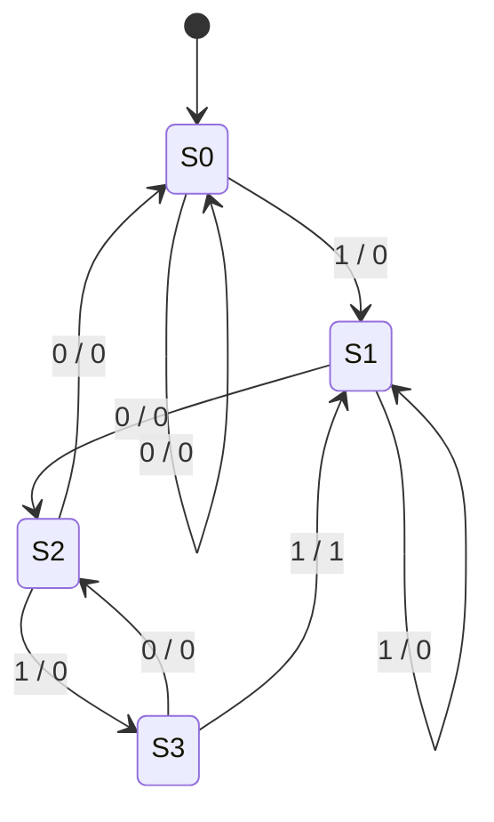
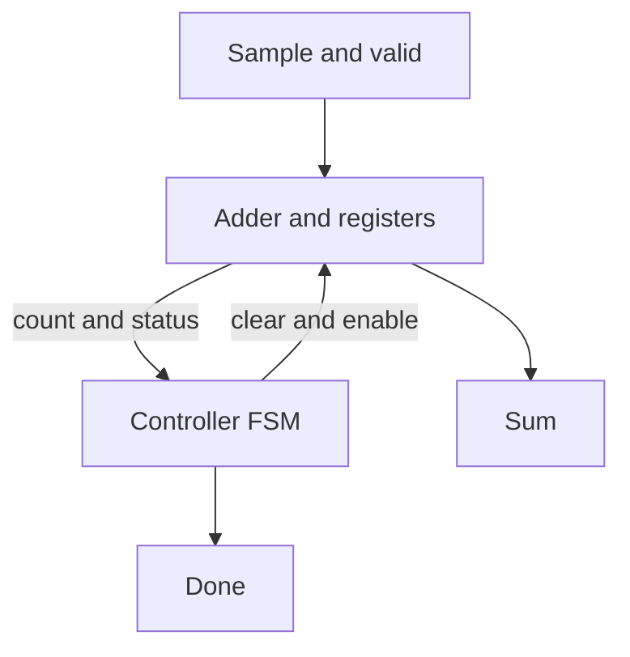

# Logic Design｜邏輯設計完整學習筆記

> **閱讀定位：從二進位、邏輯閘，到能自行設計計數器與有限狀態機。** 延續原筆記 CH0–CH9 的順序，補齊 CH1-6、CH1-7 與後續章節。解說使用繁體中文，保留英文術語，便於對照英文課程。
>
> **查核日期：2026-09-26。** 本篇是入門至進階概覽，不是完整 VLSI／CDC 專論。L01–L28 為自行編寫的教科書型例題；「公開教材原例」另行標示出處。電路延遲與取樣條件是題目假設，不是某顆 IC 的實測規格。

[回到 README](README.md) · [Computer Organization and Design](Computer_Organization_and_Design.md) · [Computer Architecture](Computer_Architecture.md)

## 目錄與學習成果

| 章節 | 主題 | 讀完應能做到 |
| --- | --- | --- |
| [CH0](#ld-0) | Concepts | 分清類比、數位、組合與循序邏輯 |
| [CH1](#ld-1) | Number Systems | 轉換進位制、處理二補數、BCD 與 Gray code |
| [CH2](#ld-2) | Boolean Algebra | 用布林定律證明等價與化簡 |
| [CH3](#ld-3) | Boolean Expressions | 從真值表建立 SOP/POS，使用 K-map |
| [CH4](#ld-4) | Combinational Logic | 設計 MUX、decoder、adder、comparator、ALU |
| [CH5](#ld-5) | Sequential Logic | 分辨 latch／flip-flop，計算 setup／hold |
| [CH6](#ld-6) | Registers and Counters | 設計 shift register、mod-N counter、PWM |
| [CH7](#ld-7) | Finite State Machine | 從規格推導狀態表、轉移與輸出 |
| [CH8](#ld-8) | Memory and Digital Systems | 計算容量、理解 LUT／ROM、整合 controller 與 datapath |
| [CH9](#ld-9) | Advanced Digital Design | 閱讀 HDL、檢查 CDC、debounce、reset 與驗證界線 |
| [附錄 A](#ld-practice) | 自我測驗 | 紙筆題、答案與學習檢核 |
| [附錄 B](#ld-sources) | 來源與閱讀地圖 | 追查公式、教材原例與官方文件 |

建議 CH0–CH4 先做所有真值表；CH5–CH7 每題畫出時序或狀態轉移；CH8–CH9 再接到程式與硬體實作。第一次閱讀不必先買 FPGA。

<a id="ld-0"></a>
## CH0 — Concepts：數位抽象與邏輯設計

### 0.1 數位訊號仍然由實體電路承載

Analog signal 可以連續變化；digital abstraction 把一定範圍的實體量視為 0 或 1。**不是每個數位系統都用 0 V／5 V，也不是邏輯 1 必須等於電源電壓。** 必須看元件的輸入、輸出與供電規格。[R1]

| 參數 | 意義 |
| --- | --- |
| $V_{IL,max}$ | 保證辨識為 LOW 的最高輸入電壓 |
| $V_{IH,min}$ | 保證辨識為 HIGH 的最低輸入電壓 |
| $V_{OL,max}$ | LOW 輸出的最高保證電壓 |
| $V_{OH,min}$ | HIGH 輸出的最低保證電壓 |

介於輸入 LOW 與 HIGH 保證範圍之間的電壓，不保證被判成哪個值。Noise margin 是輸出保證與輸入需求之間的餘裕，不是可以任意超過 absolute maximum ratings 的許可。

**教科書型例題 L01：noise margin。** 假設某介面的 $V_{OH,min}=2.9$ V、$V_{IH,min}=2.0$ V、$V_{IL,max}=0.8$ V、$V_{OL,max}=0.3$ V：

$$NM_H=2.9-2.0=0.9\ V,\qquad NM_L=0.8-0.3=0.5\ V$$

這只分析邏輯準位；實際接線還要檢查電壓容忍度、輸出電流與負載。**應用：** 感測器輸出接到開發板時，不可僅因「兩邊都是數位訊號」就認定相容。

### 0.2 真值表與基本邏輯閘

n 個獨立 binary inputs 有 $2^n$ 種輸入組合。Truth table 必須列出所有允許的組合。

本篇記號：$\overline A$ 或 A' 是 NOT；AB 是 AND；A+B 是 OR；$A\oplus B$ 是 XOR。布林式的「+」不是整數加法。[R2]

| A | B | AND | OR | XOR | NAND | NOR | XNOR |
| --- | --- | --- | --- | --- | --- | --- | --- |
| 0 | 0 | 0 | 0 | 0 | 1 | 1 | 1 |
| 0 | 1 | 0 | 1 | 1 | 1 | 0 | 0 |
| 1 | 0 | 0 | 1 | 1 | 1 | 0 | 0 |
| 1 | 1 | 1 | 1 | 0 | 0 | 0 | 1 |

NOT 把 0 變 1、1 變 0。兩輸入 XOR 表示兩者不同；多輸入串接 XOR 表示 1 的數量為奇數，不是「只能有一個 1」。

### 0.3 是否需要記憶過去？

| 類型 | 數學觀點 | 例子 |
| --- | --- | --- |
| Combinational | $Y=f(X)$，輸入穩定後輸出確定 | 加法器、資料選擇器 |
| Sequential | $Q_{next}=g(Q,X)$ | 計數器、密碼鎖、通訊協定控制器 |

電梯只看「現在按哪個樓層」不足以決定動作，還要知道目前位置、方向與門的狀態。這些需要保留的資訊就是 state。組合邏輯也有傳播延遲；「沒有記憶」不表示「零時間」。[R3]

<a id="ld-1"></a>
## CH1 — Number Systems：數字與編碼

### 1.1 Binary、hexadecimal、bit 與 byte

Binary 使用 0、1；hexadecimal 使用 0–9、A–F。一個 hex digit 對應四個 bits。Byte 在本篇定義為 8 bits；word 的寬度依系統而定。

$$1011_2=1\times2^3+0\times2^2+1\times2+1=11_{10}$$

| Binary | Hex | Decimal |
| --- | --- | --- |
| `1010 1111` | `0xAF` | 175 |
| `0010 1101` | `0x2D` | 45 |
| `0000 1111` | `0x0F` | 15 |

**教科書型例題 L02：將 45 轉二進位。** 重複除以 2，餘數依序為 1、0、1、1、0、1；由最後讀回來得到 `101101`。若指定 8-bit unsigned，寫成 `00101101`。用 $32+8+4+1=45$ 驗算。[R4]

### 1.2 Binary addition

1+1=$10_2$；1+1+1=$11_2$。要同時記錄 sum bit 與 carry。

原筆記的 `1011 + 0110 = 10001` 為 11+6=17。若硬體只有 4-bit sum，結果是 `0001` 並帶一個 carry-out；不能說完整結果就是 1。

### 1.3 Half adder

半加器處理兩個 bits，沒有 carry-in：

$$S=A\oplus B,\qquad C=AB$$

| A | B | Carry | Sum |
| --- | --- | --- | --- |
| 0 | 0 | 0 | 0 |
| 0 | 1 | 0 | 1 |
| 1 | 0 | 0 | 1 |
| 1 | 1 | 1 | 0 |

高位加法還需要接收低位進位，因此 CH4 會擴充為 full adder。[R2]

### 1.4 Leading zeros：補零的適用範圍

Unsigned 的 `1011` 與 `00001011` 都代表 11；後者恰好選了 8 bits，**不是「補前導零」一律叫 8-bit representation**。

但若 `1011` 是 4-bit two's complement，它代表 −5；擴成 8 bits 應是 `11111011`。型別、寬度與 signedness 都必須寫清楚。

### 1.5 從數字到電路的學習地圖

| 你想表達的工作 | 對應硬體 |
| --- | --- |
| 表示數值 | Bit vector 與編碼規則 |
| 判斷真假 | Logic gates |
| 加減與比較 | Adder、comparator、ALU |
| 記住結果 | Register |
| 按步驟執行任務 | FSM 與 datapath |

### 1.6 Signed integers、二補數與溢位

n-bit unsigned 範圍為 0 到 $2^n-1$；two's complement 為 $-2^{n-1}$ 到 $2^{n-1}-1$。二補數最高位的權重是負數，不只是可以刪掉的符號標記。[R4]

**教科書型例題 L03：8-bit 的 13−22。**

1. 13=`00001101`；22=`00010110`。
2. −22：反相加一，得到 `11101010`。
3. 相加：`00001101 + 11101010 = 11110111`。
4. `11110111` 的二補數值是 −9，位於 −128 到 127 之間，沒有 signed overflow。

**教科書型例題 L04：carry 不等於 signed overflow。** 4-bit 的 7+3：`0111+0011=1010`，沒有 carry-out，但 10 超過 signed 最大值 7，因此有 signed overflow。相反地，`1111+0001` 有 carry-out，卻可代表 signed −1+1=0，沒有 signed overflow。

對二補數加法，兩個同號輸入得到異號結果就是 overflow；也可用符號位的 carry-in XOR carry-out 判斷。固定寬度硬體的低位結果，不等同所有程式語言都允許 signed overflow。

### 1.7 Binary fractions、BCD、Gray code 與 parity

小數點右邊的權重是 $2^{-1},2^{-2},\ldots$。**教科書型例題 L05：**

$$10.101_2=2+\tfrac12+\tfrac18=2.625_{10}$$

0.1 十進位無法以有限個 binary fractional bits 精確表示；位寬越大，不代表每個十進位小數都變成可精確表示。[R5]

| 編碼 | 用途 | 範例／限制 |
| --- | --- | --- |
| Pure binary | 一般運算 | 59=`00111011`（8 bits） |
| BCD | 每個十進位 digit 各用 4 bits | 59=`0101 1001`；每一組 1010–1111 不是有效十進位 digit |
| Reflected Gray code | 相鄰碼字只改變一個 bit | 3 bits：000、001、011、010、110、111、101、100 |
| Even parity | 加一 bit 使總 1 數量為偶數 | 可偵測奇數個 bit flips；不能偵測所有偶數個 flips，也不能單靠它定位錯誤 |

**教科書型例題 L06：binary 1011 轉 Gray code。** 保留 MSB，其餘為相鄰 binary bits 的 XOR：`1, 1⊕0, 0⊕1, 1⊕1`，得到 **1110**。也就是 $G=B\oplus(B\gg1)$。反向從 MSB 累積 XOR 可還原 binary。[R6]

**應用：** BCD 用於十進位顯示；Gray code 可用於編碼器與某些 FIFO pointer crossings，但仍需實體時序與同步設計，不能把任意資料轉 Gray 就視為 CDC 已解決。

<a id="ld-2"></a>
## CH2 — Boolean Algebra：布林代數

### 2.1 最常使用的定律

| 定律 | OR 形式 | AND 形式 |
| --- | --- | --- |
| Identity | A+0=A | A·1=A |
| Domination | A+1=1 | A·0=0 |
| Idempotence | A+A=A | AA=A |
| Complement | A+A'=1 | AA'=0 |
| Commutative | A+B=B+A | AB=BA |
| Associative | (A+B)+C=A+(B+C) | (AB)C=A(BC) |
| Distributive | A+BC=(A+B)(A+C) | A(B+C)=AB+AC |
| Absorption | A+AB=A | A(A+B)=A |

特別注意 $A+BC=(A+B)(A+C)$：這是布林代數，不是一般實數代數的等式。[R7]

### 2.2 De Morgan's laws

$$\overline{AB}=\overline A+\overline B,\qquad \overline{A+B}=\overline A\,\overline B$$

對整個括號取反時，AND／OR 互換，每個項也取反。

**教科書型例題 L07：化簡兩個式子。**

$$F=A'B+AB=B(A'+A)=B$$
$$G=(A+B)(A+B')=A+BB'=A$$

第一式把原本兩個 AND 加一個 OR 的理想邏輯化成直接使用 B。是否在特定 FPGA 上減少 LUT 或變快，要看 synthesis 與 mapping，不能只數紙上的閘。[R7]

### 2.3 NAND 與 NOR 為什麼是 universal gates？

只用 NAND 就可構造：[R2]

| 需求 | NAND 實現 |
| --- | --- |
| NOT A | NAND(A,A) |
| A AND B | 先 N=NAND(A,B)，再 NAND(N,N) |
| A OR B | NAND(NAND(A,A), NAND(B,B)) |

**教科書型例題 L08：用 NAND 實現 F=AB+CD。** 令 N1=NAND(A,B)、N2=NAND(C,D)，則 F=NAND(N1,N2)，因為 $(\overline{AB}\cdot\overline{CD})'=AB+CD$。

**應用：** 同一功能可以有不同 gate-level 結構，工程上再比較面積、延遲、功耗與可用元件，而非只找代數最短寫法。

<a id="ld-3"></a>
## CH3 — Boolean Expressions：從規格到 SOP、POS 與 K-map

### 3.1 Minterm 與 maxterm

Minterm 包含每個變數恰好一次，且只在一列 truth table 為 1；maxterm 是包含全部變數的 OR term，只在一列為 0。令 A 為 MSB，ABC=101 對應十進位索引 5：[R7]

- $m_5=AB'C$，在 101 為 1。
- $M_5=A'+B+C'$，在 101 為 0。

**教科書型例題 L09：完整的 SOP／POS。** 定義 F 在索引 1、2、5、7 時為 1：

| ABC | 索引 | F |
| --- | --- | --- |
| 000 | 0 | 0 |
| 001 | 1 | 1 |
| 010 | 2 | 1 |
| 011 | 3 | 0 |
| 100 | 4 | 0 |
| 101 | 5 | 1 |
| 110 | 6 | 0 |
| 111 | 7 | 1 |

$$F=\Sigma m(1,2,5,7)=A'B'C+A'BC'+AB'C+ABC$$
$$F=\Pi M(0,3,4,6)=(A+B+C)(A+B'+C')(A'+B+C)(A'+B'+C)$$

SOP（sum of products）是 AND 項再 OR；POS（product of sums）是 OR 項再 AND。只有每一項含全部變數的才叫 canonical form。

### 3.2 Karnaugh map 的規則

K-map 用 Gray 順序排列相鄰格，例如 00、01、11、10，讓相鄰格只差一個變數。[R8]

1. SOP 圈 1；每個群組是 1、2、4、8…格的矩形。
2. 上下／左右邊界可相接；對角線不算相鄰。
3. 圈內會變動的變數消去；固定為 1 保留原變數，固定為 0 保留反相。
4. 可重疊，但不能把指定為 0 的格子圈進 SOP 群組。
5. 要覆蓋所有必要的 1；圈最大群組通常有利，但最小覆蓋可能需要比較不同組合。

**教科書型例題 L10：四變數化簡。**

$$F(A,B,C,D)=\Sigma m(0,2,5,7,8,10,13,15)$$

| AB \ CD | 00 | 01 | 11 | 10 |
| --- | --- | --- | --- | --- |
| 00 | 1 | 0 | 0 | 1 |
| 01 | 0 | 1 | 1 | 0 |
| 11 | 0 | 1 | 1 | 0 |
| 10 | 1 | 0 | 0 | 1 |

- 四個角（0、2、8、10）：B=0、D=0 固定，A/C 變動，所以得到 B'D'。
- 中間四格（5、7、13、15）：B=1、D=1 固定，得到 BD。
- 最後 **F=B'D'+BD = B XNOR D**；A、C 不影響結果。

### 3.3 Don't-care 不是 unknown

Don't-care 表示規格允許某些輸入下輸出任意選 0 或 1，讓實作更簡單；不必使用所有 don't-care 格子。HDL 模擬中的 `X` 則表示未知等四態語義，不能直接當成可靠的實體輸出。[R9]

**教科書型例題 L11：BCD 大於等於 5。** 輸入 ABCD 為一個有效 BCD digit，輸出 G=1 當數字 5–9：

$$G=\Sigma m(5,6,7,8,9),\qquad d=\Sigma m(10,11,12,13,14,15)$$

可以化為 **G=A+B(C+D)**。對 0–9 逐一驗算都正確；對 10–15 不提供任何「錯誤輸入必定被關閉」的保證。若外部可能輸入非法值，就要另定義 error handling，而不是任意列成 don't-care。

### 3.4 Hazard：布林等價不代表瞬間波形相同

**教科書型例題 L12：static-1 hazard。** F=AB+A'C。令 B=C=1，只有 A 由 1 變 0；兩端穩定值皆為 1，但若 AB 已掉為 0、A'C 還沒升為 1，中間可能短暫變 0。

增加 consensus term：

$$F_{safe}=AB+A'C+BC$$

在上述切換時 BC 持續為 1。這針對 **two-level SOP、單一輸入切換** 的 static-1 hazard；不保證消除多輸入同时變化或多層邏輯的所有 hazards。Synthesis 也可能把代數冗餘項移除，需依用途處理。[R10]

**應用：** 不要把可能 glitch 的一般組合輸出直接當 clock；同步資料路徑通常在滿足時序的 edge 擷取穩定結果。

<a id="ld-4"></a>
## CH4 — Combinational Logic：組合邏輯設計

### 4.1 通用設計流程

先定義輸入、輸出、合法組合、位寬及 signedness，再建立 truth table／運算規則；化簡後畫出資料選擇與運算結構，最後同時檢查**功能**與**延遲**。[R11]

### 4.2 Multiplexer 與 demultiplexer

2:1 MUX 選擇兩個資料來源之一：

$$Y=S'D_0+SD_1$$

| S | Y |
| --- | --- |
| 0 | D0 |
| 1 | D1 |

MUX 的 select 是選擇訊號，D0/D1 是資料，兩者角色不同。DEMUX 則依 select 把同一輸入送到選定的輸出路徑。

**教科書型例題 L13：用 MUX 實作 XOR。** 對 F=A XOR B，把 A 當 select。當 A=0，F=B；當 A=1，F=B'，因此 D0=B、D1=B'。

這是 Shannon expansion 的特例：$F=A'F|_{A=0}+AF|_{A=1}$。**應用：** CPU 的 ALU input 可由 MUX 選 register 或 immediate；不需為每條指令建立完全獨立的 ALU。[R11]

### 4.3 Decoder、encoder 與 priority encoder

| 元件 | 輸入／輸出 | 典型用途 |
| --- | --- | --- |
| Decoder | n-bit code → 最多 $2^n$ 選擇線 | Register select、memory chip select |
| Encoder | 有效選擇線 → binary code | 編碼 one-hot 請求 |
| Priority encoder | 多條同時有效時先挑優先者 | 中斷／資源請求仲裁 |

**教科書型例題 L14：有 enable 的 2-to-4 decoder。**

$$Y_0=EA_1'A_0',\quad Y_1=EA_1'A_0,\quad Y_2=EA_1A_0',\quad Y_3=EA_1A_0$$

E=0 時全為 0；E=1、A1A0=10 時，Y3Y2Y1Y0=`0100`。本題為 active-high outputs；某些實體 decoder 是 active-low，使用前要看 datasheet。

四輸入 priority encoder 若 D3 最高優先，規則可寫成下表。`–` 在此表示不影響結果，不是實體浮接。[R11]

| D3D2D1D0 | Valid | Code |
| --- | --- | --- |
| 1––– | 1 | 11 |
| 01–– | 1 | 10 |
| 001– | 1 | 01 |
| 0001 | 1 | 00 |
| 0000 | 0 | 00（本題預設） |

沒有 Valid 就無法分清「D0 被選到」與「完全沒有請求」。

### 4.4 Full adder、ripple carry 與加減共用

Full adder 接收 A、B、Cin：[R2]

$$S=A\oplus B\oplus C_{in}$$
$$C_{out}=AB+AC_{in}+BC_{in}=AB+(A\oplus B)C_{in}$$

| ABCin | Cout | S |
| --- | --- | --- |
| 000 | 0 | 0 |
| 001 | 0 | 1 |
| 010 | 0 | 1 |
| 011 | 1 | 0 |
| 100 | 0 | 1 |
| 101 | 1 | 0 |
| 110 | 1 | 0 |
| 111 | 1 | 1 |

**教科書型例題 L15：4-bit ripple-carry 加法。** A=0111、B=0011、C0=0，從 bit 0 開始：

| Bit | Ai | Bi | Carry-in | Sum | Carry-out |
| --- | --- | --- | --- | --- | --- |
| 0 | 1 | 1 | 0 | 0 | 1 |
| 1 | 1 | 1 | 1 | 1 | 1 |
| 2 | 1 | 0 | 1 | 0 | 1 |
| 3 | 0 | 0 | 1 | 1 | 0 |

Sum=1010，signed overflow=C3 XOR C4=1，與 L04 一致。

要用同一個 n-bit adder 做加減，令控制 M=0 加法、M=1 減法：

$$Y=A+(B\oplus\{n\{M\}\})+M\pmod{2^n}$$

也就是每一位 B 都與 M XOR，且 C0=M。減法時得到 A+B'+1。減法的 carry／borrow flag 定義可能隨介面不同，不能直接把兩者名稱互換。

### 4.5 Carry-lookahead：以面積換時間

Ripple-carry 的高位等待低位 carry。定義 $P_i=A_i\oplus B_i$、$G_i=A_iB_i$：[R12]

$$C_{i+1}=G_i+P_iC_i$$
$$C_2=G_1+P_1G_0+P_1P_0C_0$$

**教科書型例題 L16：carry 與延遲。** 當 G1=0、P1=1、G0=1、P0=0、C0=0，C2=1；高位不需要等一串逐級 carry 才從代數上知道答案。假設某 ripple critical path 經過 3 個 carry stages（各 60 ps），最後 sum logic 80 ps，該路徑延遲為 **260 ps**。這是簡化指定路徑，其他 input-to-output paths 仍須檢查。

大型 lookahead 需要考慮 fan-in、佈線及分組，不是把任意長的式子塞進一個「零成本大閘」。

### 4.6 Comparator 與 ALU

兩個 2-bit **unsigned** 數 A1A0、B1B0：

$$EQ=(A_1\operatorname{XNOR}B_1)(A_0\operatorname{XNOR}B_0)$$
$$GT=A_1B_1'+(A_1\operatorname{XNOR}B_1)A_0B_0'$$

先比高位，相等再比低位。Signed comparison 不能直接照此解讀，例如 4-bit `1111` 在 unsigned 是 15、signed 是 −1。

**教科書型例題 L17：4-bit ALU 規格。** 假設 A=0101、B=0011：

| Op | 運算 | Y |
| --- | --- | --- |
| 00 | A+B，低四位 | 1000 |
| 01 | A−B，低四位 | 0010 |
| 10 | A AND B | 0001 |
| 11 | A OR B | 0111 |

先讓各組合運算產生候選結果，再用 MUX 選 Y。Zero flag 可定義為 Y 全為 0；overflow flag 只對事先定義的有號加減運算有意義。邏輯 AND 不應沿用上一筆加法殘留的 flag。

**實際應用：** ALU 對應 CPU 運算；比較器用於門檻判斷；priority encoder 用於中斷；decoder 用於暫存器與裝置選擇。

<a id="ld-5"></a>
## CH5 — Sequential Logic：循序邏輯與時序

### 5.1 SR latch 與 D latch

Latch 是 level-sensitive。以下限定由交叉耦合 NOR 建立、active-high 的 SR latch：[R13]

| S | R | Q 的行為 |
| --- | --- | --- |
| 0 | 0 | 保持原值 |
| 0 | 1 | Reset 為 0 |
| 1 | 0 | Set 為 1 |
| 1 | 1 | 不允許的正常操作組合；NOR 兩輸出皆為 0，不再互補 |

同時解除不允許組合，最終狀態可能取決於延遲，不宜當成確定的設計功能。NAND 實現通常是 active-low inputs，其表格不同。

D latch 用單一 D 與 enable G 避開正常使用下的 SR 衝突：G=1 時 transparent，Q 跟隨 D（有延遲）；G=0 時保持資料。這不等於每次 G=1 只讀一次。

### 5.2 Edge-triggered flip-flop

D flip-flop 在指定 edge 擷取 D，其餘時間保持狀態。以下假設 rising-edge：[R14]

**教科書型例題 L18：latch 與 flip-flop 的差別。** G/clock 在 10 ns 由低變高，20 ns 變低；D 在 10 ns 前為 0、15 ns 變 1，忽略傳播延遲且 edge 附近無時序違規。

| 裝置 | 10 ns 後 | 15 ns 後 | 20 ns 後 |
| --- | --- | --- | --- |
| G=1 transparent 的 D latch | Q=0 | Q=1 | 保持 1 |
| Rising-edge D flip-flop | 擷取 0 | 仍是 0 | 仍是 0（這是 falling edge） |

### 5.3 D、T、JK 的 characteristic equation

下式描述有效 edge 的下一個狀態，不表示輸出在整個 cycle 隨公式透明變化：

| 類型 | 下一狀態 | 意義 |
| --- | --- | --- |
| D | $Q^+=D$ | 載入 D |
| T | $Q^+=T\oplus Q$ | T=1 toggle；T=0 hold |
| JK | $Q^+=JQ'+K'Q$ | 00 hold、01 reset、10 set、11 toggle |

設計時常需要反向問「要讓 Q 變成 Q+，輸入應為何」，這是 excitation table：[R3]

| Q | Q+ | D | T | J | K |
| --- | --- | --- | --- | --- | --- |
| 0 | 0 | 0 | 0 | 0 | – |
| 0 | 1 | 1 | 1 | 1 | – |
| 1 | 0 | 0 | 1 | – | 1 |
| 1 | 1 | 1 | 0 | – | 0 |

這裡的 `–` 是該狀態轉移下輸入可任選的 don't-care。

### 5.4 Setup、hold、propagation 與 contamination

| 名詞 | 你要檢查的事 |
| --- | --- |
| Setup time | 擷取 edge 之前 D 要穩定多久 |
| Hold time | 擷取 edge 之後 D 還要穩定多久 |
| Clock-to-Q max | edge 後最晚多久 Q 才確定穩定 |
| Clock-to-Q min | edge 後最早多久 Q 就可能改變 |
| Logic propagation delay | 輸入變後最晚多久輸出穩定 |
| Logic contamination delay | 輸入變後最早多久輸出可能改變 |

忽略 skew／jitter 的單時脈、相鄰 edge 模型：[R14]

$$T_{clk}\ge t_{cq,max}+t_{logic,max}+t_{setup}$$
$$t_{cq,min}+t_{logic,min}\ge t_{hold}$$

**教科書型例題 L19：setup 過了，hold 仍可能失敗。** max clk-to-Q=0.8 ns、max logic=5.5 ns、setup=0.7 ns，最小週期 **7 ns**，理想上限約 **142.86 MHz**。但若 min clk-to-Q=0.1 ns、min logic=0.1 ns、hold=0.3 ns，則 0.2<0.3，hold 違規 **0.1 ns**。

降低頻率可增加下一個 edge 之前的 setup 餘裕，卻不會修復同一個 edge 後的這個 hold 問題；需要適當調整最短路徑或 clock tree。實作工具還會納入時脈不確定性與不同 corners。

### 5.5 Reset 與 enable

- Synchronous reset：在有效 clock edge 才執行 reset。
- Asynchronous reset：assert 時不需等 clock edge；release 要考慮 recovery/removal 與同步。
- Enable：決定該 edge 是否載入新值；不等於把 clock 隨便 AND 一條控制線。

Reset／enable 優先序必須明訂。本篇 HDL 例子採 reset 優先。不能把「模擬一開始剛好是 0」當成實際上電保證。[R15]

<a id="ld-6"></a>
## CH6 — Registers and Counters：暫存器與計數器

### 6.1 Register 與 shift register

n-bit register 可視為共同控制的 n 個儲存位元。Shift register 在每個有效 edge 把資料移到相鄰位置。[R16]

| 類型 | 資料方向 | 用途 |
| --- | --- | --- |
| SISO | Serial in → serial out | 延遲線 |
| SIPO | Serial in → parallel out | 收完多個 bits 再平行使用 |
| PISO | Parallel in → serial out | 把一筆資料逐 bit 傳出 |
| PIPO | Parallel in → parallel out | 一般 register |

**教科書型例題 L20：追蹤四位元移位。** 定義更新為 `Q_next={Q[2:0], serial_in}`，初始 0000，輸入依序 1、0、1、1：

| 第幾個 edge | 輸入 | Q 更新後 |
| --- | --- | --- |
| 1 | 1 | 0001 |
| 2 | 0 | 0010 |
| 3 | 1 | 0101 |
| 4 | 1 | 1011 |

寫出位元連接比只寫「向左／向右」清楚，因為不同圖表的畫法可能相反。**應用：** SPI 類序列傳輸、LED 資料串列化；完整介面仍需遵守裝置的 edge 與 framing 規則。

### 6.2 Ripple counter 與 synchronous counter

Ripple counter 讓前一級輸出觸發下一級 clock，變化逐級傳遞；synchronous counter 讓所有位元由同一 clock 驅動。[R17][R18]

「同步」不代表實體所有 Q 在完全相同的皮秒改變；仍有 clk-to-Q 差異與 skew。多位元計數值的組合解碼仍可能短暫 glitch，需合適地使用。

對同步 binary up counter，每個高位在**所有較低位均為 1**時 toggle：

$$T_0=1,\quad T_1=Q_0,\quad T_2=Q_1Q_0,\quad T_3=Q_2Q_1Q_0$$

加上 count enable E 時，將每個 T 條件再 AND E。將 T 設定接到 JK 的 J=K 可得到同樣 toggle 行為。

### 6.3 公開教科書原例：有 enable 的 mod-4 counter

Robert G. Plantz 的公開教材 Chapter 5，**Example 5-a**，要求計數 0→1→2→3→0，Enable=0 時保持。原書以 JK excitation 設計；以下用 D flip-flop **另行推導等價實現**，不是原書逐字解答。[R3]

$$D_0=Q_0\oplus E,\qquad D_1=Q_1\oplus(EQ_0)$$

| Q1Q0 | E=0 的下一狀態 | E=1 的下一狀態 |
| --- | --- | --- |
| 00 | 00 | 01 |
| 01 | 01 | 10 |
| 10 | 10 | 11 |
| 11 | 11 | 00 |

例如 Q=01、E=1，D0=0、D1=1，下一狀態為 10。這個短例說明：相同狀態表可由不同 flip-flop 類型實現。

### 6.4 Mod-N 與非法狀態

至少需要 $\lceil\log_2N\rceil$ bits 表示 N 個狀態。若 N 不是 2 的次方，就有未使用編碼；必須決定如何恢復。

**教科書型例題 L21：mod-6 counter。** 需要 3 bits，規定同步 reset 到 000；enable=1 時依下表更新，enable=0 時保持：[R18]

| 目前 Q | 下一 Q（enable=1） |
| --- | --- |
| 000 | 001 |
| 001 | 010 |
| 010 | 011 |
| 011 | 100 |
| 100 | 101 |
| 101 | 000 |
| 110（非法） | 000 |
| 111（非法） | 000 |

可寫成 `Q >= 5 ? 0 : Q+1`。當 enable=0 時，非法狀態會保持，直到 reset 或 enable=1；若規格要求立即自我恢復，就必須改優先序。BCD counter 同理計數 0–9，另定 10–15 的行為。

### 6.5 除頻、tick 與 PWM

**教科書型例題 L22：50 MHz 產生 1 kHz tick。** 每 50,000 個 cycles 產生一個高一 cycle 的 tick，counter 跑 0–49,999，需 **16 bits**。在單一 clock domain 使用 tick 當 enable，通常比自行造一個慢 clock 容易管理。

如果每 50,000 cycles 才把輸出 toggle 一次，一個完整週期需要兩次 toggle，得到的是 **500 Hz 方波**，不是 1 kHz。

PWM 可用 counter 與比較器實現：counter=0…N−1，輸出 `counter < K`，K 必須能表示 0 到 N。Duty cycle=K/N；K=0 為 0%，K=N 為 100%。例如 N=100、K=30，duty=30%。實際 LED 亮度感受不必與 duty 線性對應。

### 6.6 Ring 與 Johnson counter

| 類型 | 四位元合法序列示例 | 注意 |
| --- | --- | --- |
| One-hot ring | 0001→0010→0100→1000→0001 | 要初始化成合法 one-hot；0000 會卡住 |
| Johnson | 0000→0001→0011→0111→1111→1110→1100→1000→0000 | 本例接法為 `{Q[2:0], ~Q[3]}`；其餘狀態不一定自動進入此循環 |

這些編碼可簡化部分解碼，但通常比二進位計數使用更多儲存位元。不能只以「狀態數多」判定哪一個設計更好。[R16]

<a id="ld-7"></a>
## CH7 — Finite State Machine：有限狀態機

### 7.1 FSM 的四個要素

FSM 包含有限的狀態集合、輸入、下一狀態規則與輸出規則。同步 FSM 由狀態暫存器、next-state logic 與 output logic 組成。[R19]

| 類型 | 輸出關係 | 設計影響 |
| --- | --- | --- |
| Moore | $Y=h(Q)$ | 輸出由目前狀態決定 |
| Mealy | $Y=h(Q,X)$ | 可回應目前輸入；組合輸出需注意輸入變化與 glitch |

Moore 不保證組合解碼永遠無 glitch；多個 state bits 切換也可能造成暫態。是否 register output，是另一個設計選擇。

### 7.2 教科書型例題 L23：可重疊的 1011 detector

**規格：** 每個 rising edge 接收一個 bit；最近四個輸入為 1011 時報告一次。允許重疊，所以輸入 `1011011` 在第 **4、7** 個 bits 各偵測一次。

狀態表示「已讀內容尾端，與目標開頭相符的最長部分」：

| 狀態 | 意義 | 編碼 Q1Q0 |
| --- | --- | --- |
| S0 | 尚無有效 prefix | 00 |
| S1 | 尾端為 1 | 01 |
| S2 | 尾端為 10 | 10 |
| S3 | 尾端為 101 | 11 |

Mealy 輸出 z 代表「目前 state 加上這一個輸入」是否完成匹配：

| Current | X=0：Next / z | X=1：Next / z |
| --- | --- | --- |
| S0 | S0 / 0 | S1 / 0 |
| S1 | S2 / 0 | S1 / 0 |
| S2 | S0 / 0 | S3 / 0 |
| S3 | S2 / 0 | S1 / 1 |

S3 遇 1 後回 S1，因為最後一個 1 同時可能是下一次匹配的開頭。S3 遇 0 回 S2，因為尾端 `10` 仍有效。**不能一遇不符就全部回 S0。**



由八種 Q1Q0X 組合可推導 D flip-flop 的輸入與 Mealy 輸出：

$$D_0=X$$
$$D_1=Q_0X'+Q_1Q_0'X$$
$$z=Q_1Q_0X$$

手算 trace：

| 輸入位置 | X | 目前 state | Next | z |
| --- | --- | --- | --- | --- |
| 1 | 1 | S0 | S1 | 0 |
| 2 | 0 | S1 | S2 | 0 |
| 3 | 1 | S2 | S3 | 0 |
| 4 | 1 | S3 | S1 | 1 |
| 5 | 0 | S1 | S2 | 0 |
| 6 | 1 | S2 | S3 | 0 |
| 7 | 1 | S3 | S1 | 1 |

這是從規格自行推導的例題；設計方法參考 MIT FSM 課程。[R19]

### 7.3 State encoding 與 state minimization

| 編碼 | K 個 states 所需 flip-flops | 取捨 |
| --- | --- | --- |
| Binary | 至少 $\lceil\log_2K\rceil$ | 儲存位元較少，解碼可能較複雜 |
| One-hot | K | 儲存較多，部分轉移／輸出可能較簡單 |

兩個 states 能合併，必須對所有未來輸入序列產生相同的可觀察輸出行為，不能只看「這一刻輸出一樣」。Moore 可先按輸出分組，再依各輸入下轉到哪一組反覆細分，直到分組不再改變。[R19][R20]

**教科書型例題 L24：相同輸出仍不能合併。** P/Q 目前輸出皆為 0；輸入 1 時 P→R，而 R 輸出 1；Q→Q 且仍輸出 0。只需輸入 1 就能區分 P/Q，因此不能合併。

設計中的 unused encoding 也需要策略。HDL 的 `default` 有助於描述已知非法 binary states；不代表實際電路具備完整 soft-error recovery，也不保證從 metastability 自動恢復。

### 7.4 生活應用：從規格寫起

| 系統 | 需要記住的狀態 | 容易遺漏的規格 |
| --- | --- | --- |
| 自動販賣機 | 已投入金額、是否出貨 | 同時投入／取消、找零、缺貨 |
| 洗衣機 | 洗滌／漂洗／脫水 | 門開啟、暫停、斷電恢復 |
| 通訊接收器 | 是否找到封包開頭、已收 bytes | 逾時、錯誤資料、重同步 |
| 感測器警報教學模型 | 正常／待確認／警報 | 解除條件、錯誤感測、手動 reset 優先序 |

最後一項只是學習設計情境，不代表現有火災偵測專案已完成此模組。

<a id="ld-8"></a>
## CH8 — Memory and Digital Systems：記憶體與系統整合

### 8.1 先分清 bit、word、address

若 memory 有 $2^a$ 個 words，每個 w bits，資料容量為 $2^a\times w$ bits。a 條位址線選 word，w 條資料線傳 word；是否 byte-addressed 是系統介面的另一個決定。

**教科書型例題 L25：用 1K×8 chips 組成 4K×16。** 本題 K=1024，忽略額外控制電路：

1. 寬度：16/8=2 chips 並排，低八位／高八位各一顆。
2. 深度：4K/1K=4 banks。
3. 共 2×4=**8 chips**；整體有 12-bit word address、16-bit data。
4. 低 10 address bits 接每顆 chip，高 2 bits 透過 decoder 選 bank。
5. 容量=4096×16=65,536 bits=**8 KiB**。

此處 chip select 必須保證讀取時只有被選 bank 驅動匯流排；實際是否用三態 bus 或內部 MUX 依平台而定。[R3][R21]

### 8.2 SRAM、DRAM、ROM 與 register file

| 結構 | 儲存／存取特性 | 常見用途 |
| --- | --- | --- |
| Flip-flop register | 小量資料、控制彈性高 | State、pipeline register |
| Register file | 多個 registers 的讀寫介面；port 數由設計決定 | CPU operands |
| SRAM | 有供電時不需像 DRAM 一樣週期刷新；仍屬 volatile | Cache、嵌入式記憶體 |
| DRAM | 以電荷儲存，需 refresh；通常有較高密度 | 主記憶體 |
| ROM／查表邏輯 | 操作時依 address 讀固定內容 | 常數、解碼、查表 |

「Static RAM」不表示斷電後仍保留；「ROM 行為」也不保證底層使用非揮發製程，例如 FPGA 的 LUT／block RAM 可在配置時載入內容。[R21]

### 8.3 ROM 與 LUT 可以實現布林函數

每個 input combination 當作 address，每個 output bit 當作表格的資料。三個輸入、兩個輸出，需要 8×2=16 個 truth-table bits。單輸出的任意六輸入函數需要 **64 個 truth-table bits**；不包含其他路由與控制成本。[R3][R11]

這說明 FPGA 的 LUT 為何能實作多種邏輯，而不是一張晶片只固定一種功能。實際一個 physical LUT 如何分割、是否支援 RAM，需看器件架構。

### 8.4 Read latency 與 read-during-write

| 介面模型 | 行為 |
| --- | --- |
| Asynchronous read | address 改變後，經延遲得到資料 |
| Synchronous read | address／read command 在 edge 被接收，依介面定義於後續時間輸出 |
| Same-address read/write | 可能回傳舊值、新值、保持原輸出，或不保證；需查定義 |

不能看到 HDL 的 `mem[address]` 就推斷實際一定是零週期讀取，或一定推導成指定 block RAM。需要依工具支援的 coding pattern 與目標記憶體資源確認。[R22]

### 8.5 Controller 與 datapath 如何合作？

**教科書型例題 L26：逐筆加總四個 samples。** 假設每筆 unsigned 8 bits，最大總和 4×255=1020，需 **10-bit accumulator**。若只用 8 bits 會溢位。

| 狀態 | Control | Datapath 行為 |
| --- | --- | --- |
| IDLE | 等待 start | 保持／顯示上一筆結果 |
| INIT | clear_acc、clear_index | acc=0、index=0 |
| ACCUM | sample_valid 時 enable | acc 加 sample；index 計已接受筆數 |
| DONE | done=1 | 輸出結果並等待下一次控制 |



若來源可能停頓，只有 `sample_valid` 時才能更新；若有 ready/valid handshake，就應在兩者皆 1 的 edge 才視為一次傳輸。資料讀取 latency 也要與狀態轉移對齊，不能尚未拿到 sample 就累加。[R19][R22]

**應用：** 感測器平均值、像素區塊加總、封包 checksum 都可拆成控制與資料路徑；同一個 adder 反覆使用可節省資源，但增加完成整批工作的週期數。

<a id="ld-9"></a>
## CH9 — Advanced Digital Design：HDL、同步與驗證

### 9.1 HDL 描述硬體，不是逐行執行的 CPU 程式

SystemVerilog 模組內的多個 hardware processes 可同時運作；`always_comb` 用來描述組合邏輯，`always_ff` 描述受 edge 控制的暫存器行為。[R22]

| 寫法 | 本篇採用的規則 | 常見問題 |
| --- | --- | --- |
| `assign` | 持續的組合連接 | 與 procedural assignment 混用造成多重驅動 |
| `always_comb` | Blocking `=`，所有路徑都指派輸出 | 漏寫分支而推導出 latch |
| `always_ff` | Nonblocking `<=`，清楚列 clock/reset | 誤把更新後值當成同一 edge 可立即讀到 |

例如 `q1 <= d; q2 <= q1;` 在同一個 edge 讓 q2 取得**舊 q1**，表示兩級暫存器，不是把 d 瞬間穿過兩級。`#delay` 可用於 testbench，但不是一般可綜合的延遲電路指令。

### 9.2 教科書型例題 L27：帶 registered output 的 detector

下列 RTL 實作 L23 的轉移，另把偵測結果放進輸出暫存器。`hit` 在接收第 4 個符合的 bit 的 edge **之後**為 1，保持到下一個 edge。因此不要把 `hit` 的波形誤認為未註冊的 Mealy z。

```systemverilog
module seq1011 (
    input  logic clk,
    input  logic rst,
    input  logic bit_in,
    output logic hit
);
    typedef enum logic [1:0] {
        S0 = 2'b00, S1 = 2'b01,
        S2 = 2'b10, S3 = 2'b11
    } state_t;
    state_t state, next_state;

    always_comb begin
        next_state = S0;
        case (state)
            S0: if (bit_in) next_state = S1;
                else        next_state = S0;
            S1: if (bit_in) next_state = S1;
                else        next_state = S2;
            S2: if (bit_in) next_state = S3;
                else        next_state = S0;
            S3: if (bit_in) next_state = S1;
                else        next_state = S2;
            default: next_state = S0;
        endcase
    end

    always_ff @(posedge clk) begin
        if (rst) begin
            state <= S0;
            hit   <= 1'b0;
        end else begin
            state <= next_state;
            hit   <= (state == S3) && bit_in;
        end
    end
endmodule
```

本例 rst 為 active-high synchronous reset；bit_in 必須在 clock edge 附近符合 setup/hold，且每 cycle 都有一筆有效輸入。需要 valid／enable 時，state 與 hit 的行為要另外定義。非同步外部訊號不能直接假設符合這個介面。

**檢核方式：** reset、全 0、全 1、1011、1011011、尚未匹配完就 reset，以及隨機 bitstream 都應測試。RTL 程式片段以官方 coding guidance 及狀態表核對；本次未在 HDL simulator 或 FPGA 上執行，不標示為 synthesis／timing 已通過。[R22]

### 9.3 可執行的 Python 功能參考模型

把下列完整程式存為 `logic_checks.py`，用 `python3 logic_checks.py` 執行。它比較**狀態表、推導方程式與獨立字串匹配**，也檢查 K-map 結果；不模擬 analog metastability 或 gate delays。

```python
from itertools import product


def detector_step(state, x):
    # Columns: input 0, input 1. State codes match L23.
    transitions = ((0, 1), (2, 1), (0, 3), (2, 1))
    return transitions[state][x], int(state == 3 and x == 1)


def equation_step(state, x):
    q1, q0 = state >> 1, state & 1
    d0 = x
    d1 = (q0 & (1 - x)) | (q1 & (1 - q0) & x)
    z = q1 & q0 & x
    return (d1 << 1) | d0, z


def detect(bits):
    state = 0
    result = []
    for x in bits:
        state, hit = detector_step(state, x)
        result.append(hit)
    return result


def check_logic():
    for a, b, c, d in product((0, 1), repeat=4):
        index = (a << 3) | (b << 2) | (c << 1) | d
        original = int(index in (0, 2, 5, 7, 8, 10, 13, 15))
        simplified = int(b == d)
        assert original == simplified

    for value in range(10):  # L11 only specifies valid BCD digits.
        a, b, c, d = ((value >> k) & 1 for k in (3, 2, 1, 0))
        assert (a | (b & (c | d))) == int(value >= 5)

    for state, x in product(range(4), range(2)):
        assert detector_step(state, x) == equation_step(state, x)

    tested = 0
    for length in range(13):
        for bits in product((0, 1), repeat=length):
            expected = [int(i >= 3 and bits[i-3:i+1] == (1, 0, 1, 1))
                        for i in range(length)]
            assert detect(bits) == expected
            tested += 1
    assert detect((1, 0, 1, 1, 0, 1, 1)) == [0, 0, 0, 1, 0, 0, 1]
    print(f"PASS: K-map, BCD, FSM equations, {tested} input sequences")


if __name__ == "__main__":
    check_logic()
```

預期輸出：`PASS: K-map, BCD, FSM equations, 8191 input sequences`。這是 0–12 bits 長度的全部序列，不是所有無限長序列的形式化證明，也不是對 SystemVerilog 原始碼進行模擬。

### 9.4 Metastability 與 clock domain crossing（CDC）

非同步訊號若在擷取窗口改變，flip-flop 可能進入 metastability，無法保證在一般 clk-to-Q 規格內解析成合法 0/1。多級 synchronizer 增加解析時間，**降低失效機率而非降為零**；級數要依時脈、事件率、製程與 MTBF 需求決定。[R23]

| 要跨越的訊號 | 可考慮的方法 | 界線 |
| --- | --- | --- |
| 維持足夠久的單一 level | Destination domain 的多級 synchronizer | 不是準確延遲固定為兩 cycles 的保證 |
| 短 pulse | Pulse stretch、toggle 或 handshake | 單純兩級 FF 可能整個漏接 |
| 彼此獨立的多個 flags | 分別同步 | 必須真的是獨立訊號 |
| 同一數值的多位元 bus | Handshake、適當 Gray pointer 或 async FIFO | 逐 bit 同步不能保證整筆資料一致 |

例如 binary counter 0111→1000，有四個 bits 改變，跨時脈逐 bit 擷取可能湊到不存在的數值。AMD 的 array synchronizer 文件也明確要求每個 bit 互相獨立，否則需改用適當的 coherent transfer 機制。[R24]

### 9.5 Debounce 與同步是兩件事

Mechanical switch 可能在按下／放開時多次彈跳。Synchronizer 處理取樣風險；debouncer 處理多次有效邏輯跳變。二者不能互相替代。[R25]

**教科書型例題 L28：連續樣本去彈跳。** 假設已同步的按鍵每 1 ms 取樣一次，連續 20 筆相同才接受新狀態，counter 需能表示 0–20，至少 **5 bits**。20 個樣本之間跨 19 個取樣間隔，因此相對於一次理想且持續的新 level，忽略同步器延遲時，接受延遲約為 **19–20 ms**，不是嚴格保證「已穩定滿 20 ms」。

若規格要求第一個不同樣本後再經過至少 20 ms，可計算 elapsed ticks，或要求更多連續樣本，明訂起算點。門檻需依開關實測與使用體驗選擇；20 ms 只是本題假設。

### 9.6 Reset、clock enable 與 clock gating

Asynchronous reset 的 assert 不需 clock，但 deassert 應按 domain 安排同步，避免 recovery/removal 問題；同步 reset 也必須維持到被有效 edge 接收。[R15]

在 FPGA 入門設計中，先使用共同 clock 與 clock enable。若需要 gating，使用平台支援的專用資源與約束，不將普通 LUT 的 AND 輸出當作可靠 clock。不同平台對 reset／clock 資源的最佳策略可能不同。[R26]

### 9.7 Simulation、synthesis、STA 與實機驗證

| 階段 | 可以確認什麼 | 不能單獨保證什麼 |
| --- | --- | --- |
| 功能模型／truth table | 數學與狀態轉移是否符合規格 | HDL 寫法與物理時序 |
| RTL simulation | Testbench 覆蓋到的 HDL 行為 | 未測輸入、metastability 失效率 |
| Synthesis | RTL 映射成邏輯資源；檢查 latch 等 | 佈線後所有 timing 已通過 |
| Static timing analysis（STA） | 在正確 constraints 與模型下檢查路徑 | 演算法功能與板級訊號完整性 |
| Hardware validation | 真實器件／板卡情境下的觀察 | 所有未測製程、環境與故障條件 |

功能正確後，還要平衡 timing、資源使用與功耗。更多 pipeline registers 可能提高吞吐量，但增加延遲及 clock 負載；共用運算單元節省資源，但可能需要更多 cycles。[R12][R22]

### 9.8 一個可完成的學習專題

**按鍵控制的 mod-6 計數顯示器：** 先以合成輸入測 counter，再依序加入 reset、clock enable、同步、debounce、顯示 decoder。每一步都保存輸入與預期結果；不要一次把所有模組接上後才找錯。

這是建議的後續練習，倉庫目前沒有完整 FPGA project、pin constraints 或 board measurements。MacBook 與 Raspberry Pi 都可以閱讀筆記、跑 Python；FPGA bitstream 的工具支援需依器件與供應商另行核對。

<a id="ld-practice"></a>
## 附錄 A — 自我測驗與學習檢核

以下皆為自行編寫的練習，先寫出假設與中間步驟，再展開答案。

### A1. 表示法與化簡

1. `11010110` 分別解讀為 unsigned 與 8-bit two's complement，值是多少？如何 sign-extend 到 12 bits？
2. 8-bit signed 的 `01111111 + 00000001` 有 carry-out 嗎？有 overflow 嗎？
3. 化簡 $F=A'BC+ABC+AB'C$，並用因式分解說明。
4. $F(A,B,C)=\Sigma m(0,2,4,6)$ 的最簡 SOP 是什麼？
5. 以 even parity 保護資料 `1011001`，parity bit 是多少？兩個 bits 翻轉一定能發現嗎？

<details>
<summary>答案與推導</summary>

1. Unsigned：128+64+16+4+2=214。Signed：214−256=−42。複製 sign bit：`111111010110`；其 12-bit unsigned 值 4054，4054−4096=−42。
2. 結果 `10000000`，carry-out=0；127+1=128 超過 signed 上限 127，所以 overflow=1。符號位改變本身不是充分判準，必須結合操作數符號。
3. 先合併前兩項成 BC，再得 $C(B+AB')=C(A+B)$。最後一步可用 $B+AB'=(B+A)(B+B')=A+B$ 證明。
4. 四個 minterms 都是 C=0，A/B 任意，因此 F=C'。K-map 是四格群組。
5. 資料有四個 1，parity=0。兩個不同 bits 翻轉會維持總 parity，不能保證發現；這包括資料與 parity bit 的組合。

</details>

### A2. 電路與時序

6. 用 A/B 作為 4-to-1 MUX select，實現三輸入 majority function（至少兩個 1 才輸出 1）。D0–D3 各接什麼？
7. $t_{CQ,max}=0.4$ ns、$t_{logic,max}=3.8$ ns、$t_{setup}=0.3$ ns，忽略 skew，最小週期與最高頻率為何？若 min clk-to-Q=0.08 ns、min logic=0.07 ns、hold=0.20 ns，hold 是否通過？
8. 一個 synchronous mod-10 counter 最少需幾個 flip-flops？剩餘編碼如何處理？
9. 24 MHz clock 下，每 1 ms 產生一個單週期 tick，需數多少 cycles、最少幾 bits？如果每個 tick 都 toggle output，其方波頻率是多少？
10. 四位 ring counter 若誤進 0000，僅循環移位能恢復 one-hot 嗎？

<details>
<summary>答案與推導</summary>

6. AB=00 時不可能多數，D0=0；01、10 時由 C 決定，D1=D2=C；11 時已滿足，D3=1。
7. 週期至少 0.4+3.8+0.3=4.5 ns，頻率至多約 222.22 MHz。Hold 路徑只有 0.15 ns，小於 0.20 ns，差 0.05 ns；降低 clock frequency 不能直接修好這個 hold 違規。
8. $\lceil\log_2 10\rceil=4$。1010–1111 為未使用編碼；應明訂 reset／恢復規則，而不是假設永遠不會出現。若 enable=0 保持，恢復也可能要等 enable=1；規格須寫清楚。
9. 24,000 cycles；counter 從 0 到 23,999，15 bits 足夠。Tick rate=1 kHz，但 toggle 方波需要兩次 tick 才一週，所以為 500 Hz。
10. 不會；0000 移位後仍是 0000。需要 reset 到合法 one-hot 狀態，或額外的錯誤偵測／恢復邏輯。

</details>

### A3. 系統整合

11. L23 的 detector 輸入 `11011011`，哪幾個位置 hit=1？位置從 1 開始。
12. 用 2K×8 chips 組成 8K×32，需幾顆？共多少 bytes？若按 word 定址，需要幾條 address bits？
13. 將 16 個 unsigned 10-bit samples 精確相加，accumulator 至少幾 bits？
14. 跨時脈傳送一筆 16-bit word，能否各 bit 加兩個 flip-flops 就保證 word 一致？
15. Clock edge 前 a=0、b=1，執行 `a <= b; b <= a;` 後會怎樣？如果 reset 在 L27 匹配到 `101` 後被有效取樣，再輸入 `1`，應有 hit 嗎？

<details>
<summary>答案與推導</summary>

11. 位置 5、8。對照連續四位：positions 2–5 與 5–8 都是 1011，且共用位置 5。
12. Width：32/8=4 顆；depth：8K/2K=4 組；共 16 顆。容量 8192×4=32768 bytes=32 KiB；word address 為 13 bits，低 11 bits 給 chips，高 2 bits 選 bank。若系統採 byte addressing，完整 byte address 是 15 bits；不要混淆兩個介面。
13. 最大值 16×1023=16368，$2^{13}<16369\le2^{14}$，所以 14 bits。
14. 不能；各 bit 可能在不同 destination cycles 被接收，形成不曾存在的組合。依流量與協定選 handshake、asynchronous FIFO 等；Gray 適用於符合單步轉移等條件的編碼資料，不是通用 word synchronizer。
15. Nonblocking assignments 使用 edge 時的舊值：更新後 a=1、b=0。L27 reset 將 state 清為 S0、hit 清為 0；後續單獨一個 1 不構成 1011，所以 hit=0。

</details>

### A4. 學習完成檢核

- [ ] 不看答案完成 signed／unsigned、carry／overflow 的比較。
- [ ] 由真值表寫出 SOP/POS，解釋每個 K-map 群組消去哪些變數。
- [ ] 由規格設計 MUX、adder、counter，列出所有有效與未使用狀態。
- [ ] 能分別判斷 setup 與 hold，不只計算最高 clock frequency。
- [ ] 能從輸入字串獨立驗證 FSM，不只重抄轉移表。
- [ ] 能說明 synchronizer、debouncer、clock enable 分別解決什麼問題。
- [ ] 清楚分辨數學模型檢查、RTL simulation、STA 與實機測試。

<a id="ld-sources"></a>
## 附錄 B — 來源、教材原例與閱讀地圖

### B1. 如何使用來源

本文以課程原站、作者公開教材及器件供應商官方文件交叉查核。公式與例題另做推導；來源編號用於追溯概念，不代表該頁含有本文每一道自編題。工具文件的結論限於其平台與版本；不要直接移植成所有 ASIC／FPGA 的規則。

**公開教材原例：** CH6.3 明確對應 Robert G. Plantz 教材 Chapter 5、Example 5-a 的 enabled modulo-4 counter；本文另以 D flip-flops 推導，不冒充原書 JK 解法或官方解答。L01–L28 與附錄 A 為自編。未取用付費教科書全文，也不虛構其頁碼、題號或解答。

### B2. 參考資料對照表

查閱日期：**2026-09-26**。以下連結為公開閱讀來源，不代表允許重新散布整份教材。

| ID | 公開來源 | 本文查核重點 |
| --- | --- | --- |
| R1 | [MIT 6.004 — Digital Abstraction](https://ocw.mit.edu/courses/6-004-computation-structures-spring-2017/pages/c2/c2s1/) | 數位電壓範圍與 noise margins |
| R2 | [Cornell CS 3410 — Gates and Logic](https://www.cs.cornell.edu/courses/cs3410/2026sp/notes/logic.html) | 邏輯閘、組合邏輯、加法器 |
| R3 | [Robert G. Plantz — Introduction to Computer Organization, Chapter 5](https://bob.cs.sonoma.edu/IntroCompOrg-x64/bookch5.html) | Latch／flip-flop；Example 5-a counter 原例 |
| R4 | [Cornell CS 3410 — Numbers](https://www.cs.cornell.edu/courses/cs3410/2026sp/notes/numbers.html) | 位元權重、二補數與數值範圍 |
| R5 | [Cornell CS 3410 — Floating Point](https://www.cs.cornell.edu/courses/cs3410/2026sp/notes/float.html) | 二進位小數與有限精度 |
| R6 | [Marie Christiano — Gray Code Basics](https://www.allaboutcircuits.com/technical-articles/gray-code-basics/) | Binary-reflected Gray code 與相鄰值；本文不採用其泛化的錯誤偵測宣稱 |
| R7 | [Robert G. Plantz — Chapter 4](https://bob.cs.sonoma.edu/IntroCompOrg-x64/bookch4.html) | Boolean algebra 與邏輯等價 |
| R8 | [All About Circuits — Karnaugh Maps, Truth Tables, and Boolean Expressions](https://www.allaboutcircuits.com/textbook/digital/chpt-8/karnaugh-maps-truth-tables-boolean-expressions/) | K-map 的相鄰與分組方法 |
| R9 | [All About Circuits — Don't Care Cells](https://www.allaboutcircuits.com/textbook/digital/chpt-8/dont-care-cells-karnaugh-map/) | Don't-care 的選擇與合法輸入假設 |
| R10 | [University of Illinois ECE 199 — Combinational Logic notes, §§2.1–2.8](https://courses.grainger.illinois.edu/ece199/fa2012/notes/ece199jl-notes-2.1-to-2.8.pdf) | 傳播延遲與 hazards |
| R11 | [MIT 6.004 — Combinational Logic](https://ocw.mit.edu/courses/6-004-computation-structures-spring-2017/pages/c4/c4s1/) | 規格、組合電路、MUX 與邏輯實作 |
| R12 | [MIT 6.004 — Design Tradeoffs](https://ocw.mit.edu/courses/6-004-computation-structures-spring-2017/pages/c8/c8s1/) | Latency、throughput 與資源權衡 |
| R13 | [Cornell CS 3410 — State](https://www.cs.cornell.edu/courses/cs3410/2026sp/notes/state.html) | 暫存器與時序電路 |
| R14 | [MIT 6.004 — Sequential Logic](https://ocw.mit.edu/courses/6-004-computation-structures-spring-2017/pages/c5/c5s1/) | Clock、setup、hold 與狀態儲存 |
| R15 | [AMD UG949 — Synchronous Reset vs. Asynchronous Reset, 2023.2](https://docs.amd.com/r/2023.2-English/ug949-vivado-design-methodology/Synchronous-Reset-vs.-Asynchronous-Reset) | Reset 的 recovery/removal 與解除同步 |
| R16 | All About Circuits — [Introduction to Shift Registers](https://www.allaboutcircuits.com/textbook/digital/chpt-12/introduction-to-shift-registers/)、[Ring Counters](https://www.allaboutcircuits.com/textbook/digital/chpt-12/ring-counters/) | Shift register、ring 與 Johnson counter |
| R17 | [All About Circuits — Asynchronous Counters](https://www.allaboutcircuits.com/textbook/digital/chpt-11/asynchronous-counters/) | Ripple counter 的不同級更新時間 |
| R18 | [All About Circuits — Synchronous Counters](https://www.allaboutcircuits.com/textbook/digital/chpt-11/synchronous-counters/) | 同步計數與 toggle 條件 |
| R19 | [MIT 6.004 — Finite State Machines](https://ocw.mit.edu/courses/6-004-computation-structures-spring-2017/pages/c6/c6s1/) | 狀態、轉移、輸出與設計流程 |
| R20 | [All About Circuits — Finite-state Machines](https://www.allaboutcircuits.com/textbook/digital/chpt-11/finite-state-machines/) | FSM 由規格到電路的練習方向 |
| R21 | [Dive Into Systems — §11.2 Storage Devices](https://diveintosystems.org/book/C11-MemHierarchy/devices.html) | SRAM／DRAM 的儲存方式與 refresh |
| R22 | AMD UG901, 2023.2 — [Always Procedures](https://docs.amd.com/r/2023.2-English/ug901-vivado-synthesis/Always-Procedures)、[RAM HDL Coding Guidelines](https://docs.amd.com/r/2023.2-English/ug901-vivado-synthesis/RAM-HDL-Coding-Guidelines) | HDL processes、記憶體推導限制 |
| R23 | [Altera／Intel Quartus Prime — Metastability Analysis, Standard Edition 18.1](https://docs.altera.com/r/docs/683323/18.1/intel-quartus-prime-standard-edition-user-guide-design-recommendations/metastability-analysis-in-the-intel-quartus-prime-software) | Synchronizer 與 MTBF 的工程意義 |
| R24 | [AMD — XPM_CDC_ARRAY_SINGLE](https://docs.amd.com/r/en-US/pg382-xpm-cdc-generator/XPM_CDC_ARRAY_SINGLE) | Independent bits 與相關多位元資料的界線 |
| R25 | [Texas Instruments — Debounce a Switch, SCEA094](https://www.ti.com/document-viewer/lit/html/SCEA094) | 機械開關彈跳與誤觸發 |
| R26 | [AMD UG949 — Use Clock Enable Pins of Dedicated Clock Buffers](https://docs.amd.com/r/en-US/ug949-vivado-design-methodology/Use-Clock-Enable-Pins-of-Dedicated-Clock-Buffers) | Clock gating 使用專用 clock resources |

### B3. 由淺入深的公開課程路線

| 階段 | 本文 | 接著閱讀／操作 |
| --- | --- | --- |
| 第一次學邏輯 | CH0–CH2 | Cornell Gates/Numbers；逐列重建 truth tables |
| 組合電路設計 | CH3–CH4 | MIT Combinational Logic；AAC K-map；以全部輸入驗證小型電路 |
| 循序電路 | CH5–CH6 | MIT Sequential Logic；Plantz Chapter 5；手算每個 edge |
| 控制器 | CH7–CH8 | MIT FSM；把 sample-valid 納入 controller 規格 |
| 工程實作 | CH9 | 官方 HDL／CDC 文件；完成 testbench 後再讀 synthesis 與 timing reports |

更多有公開解答的練習可見 [MIT 6.004 Spring 2009 — Tutorial Problems](https://ocw.mit.edu/courses/6-004-computation-structures-spring-2009/pages/tutorial-problems/)。2009 與 2017 課程順序不完全相同，請按主題對照，不把兩年的題號當成相同。

**本次驗證界線：** Python 檢查程式用來實際驗證 L10/L11 的化簡、L23 的轉移方程式及長度 0–12 的全部輸入序列；數值、真值表與 counter 週期另行重算。HDL 範例尚未執行 RTL simulation、synthesis、STA 或板級測試。後續若完成，應補上工具版本、測試向量、時序約束與結果。
